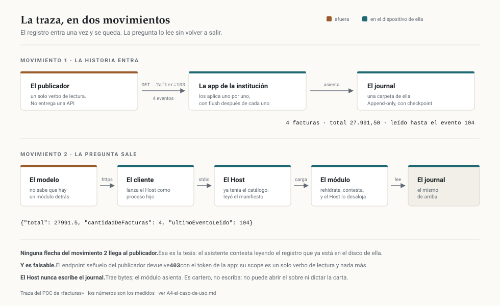

# La conversación, separada por enfoque

Todo lo que salió de una sesión larga de trabajo sobre Gnothi, repartido en **seis capas**. Cada
capa contesta una pregunta distinta y la lee alguien distinto.

**Se repite a propósito.** Donde dos capas se cruzan, el contenido está en las dos. Preferimos
redundancia a mandarte a otro archivo en medio de una idea.

**Corte:** 2026-08-26. Complementa el set del arquitecto —la especificación—, que está en
[`../Especificacion/`](../Especificacion/00-INDICE.md), con su propio índice. Esto es lo que se
pensó, se construyó y se midió contra ella.

**Actualización posterior al corte.** Lo que vino después —el **modelo de carga** (el módulo son dos
DLLs y el Host presta el motor), las **caras de escritorio** (Gnothi.Desktop, Comercio.Shell) y los
**dos instaladores MSI**— está reflejado dentro de los docs que tocó (marcado en su lugar) y reunido en
`C7`. Las trampas nuevas de plataforma (WiX, `msiexec`, WebView2) están en `E1`.

**Y lo de móvil, que es del 3 y 4 de septiembre**: cuatro instituciones con su app web corriendo
**adentro de Gnothi** en Android. Está en `F6`, y movió el estado de `F2` — **P5 y P7 quedaron
resueltos**.

---

## Las seis capas

### A · Producto — *«¿qué es esto y por qué importa?»*
Para quien tiene que entenderlo o contarlo. Nada de código.

| | |
|---|---|
| [`A1-la-tesis-y-las-cuatro-autoridades.md`](A-producto/A1-la-tesis-y-las-cuatro-autoridades.md) | el argumento de fondo, y el reparto de poderes que lo sostiene |
| [`A2-que-es-el-host.md`](A-producto/A2-que-es-el-host.md) | en palabras simples, sin arquitectura |
| [`A3-lectura-de-las-laminas.md`](A-producto/A3-lectura-de-las-laminas.md) | qué dicen las seis infografías, y qué dejan abierto |
| [`A4-el-caso-de-uso.md`](A-producto/A4-el-caso-de-uso.md) | la historia completa, con números reales |
| [`A5-la-reunion.md`](A-producto/A5-la-reunion.md) | la mejor definición del Host, y **las dos tensiones que la grabación abrió** |
| [`A6-las-catorce-funciones-del-host.md`](A-producto/A6-las-catorce-funciones-del-host.md) | el catálogo funcional completo, **con el estado de cada una** |

### B · Arquitectura — *«¿por qué está cortado así?»*
Para quien tiene que diseñar. Decisiones y sus razones, sin implementación.

| | |
|---|---|
| [`B1-spawn-y-stdio.md`](B-arquitectura/B1-spawn-y-stdio.md) | el mecanismo, a fondo, y por qué no existe en móvil |
| [`B2-el-eslabon-host-modulo.md`](B-arquitectura/B2-el-eslabon-host-modulo.md) | por qué **no** hay MCP entre el Host y el módulo |
| [`B3-el-journal-como-protocolo.md`](B-arquitectura/B3-el-journal-como-protocolo.md) | un escritor, dos autores, y el precio de compartir carpeta |
| [`B4-manifiesto-vs-instalacion.md`](B-arquitectura/B4-manifiesto-vs-instalacion.md) | dos archivos porque son dos autoridades |
| [`B5-el-browser-y-por-que-no.md`](B-arquitectura/B5-el-browser-y-por-que-no.md) | el camino descartado, y qué sí sirvió de él |
| [`B6-los-cuatro-caminos-de-la-pwa.md`](B-arquitectura/B6-los-cuatro-caminos-de-la-pwa.md) | **las cuatro formas de que la app de una institución y Gnothi convivan**, comparadas renglón por renglón: cuántas copias del expediente, quién sale a la red, qué le toca hacer a ella. Con el traslado de la app hacia adentro, y **las aserciones de la persona como el único pedazo que no se puede reconstruir** |
| [`B7-el-canal-de-la-lamina-04.md`](B-arquitectura/B7-el-canal-de-la-lamina-04.md) | **por qué canal le pregunta la cara a Gnothi «¿qué pinto?»** — los once mecanismos con su punto de choque, qué es una TWA y qué implica su APK, `http` contra `https` en loopback, y el hallazgo: **el ícono pelea con el canal** |
| [`B8-la-puerta-de-View.md`](B-arquitectura/B8-la-puerta-de-View.md) | **`[View]` no pasa por el despacho**: qué se saltea y qué no. El consentimiento es deliberado y está argumentado; la procedencia por petición no existe para nadie; **el contador sí es un hueco real** — nada mide lo que pregunta la pantalla. Y la pregunta de fondo: si `[View]` necesita su propio despacho |
| [`B9-el-ensamblado-y-el-candado.md`](B-arquitectura/B9-el-ensamblado-y-el-candado.md) | **dos observaciones más, verificadas contra el código.** `keepLoaded` no suelta nunca el DLL —el comentario que dice que sí está equivocado— y **actualizar un módulo abierto deja el viejo cargado con su actor sobre el mismo journal**. Y el candado de la institución: la carrera que se temía no existe (`ActorHandler.rwLock` ya la cubre), pero el `static` + `lock` sobra igual, porque **la cáscara reconstruye la superficie en cada llamada** |

### C · Implementación — *«¿qué hay escrito y cómo?»*

**Partida en dos mitades, porque son dos audiencias distintas.** El Host lo escribimos nosotros; un módulo
lo escribe el developer de cada institución, y sus preguntas son otras.

**C · host/** — para quien modifica el Host

| | |
|---|---|
| [`C1-que-se-construyo.md`](C-implementacion/host/C1-que-se-construyo.md) | el POC: piezas, cadena, y qué prueba |
| [`C2-decisiones-de-codigo.md`](C-implementacion/host/C2-decisiones-de-codigo.md) | diez decisiones, y cómo se rompe cada una |
| [`C3-el-bundle-mcpb.md`](C-implementacion/host/C3-el-bundle-mcpb.md) | empaquetar el Host como extensión instalable |
| [`C7-los-instaladores-y-las-caras-de-escritorio.md`](C-implementacion/host/C7-los-instaladores-y-las-caras-de-escritorio.md) | los dos instaladores MSI, la marca de descubrimiento en el registro, y las dos caras de escritorio |
| [`C8-el-journal-que-escribe-otro.md`](C-implementacion/host/C8-el-journal-que-escribe-otro.md) | cuando la app suelta escribe el journal afuera y Gnothi lo copia para que el módulo lo lea: el cartero de archivos, la huella y el refresco |

**C · modulo/** — para quien escribe un módulo

| | |
|---|---|
| [`C4-que-es-un-modulo.md`](C-implementacion/modulo/C4-que-es-un-modulo.md) | anatomía, **lo que NO puede tener**, y la lista de conformance |
| [`C5-la-superficie-que-expone.md`](C-implementacion/modulo/C5-la-superficie-que-expone.md) | las consultas intencionales, y el anti-patrón que dos IAs propusieron |
| [`C6-el-dominio-y-el-journal.md`](C-implementacion/modulo/C6-el-dominio-y-el-journal.md) | cero dependencias, qué se asienta, y la trampa del determinismo |
| [`C9-la-forma-hibrida.md`](C-implementacion/modulo/C9-la-forma-hibrida.md) | **la tercera forma: la cara sin motor y la superficie al lado**, con Puppeteer prestado por el Host. 97 KB contra 12 594, las siete costuras, **`[Query]` contra `[View]`: dos públicos, no uno**, la pantalla del laboratorio portada con sus cinco formas, y el **icono en la pantalla de inicio** |

### D · Configuración — *«¿cómo lo pongo a andar?»*

**Partida por la misma frontera que el diseño:** lo que es de la persona y lo que está afuera.

**D · host/** — lo que corre en la máquina de la persona

| | |
|---|---|
| [`D1-las-tres-superficies.md`](D-configuracion/host/D1-las-tres-superficies.md) | los tres mecanismos de registro de asistente, y **la ruta MSIX que cuesta encontrar** |
| [`D2-el-confinamiento-en-docker.md`](D-configuracion/host/D2-el-confinamiento-en-docker.md) | el Host y el módulo contenidos, con el confinamiento **falsable** |
| [`D3-el-motor-y-sus-versiones.md`](D-configuracion/host/D3-el-motor-y-sus-versiones.md) | el sustrato: el paquete, qué cambió en 10029, y el versionado |

**D · proveedor/** — lo que la institución expone, «afuera»

| | |
|---|---|
| [`D4-url1-url2-y-el-inyector.md`](D-configuracion/proveedor/D4-url1-url2-y-el-inyector.md) | la página de descarga, el endpoint de eventos, **el señuelo que da 403**, y por qué los datos del demo se orquestan |

### E · Trampas — *«esto ya lo pagamos»*
El que más tiempo ahorra. Cada una da un síntoma que no se parece a su causa.

| | |
|---|---|
| [`E1-trampas-de-plataforma.md`](E-trampas/E1-trampas-de-plataforma.md) | PowerShell, XML, MSIX, feeds privados, alpine |
| [`E2-trampas-de-mcp.md`](E-trampas/E2-trampas-de-mcp.md) | stdout es el protocolo, EOF, registro por superficie |
| [`E3-trampas-del-journal.md`](E-trampas/E3-trampas-del-journal.md) | dos escritores, el service worker, el picker |

### F · Evidencia — *«¿qué está medido y qué falta?»*
Para no confundir lo verificado con lo supuesto.

| | |
|---|---|
| [`F1-mediciones.md`](F-evidencia/F1-mediciones.md) | cada número con el comando que lo reproduce |
| [`F2-estado-y-pendientes.md`](F-evidencia/F2-estado-y-pendientes.md) | qué anda, qué no, y en qué orden seguir |
| [`F3-el-modulo-sin-motor.md`](F-evidencia/F3-el-modulo-sin-motor.md) | el módulo sin motor ni runtime, medido: `ExcludeAssets`, el sustrato prestado, la conformance |
| [`F4-lo-hecho-contra-los-mds.md`](F-evidencia/F4-lo-hecho-contra-los-mds.md) | lo que se hizo contra lo que piden los MDs del arquitecto, honesto por categoría |
| [`F5-la-caja-wasm.md`](F-evidencia/F5-la-caja-wasm.md) | el módulo corriendo confinado en wasmtime, alcanzado por el Host |
| [`F6-lo-construido-en-movil.md`](F-evidencia/F6-lo-construido-en-movil.md) | el alta con permiso, el cartero, la credencial fuera del journal y el WebView que hospeda la PWA — con el resultado de la corrida en Android |

---

## Lo que está al lado, y no es del set

| | |
|---|---|
| [`../Especificacion/`](../Especificacion/00-INDICE.md) | **los MDs del arquitecto**, la especificación, con su propio índice. No se editan |
| [`NOTA-2026-09-02-coordinacion-pwa-gnothi.md`](NOTA-2026-09-02-coordinacion-pwa-gnothi.md) | **nota de trabajo del 2 de septiembre**, no un documento del set y no se va a terminar. Vale por la investigación de OPFS, SAF y el motor; su encabezado dice qué quedó superado |
| [`2026-09-09-modo-lector-y-puerto-de-lectura.md`](2026-09-09-modo-lector-y-puerto-de-lectura.md) | **el pedido a quien mantiene el motor** — esto es lo que se entrega. Autocontenido y para otra audiencia: los dos cambios al backend `FileSystem`, lo que cuestan, la evidencia, lo que NO se pide, la objeción que esperamos y lo que **no** está medido |
| [`PEDIDO-2026-09-09-lo-que-no-va-en-el-pedido.md`](PEDIDO-2026-09-09-lo-que-no-va-en-el-pedido.md) | **compañero interno del anterior, y NO se entrega**: cuánto vale el pedido, qué pasa si lo rechazan, la pregunta de diseño que conviene hacer hablando, y por qué cada una de esas cosas se sacó |
| [`imagenes/traza.svg`](imagenes/traza.svg) | el diagrama de la traza, para mostrar |
| [`../../Gnothi.Mobile/PRUEBAS-WEBVIEW.md`](../../Gnothi.Mobile/PRUEBAS-WEBVIEW.md) | el guion de las nueve pruebas de Android, con sus comandos y 14 capturas |

---

## Si tenés diez minutos

Leé `A2` (qué es el Host), `E1`–`E3` (las trampas) y `F2` (el estado). Con eso podés hablar del
proyecto sin decir nada falso y sin volver a pagar lo que ya se pagó.

## Si te interesa lo de móvil

`F6` y nada más. Es corto y trae la corrida. Si después vas a construir algo, la especificación
contra la que se hizo son `11`, `12` y `13` en [`../Especificacion/`](../Especificacion/00-INDICE.md).

## Si vas a tocar el Host

`C2` primero. Después `B2` y `B4`, que son los dos cortes que más fácil se deshacen sin darse cuenta.

## Si vas a instalarlo o empaquetarlo

`C7` (los dos instaladores MSI, la marca de descubrimiento y las caras de escritorio) y `E1` (las
trampas de WiX/`msiexec`/WebView2, que son las que más caras se pagan). Y `F3`, para el porqué de MSI y
no MSIX.

## Si vas a escribir un módulo

`C4` primero —y sobre todo su tabla de **lo que un módulo no puede tener**— después `C5` para la superficie
y `C6` para el dominio. Y `E3`, porque la mitad de esas trampas te van a tocar a vos.

Un atajo si tenés cinco minutos: la sección *«el determinismo del DSL»* de `C6`. Es la única trampa del set
cuyo síntoma llega **años después** y sin ningún error.

## Si vas a mostrarlo

`A4` (el caso de uso) y `A1` (las cuatro autoridades). Y el **diagrama de la traza**, que está en el
repo como archivo: [`imagenes/traza.svg`](imagenes/traza.svg). Se abre con doble clic en cualquier
navegador y no hace falta permiso de nada.

Lo que hay que hacer notar al mostrarlo: **ninguna flecha del movimiento 2 llega al publicador.**
