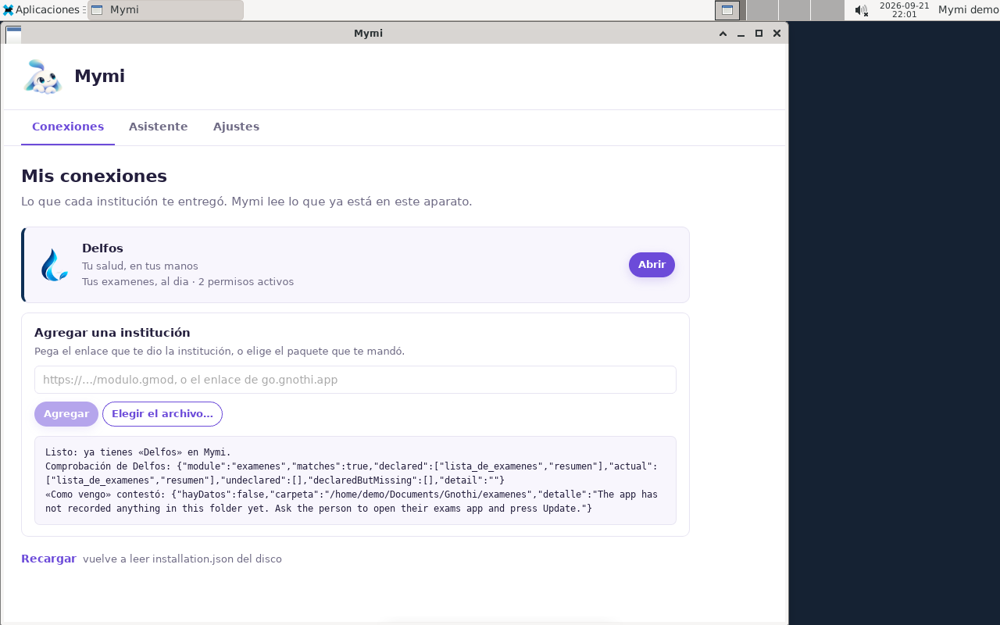
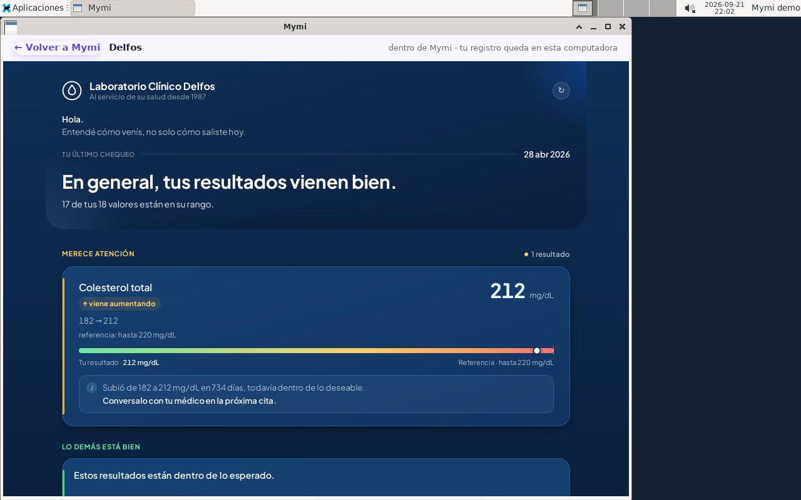
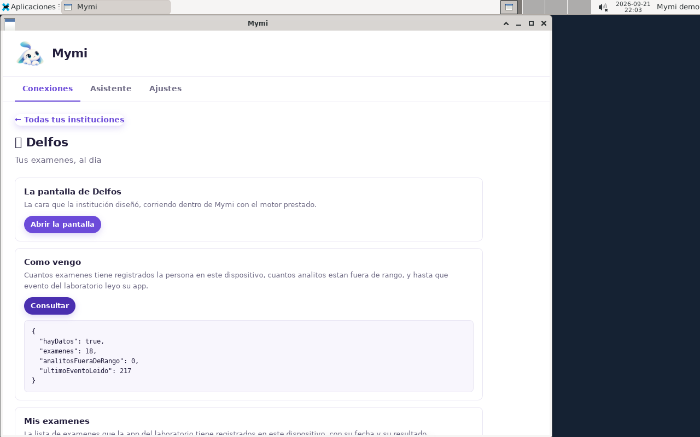
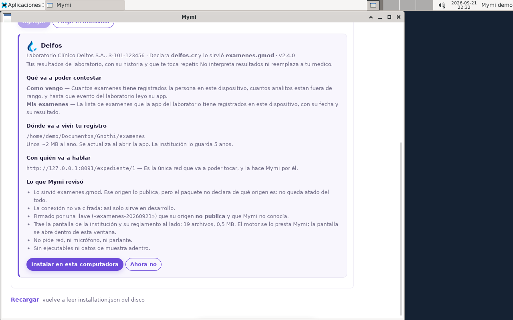

# F9 · La VM de Linux, de punta a punta — medido

**Corte: 2026-09-21.** Todo lo de acá se corrió en esta máquina, dentro de la imagen, y está
capturado en pantalla. Lo que no se probó dice que no se probó.

Es la demo descargable: una Ubuntu 24.04 con Mymi, los cinco paquetes y el publicador de una
institución adentro. Lo que se fue a medir no es que los archivos estén —eso ya se sabía— sino
que **la persona pueda hacer el recorrido completo sin ayuda**: elegir el paquete, leer la hoja,
dar el alta, ver la cara y que el asistente pueda consultar.

---

## El resultado en una línea

```json
{ "hayDatos": true, "examenes": 18, "analitosFueraDeRango": 0, "ultimoEventoLeido": 217 }
```

18 exámenes en el journal de la persona, leídos hasta el evento 217, **traídos por el camino
real**: el publicador corre adentro en `127.0.0.1:8091`, el cartero sale con la credencial de la
app, y el `[Deliver]` escribe. Nada precocinado, ningún journal sembrado en la construcción.

---

## El recorrido, en cuatro pantallas

### 1 · La hoja del alta


Lo que Mymi le muestra a la persona **antes** de instalar, y es la pantalla que más dice de todo
el producto:

| | |
|---|---|
| Quién | Laboratorio Clínico Delfos S.A., 3-101-123456 · declara `delfos.cr` · lo sirvió `examenes.gmod` · **v2.4.0** |
| Qué va a poder contestar | **Como vengo** y **Mis examenes** — las dos, con su descripción |
| Dónde va a vivir el registro | `/home/demo/Documents/Gnothi/examenes` |
| Con quién va a hablar | `http://127.0.0.1:8091/expediente/1` — «es la única red que va a poder tocar, y la hace Mymi por él» |
| Lo que Mymi revisó | seis puntos, entre ellos que la conexión **no va cifrada**, que la llave (`examenes-20260921`) **su origen no publica**, y que trae su pantalla y su reglamento: 19 archivos, 0,5 MB, con el motor prestado |

### 2 · El alta hecha



```
"module":"examenes", "matches":true,
"declared":["lista_de_examenes","resumen"], "actual":["lista_de_examenes","resumen"],
"undeclared":[], "declaredButMissing":[]
```

El manifiesto y la superficie coinciden: **nada sin declarar y nada declarado que falte.** En ese
momento el journal todavía está vacío —`"hayDatos":false`— y el módulo lo dice con una frase
escrita para el modelo, no para el ojo: *«Ask the person to open their exams app and press
Update.»* En inglés **a propósito**, por la regla de que al catálogo del Host no entra lo que se
le escribe al modelo.

### 3 · La cara de la institución, con los datos



El `[View]`, corriendo dentro de la ventana con el motor prestado:

- **«En general, tus resultados vienen bien.»** — 17 de tus 18 valores están en su rango
- **MERECE ATENCIÓN** · Colesterol total **212 mg/dL**, ↑ viene aumentando, **182 → 212**, referencia hasta 220
- *«Subió de 182 a 212 mg/dL en 734 días, todavía dentro de lo deseable. Conversalo con tu médico en la próxima cita.»*

**Y se llenó sin apretar Actualizar**: la app hace el pull al abrirse, que es lo que la hoja del
alta había anunciado. La frase que la cara usa —*«Entendé cómo venís»*— está en voseo porque es
**la voz de la institución**, que el Host no traduce ni corrige; el Host habla de tú neutro.

Vale notar que `analitosFueraDeRango` es **0** y la cara igual señala un resultado: el 212 está
dentro del rango, y lo que la cara muestra es **la tendencia**. Es la diferencia entre una hoja
de resultados y una app que tiene la serie.

### 4 · La otra puerta



El `[Query]` leyendo el mismo journal que pintó la cara. Las dos puertas sobre el mismo registro,
que es el punto.

---

## Lo que costó, y no era de Mymi

**El alta murió en el primer clic por una carpeta de root.** `provision.sh` corre como root, así
que `/opt/mymi/Modulos` quedaba de root; pero el alta la hace la persona desde la ventana, y
escribir el módulo en su carpeta es lo primero que intenta:

```
No se pudo instalar: IOException: Access to the path '/opt/mymi/tmp/alta-683a121a' is denied.
```

Arreglado con `install -d -o "$PERSONA" -g "$PERSONA"` sobre `Modulos` y `-m 1777` sobre el
temporal. **Y la inspección del disco no lo veía**: los archivos estaban todos donde tenían que
estar. Es la misma lección de las cinco fallas de arranque anteriores, y por eso el
procedimiento ahora incluye hacer el recorrido, no sólo mirar que la ventana abra.

**El `chmod` de guestfish es decimal si no lleva el `0`.** `chmod 1777` deja `d-wxrwS--t`, que
tiene el sticky y el setgid puestos y el read quitado. Va `chmod 01777`.

---

## Cómo se reproduce

`vncdo` contra el VNC de qemu: es lo que permitió hacer el recorrido completo sin interfaz
gráfica, y deja la prueba automatizable.

```bash
qemu-system-x86_64 -enable-kvm -m 4096 -smp 2 \
  -drive file=nueva.qcow2,if=virtio,format=qcow2 \
  -netdev user,id=n0,hostfwd=tcp:127.0.0.1:18091-:8091 -device virtio-net,netdev=n0 \
  -vga virtio -display none -vnc :7 -monitor unix:/tmp/mon7,server,nowait -daemonize

# el publicador, comprobado desde AFUERA: 401 es la respuesta correcta
curl -s -o /dev/null -w "%{http_code}\n" http://127.0.0.1:18091/expediente/1/events?after=0

# el recorrido
V="vncdo -s localhost::5907"
$V move 208 538 click 1 pause 4 key ctrl-l type "/home/demo/Entregas/examenes.gmod" key enter
$V pause 7 key pgdn move 186 660 click 1 pause 10 capture /tmp/alta.png
```

El `hostfwd` sirve para preguntarle al publicador desde afuera sin abrirle nada a la VM: **401**
es la respuesta que se quiere —vivo y exigiendo credencial—, y un silencio habría sido el
servicio caído.

---

## Lo que NO prueba

- **Claude Desktop.** No está en la imagen: falta pasarle el `.deb` a `provision.sh`. El recorrido
  del asistente por MCP no se corrió acá; lo que se probó es que la consulta que el asistente
  usaría **contesta**.
- **Las otras cuatro instituciones.** Los cinco `.gmod` van en `~/Entregas`, pero el único
  publicador que corre adentro es el del laboratorio. Los otros cuatro dan de alta, pintan su
  cara y se quedan vacíos.
- **La fluidez.** Sin GPU, WebKit renderiza por software. No impide nada de lo de arriba, pero no
  se midió cómo se siente.

## Los dos defectos del Host que salieron a la luz acá — y su arreglo

Ninguno rompía nada; los dos se veían en las capturas de arriba, y los dos estaban **en el
producto**, no en la imagen. Arreglados el mismo día y verificados en la misma VM.

### 1 · Tres frases enteras pegadas sin espacio

```
Unos ~2 MB al ano.Se actualiza al abrir la app.La institución lo guarda 5 anos.
```

`Alta.razor` emitía cada frase en su propio `<text>` con un espacio **al final**, y **Razor
recorta el whitespace al final de un bloque**. Un espacio al INICIO sí sobrevive —por eso las
otras líneas de la misma hoja (`· v2.4.0`, `— Es la única red…`) se veían bien—, y apoyarse en
esa asimetría es lo que produjo el bug.

Lo interesante es que la cara del teléfono **nunca lo tuvo**, porque arma la línea distinto:

```js
[ tamano, refresco, retencion ].filter(Boolean).join(' ')      // ui.html
```

El arreglo lleva el escritorio a esa misma forma —un `string.Join(" ", …)` con el separador
explícito— en vez de mover el espacio de lugar, así que las dos caras coinciden y la clase
entera de error desaparece:

```
Unos ~2 MB al ano. Se actualiza al abrir la app. La institución lo guarda 5 anos.
```

Cae de lleno bajo la regla 7 de `Metodologia/Guias/reglas-de-localizacion.md` —una clave por
frase entera—: las claves estaban bien, lo que faltaba era el separador entre ellas.

### 2 · La institución se veía con la cara de otra

El encabezado de la hoja del alta y el de la página de la institución pintaban **siempre el
dibujo del rubro** —un emoji— y nunca el logo que el paquete declara. La misma institución salía
con su gota azul en la tarjeta de «Mis conexiones» y con un estetoscopio genérico en las otras
dos pantallas.

En Linux ni el emoji: sin `fonts-noto-color-emoji` el glifo sale como un **cuadro vacío**, y así
fue como se notó. La fuente se agregó a la imagen —el fallback del rubro tiene que verse cuando
una institución no declara marca—, pero esa era la mitad chica del problema.

El arreglo es el patrón que `ModuleList.razor` ya usaba: `Module.LookOf(...)`, el logo si lo hay,
el dibujo del rubro si no. En la hoja del alta se puede **antes de instalar nada**, porque la
propuesta ya trae la carpeta extraída en `Folder` — que es justo cuando la persona necesita
reconocer quién le está hablando.

### Verificado en la misma VM



La gota de Delfos en el encabezado, y las tres frases separadas. Los tres usos de
`HostState.Icon` en el escritorio quedan cubiertos: uno ya estaba bien, dos se arreglaron.

### Una trampa nueva de la imagen, de propina

`language-pack-gnome-es` traduce las carpetas del hogar en la primera sesión —«Documentos»,
«Descargas», «Imágenes»— pero **respeta la que ya existe**: `provision.sh` creaba «Desktop» a
mano, así que quedaba una carpeta en inglés entre las demás. Funciona —el `LEEME.txt` y el
lanzador igual se ven, y `XDG_DESKTOP_DIR` apunta ahí— pero se ve mal. Ahora el script pregunta
en vez de suponer:

```bash
sudo -u "$PERSONA" env LANG=es_CR.UTF-8 xdg-user-dirs-update --force
ESCRITORIO=$(sudo -u "$PERSONA" env LANG=es_CR.UTF-8 xdg-user-dir DESKTOP)
```

Y de paso: con el idioma puesto, el journal pasa a vivir en `/home/demo/**Documentos**/Gnothi/
examenes`. El recorrido completo se volvió a correr con esa ruta y da lo mismo.

---

## Las cinco instituciones con datos — 2026-09-21

El primer corte de esta imagen llevaba un solo publicador, el del laboratorio: las otras cuatro
se daban de alta, pintaban su cara y se quedaban vacías. Ahora **corren los cinco**, cada uno en
`127.0.0.1` y en el puerto que su propio manifiesto declara:

| institución | rubro | puerto | recurso |
|---|---|---|---|
| **Delfos** | laboratorio | `:8091` | `expediente/1` |
| **Sotaventos Motors** | concesionario | `:8092` | `vehicle/1HGCM82633A004352` |
| **La Guaria** | supermercado | `:8101` | `cliente/1` |
| **Faro** | combustible | `:8111` | `cargas/1` |
| **Monteverde** | municipalidad | `:8121` | `contribuyente/CEDULA-DEMO-1` |

**Y a ninguno hay que sembrarle nada.** Los cinco mocks nacen con su historia adentro —tres con
un `Sembrar()` explícito, la municipalidad desde su constructor—, así que la unidad de systemd
alcanza. Correrles el `InyectorDeEventosDemo historia` encima **postea el mismo guion con ids
nuevos y duplica todo**: es el error que ya se había cometido con el laboratorio y que quedó
documentado más arriba.

### Lo que muestra cada una, con el alta hecha a mano en la VM

**La Guaria** — «87 compras tuyas desde enero de 2025 · ₡3.217.096». Arriba, lo que la cara
elige destacar: *«El tomate que comprás siempre bajó de precio»*, ₡1.150 → ₡1.060. Abajo, un
cambio de hábito: pechuga de pollo, *1 vez/semana → 1 vez/mes*.

**Sotaventos Motors** — «Tu YARIS-2019 tiene algo por hacer». 3 de 4 operaciones al día, 1 que
toca ahora, 60.962 km recorridos y la fecha de la última lectura que envió el concesionario.
Y una frase que es el producto entero: *«Tu concesionario lleva este registro y es el único que
lo cambia. Aquí lo leés.»*

**Monteverde** — «Por qué pago más», que es la pregunta que el portal de una municipalidad no
contesta. Recolección de basura: de 5.000 en 2025-06 a 8.000 en 2026-06, **60 % más, y es un
salto por cambio de tarifa**. Limpieza de calles: 2.500 → 2.700, 8 %, *«cambió, pero por debajo
del umbral con que se preguntó, así que esta app no lo explica como un salto»*.

**Delfos** — ya descrita arriba: el colesterol en 212 con la serie 182 → 212.

### Faro es el caso interesante, y no es una falla

Faro **recibe sus datos** —el `[Query]` contesta `{"hayDatos":true,"cargas":28,"vehiculos":1,
"ultimoEventoLeido":314}`— y aun así su cara dice:

> Todavía no puedo calcular tu rendimiento: falta un segundo tanque lleno con kilometraje.

No es un publicador caído ni un puerto mal puesto. Lo dice el propio inyector de la estación:

> Los kilometrajes y el tanque NO se inyectan: son aportes de Sonia y entran por su app.

**La estación sabe cuántos litros vendió; nadie sabe el odómetro del carro salvo la persona.**
Sin dos tanques llenos con kilometraje no hay tramo cerrado, y sin tramo no hay km/L. La cara lo
dice con todas las letras: *«Nadie sabe el kilometraje de tu carro salvo vos.»*

Así que Faro, tal como sale de la caja, **demuestra algo que ninguna de las otras cuatro
demuestra**: que hay datos que no son de ninguna institución, y que el módulo distingue entre lo
que le entregaron y lo que la persona aporta. Vale la pena mostrarlo antes de llenarlo.

Para ver la serie completa —los trece tramos de 12,6 km/L, la caída, el cierre en 9,4— la imagen
trae la herramienta que el repo ya tenía para eso, *«el guion del demo sin teclear 17
formularios»*, y el `LEEME.txt` la explica:

```bash
cd /opt/mocks/cargas/consola
DOTNET_ROLL_FORWARD=Major ./Cargas.Consola sembrar-aportes ~/Documentos/Gnothi/cargas
```

Va **después** de abrir Faro una vez, porque opera sobre un journal que ya existe — y el journal
no existe hasta que la persona da el alta. Por eso es un comando y no un servicio: sembrarlo en
la construcción exigiría hornear el alta en la imagen, que es justo lo que esta VM no hace.

---

## Los aportes de Faro, sembrados solos — y las tres trampas que costó

La imagen anota ahora los aportes de la persona sobre el registro de Faro, así que la cara
muestra su serie en vez de quedarse en *«todavía no puedo calcular»*:

> **Venías rindiendo 12,6 km/L y el último tramo dio 9,4: un 25 % menos.**
> Revisalo con tu taller este mes.

Con el rendimiento en **9,41 km/L ▼25 %**, la curva de los tramos, *«tu nivel de siempre: 12,59
km/L · sobre 25 tramos entre tanques llenos, 2 sin calcular»*, el costo por kilómetro en
**₡55,79** y el odómetro en 062192.

**Sigue sin ser un dato de la institución**, y eso no cambió: los kilometrajes y la confirmación
del tanque son de la persona. Lo que hace la imagen es ahorrarle teclear diecisiete formularios,
con la herramienta que el repo ya tenía para eso (`Cargas.Consola sembrar-aportes`, *«el guion
del demo sin teclear 17 formularios»*).

### 1 · Un `.path` de systemd no dispara si el padre no existe

El primer intento fue una unidad `.path` con `PathChanged` sobre la carpeta del registro. **No
disparó nunca**, y sin un solo error: systemd necesita que el directorio **padre** exista al
arrancar para poner el inotify, y `~/Documentos/Gnothi/` no existe hasta que la persona da el
alta. La unidad arranca, no encuentra a quién vigilar, y se queda callada — la peor forma de
fallar.

Reemplazado por un `.timer` de 45 s que se apaga solo con una marca
(`ConditionPathExists=!…/.aportes-hechos`).

### 2 · Un servicio que no puede escribir su log muere sin dejar log

Segundo intento: el timer corría y el log seguía **vacío, sin crearse siquiera**.
`virt-copy-in` deja lo que copia como root, y el servicio corre con `User=demo`, así que el
`exec >>"$LOG"` del script fallaba en la primera línea y todo moría antes de poder contarlo.

Es la misma clase de falla que el alta con `Modulos` de root, un nivel más abajo, y deja una
regla: **un script de diagnóstico tiene que poder escribir su diagnóstico**. Se arregla con
`chown -R` sobre `/opt/mocks`, que `provision.sh` ya hacía y la imagen no tenía.

### 3 · Mymi tiene el registro abierto, y no ve lo que escribe otro proceso

La tercera es la interesante, porque no es un error de la imagen sino una propiedad del diseño.
Con el sembrado hecho —`VEREDICTO Y PUNTOS CORRECTOS: True`, salida 0, marca puesta— **la cara
seguía diciendo que faltaba el kilometraje**, y apretar *Actualizar* no cambiaba nada: ese botón
sale a buscar lo nuevo de la estación, no relee el registro desde el disco.

Lo que lo destapó fue arrancar el mismo disco otra vez: con Mymi reabierta, Faro pinta la serie
completa. **El journal lo tiene abierto el proceso que corre el módulo**, y un segundo proceso
que escribe por fuera no se le aparece hasta que el primero vuelve a leer.

Se decidió **no** reiniciar Mymi desde el timer —cerrarle la ventana a quien está mirando una
demo es peor que el problema— y decirlo en el `LEEME.txt`:

> PARA VERLOS, CERRÁ MYMI Y VOLVÉ A ABRIRLA. Mymi tiene tu registro abierto mientras corre, así
> que lo que se anota por fuera lo ve al reabrirse, no en el acto.

Vale anotarlo como pregunta de diseño y no sólo como nota de la demo: **hoy nada le avisa al
módulo que su journal cambió por fuera.** Para esta VM no importa; para dos caras del mismo
módulo abiertas a la vez —la ventana y el asistente por MCP, que es exactamente lo que esta demo
quiere mostrar— es una pregunta que en algún momento hay que contestar.
