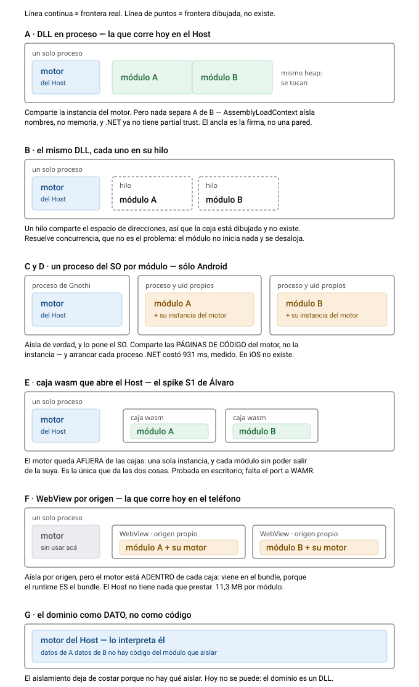

# 08 · ¿Se estira el sustrato compartido con hilos o con procesos del SO?

**2026-09-07.** **Para Álvaro.** Continuación del `07`. Pregunta suya: si Gnothi comparte
recursos con sus módulos, **¿esa opción se puede estirar con hilos o con procesos del sistema
operativo?**

La respuesta corta:

- **Hilos: no.** Y no por esfuerzo: un hilo comparte el espacio de direcciones, así que no aísla
  nada. Es un callejón, vale cerrarlo.
- **Procesos: sí en Android, no en iOS.** Y —esto es lo que vale— **su R1 no lo bloquea**, porque
  el mecanismo de Android no es `exec`.
- **La caja wasm** sigue siendo la única que da las dos cosas en las dos plataformas.

**Pero «hilos o procesos» es la pregunta de segundo orden.** La de primer orden es **de qué está
hecho el módulo**, porque eso decide qué cosa puede aislarlo — y ahí aparece una cuarta respuesta
que es la suya: si el módulo fuera **dato** en vez de código, el aislamiento no costaría nada.

Así que el documento va en este orden: por qué compartimos (§1), **el punto 7 frase por frase
y la única de sus tres afirmaciones que no se sostiene** (§2), las dos respuestas directas
(§3 y §4), la pregunta que en realidad ordena (§5), **las ocho formas que había y cuáles dos
elegimos** (§6), **por qué ésas — y que el trade-off no lo elegimos, vino puesto** (§7), y cómo
se estira de menos a más cambio (§8) — y **§9 es la más práctica: qué se puede compartir sin
dejar el WebView que ya corre.**

### Si venís con una pregunta puntual

| lo que querés saber | dónde está |
|---|---|
| **qué opciones había** para compartir el motor | **§6**, las ocho formas, con cuál se eligió y por qué |
| **si un módulo podría ver los datos de otro** | **§9 ④** — sí, y qué exactamente: la credencial y el IndexedDB |
| **la forma que corre hoy, y por qué no comparte** | **§6 fila F** y **§7** |
| **qué se puede compartir sin cambiar nada de la forma actual** | **§9**, cuatro caminos ordenados por lo que exponen |
| **cómo retomar cualquiera de estos escenarios** | **§10**, al final |

---

## 1 · Primero, por qué Gnothi comparte recursos con sus módulos

La decisión está tomada e implementada —es la «A1», documentada en `Gnothi.Host.csproj`— y el
motivo **no es el tamaño**. Es el que él mismo separó en `NotasGnothi/04` R9:

> *«Y una razón para el sustrato compartido que NO depende de los bytes: hay **una sola cosa que
> auditar**. Si el trimming mejora el tamaño, esta razón sigue en pie.»*

**Y la medición del `07` le da la razón de una forma que quizá no esperaba.** En la forma que hoy
corre en el teléfono —el módulo hospedado— el sustrato es apenas el **8,6%** del bundle; el
88,8% es el runtime de .NET en el navegador. O sea que **el argumento del tamaño se desinfló y el
de auditoría quedó solo en pie**, tal como él anticipó, aunque por otro camino.

El mecanismo del préstamo es una línea de `InProcessShell.cs`: cuando el módulo pide un
ensamblado, se le pregunta primero al contexto del Host y si lo tiene, se lo da. Y el instalador
**rechaza** un paquete que traiga `Puppeteer.dll`, `Choreography.dll`, `Puppets.Portador.dll`,
`Gnothi.Contract.dll` o los dos de MCP. La garantía está implementada como una lista de
prohibidos, no como una intención.

**Lo que se paga por ella, y está en su propia tabla R9:** el módulo corre en el proceso del
Host, mismo heap, y **`AssemblyLoadContext` no es frontera de seguridad**. Ahí nace la pregunta
de este documento.

---

## 2 · El punto 7 de la lista, frase por frase

El punto que originó todo esto dice tres cosas. **Dos se sostienen y una no**, y justamente la
que no es la que decide si hay trabajo o no.

### «Cada módulo trae su propio motor: 20 MB de `_framework` por bundle»

**Cierto para la forma F**, y el número se parte en tres. Los 20 MB son **con** las copias
`.br`/`.gz` que el servidor **nunca sirve** — 40% de peso muerto, medido. Servido son
**11,3 MB**, y de ésos:

| | | |
|---|---|---|
| el **motor** — Puppeteer, Choreography | 0,97 MB | **8,6%** |
| el dominio y la UI de la institución | 0,29 MB | 2,6% |
| correr .NET en un navegador | 10,02 MB | **88,8%** |

O sea que trae su propio motor, sí, **pero el motor es la parte chica.** Aunque se resolviera
compartirlo, se ahorraría el 8,6%.

### «Por eso `substrate.range` se declara y nadie lo valida — no hay contra qué»

**Acá está la que no se sostiene**, y cambia el trabajo pendiente. **Sí hay contra qué**, para la
forma A: el sustrato existe, es obligatorio —la lista de prohibidos del instalador lo hace
cumplir— y su versión está clavada en `Directory.Build.props`:

    VersionDelMotor = 3.0.0-beta.10029

Y los cuatro manifiestos declaran `">=3.0.0 <4.0.0"`. **No falta el sustrato: falta el `if`.**

Para la forma F tiene razón, pero por otro motivo: ahí `substrate.range` **no tiene sentido**,
porque el módulo trae el suyo. Que es distinto de «no hay contra qué» — es que la pregunta no
aplica a esa forma.

> **Y una trampa que apareció al confirmarlo, que conviene saber ANTES de escribir ese `if`.**
> `3.0.0-beta.10029` es un prerelease, y por precedencia de semver un prerelease es **menor**
> que su versión final: `3.0.0-beta.10029 < 3.0.0`. Así que un rango `>=3.0.0` **lo excluye**,
> y una validación escrita en cinco minutos **rechazaría los cuatro módulos hoy**.
>
> Hay que decidir antes una de dos: que el rango incluya prereleases explícitamente, o que el pin
> del motor deje de ser uno. **[RAZONADO]** — es precedencia de semver, no algo que haya medido
> corriendo el comparador.

### «Es arquitectura, no ajuste»

**De acuerdo.** Y las opciones de más abajo dicen **cuál** decisión de arquitectura es: no es
«¿compartimos el sustrato?» —eso ya está decidido e implementado, es la A1— sino **«¿puede la
forma hospedada compartirlo sin dejar de ser hospedada?»**. La respuesta, y el dibujo la hace
obvia: **no, mientras el aislamiento sea por origen**, porque ahí el motor **es** el bundle.

Y agregaría algo que la frase no dice, porque mueve el dueño de la decisión: **los 10,02 MB no
son el precio del aislamiento, son el precio de que la institución traiga su pantalla.** Eso la
vuelve una decisión de producto y no de arquitectura — y hoy es nuestra, porque la institución
todavía somos nosotros.

---

## 3 · Hilos: no, y conviene cerrarlo

Un hilo **comparte el espacio de direcciones**. Dos módulos en dos hilos del mismo proceso ven la
misma memoria: uno puede leer los buffers del otro, y nada del runtime lo impide.

Y no hay una capa de .NET que lo arregle:

- `AssemblyLoadContext` **aísla nombres, no memoria**. Sirve para que dos módulos carguen
  versiones distintas del mismo ensamblado sin chocar. No es una barrera.
- **.NET ya no tiene CAS ni partial trust.** Se quitaron en .NET Core; no hay forma soportada de
  correr código .NET con permisos reducidos dentro del mismo proceso.

**[RAZONADO]** Los hilos resuelven un problema distinto —concurrencia— y ese problema hoy no lo
tenemos: el módulo no inicia nada, se instancia por demanda y se desaloja. La regla de desalojo
ya existe y es obligatoria (`WebViewShell.DisposeAsync`), así que ni siquiera hay varios vivos a
la vez.

**Conclusión: los hilos no estiran nada.** Es un callejón que vale marcar para no volver.

---

## 4 · Procesos: y acá está el matiz que cambia la respuesta

### Su R1 bloquea una forma de proceso, no todas

R1 dice, y es correcto:

> *«Android bloquea `execve` sobre archivos del directorio de datos de la app desde API 29; los
> binarios ejecutables solo salen del `lib/` del APK. iOS directamente no tiene `fork`/`exec`
> para apps.»* → *«Cualquier diseño donde **el Host lance el módulo como proceso hijo**.»*

Eso cierra `Process.Start` y por lo tanto stdio en móvil. **Pero Android tiene otro camino que no
pasa por `exec`:** declarar un componente con **`android:process`** en el manifiesto. Ahí no lo
lanza el Host — **lo lanza el sistema**, cuando alguien se ata a ese componente. Es el mecanismo
con el que Chrome aísla sus renderers.

**[FUENTE]** Y hay un escalón más: `android:isolatedProcess="true"` sobre un `<service>` lo corre
**con un uid propio, sin ningún permiso y sin acceso al sistema de archivos**, alcanzable
únicamente por Binder. Es el sandbox más fuerte que Android le ofrece a una app.

### Y esa forma encaja con lo que Gnothi ya hace

Lo notable es que **un proceso aislado obliga exactamente al modelo que el puente ya implementa**:
si el módulo no puede tocar archivos, tiene que **pedirle** al Host. Y pedirle es lo que ya hace
—`listar`, `leer`, `escribir`— porque el módulo hospedado tampoco toca la carpeta directamente.

O sea que el contrato del módulo **no cambiaría**. Cambiaría quién está del otro lado del puente.

### Qué se comparte y qué no, entre procesos

Esto es lo que contesta la pregunta de fondo:

| | ¿se comparte entre procesos? |
|---|---|
| **las páginas de código del sustrato** | **sí** — el SO mapea el mismo binario read-only en los dos, y la RAM física del código se paga una vez |
| el heap de cada módulo | no, y **eso es justamente el aislamiento** |
| el estado del runtime (tablas, JIT/AOT, GC) | no — cada proceso arma el suyo |

**[RAZONADO]** Así que «compartir el sustrato» con procesos es real pero parcial: se comparte el
**código**, no la **instancia**. Es más de lo que da el WebView de hoy —que ni el código comparte,
porque cada bundle trae el suyo— y menos de lo que da el préstamo in-process.

### En iOS esto no existe

**No hay procesos para código propio.** R1 ya lo dice para `fork`/`exec`, y no hay puerta lateral:
las app extensions **sí** corren en procesos separados, pero son **bundles distintos, con puntos
de extensión fijos, lanzados por el sistema** — no se pueden usar como sandbox genérico para un
módulo que llegó después de instalar.

Es la misma asimetría que cerró los App Intents (`33`): **en iOS, lo que llega después de la
compilación no puede ser un ciudadano de primera clase.**

---

## 5 · La pregunta que en realidad ordena esto

«Hilos o procesos» es la pregunta de segundo orden. La de primer orden es **de qué está hecho el
módulo**, porque eso determina qué cosa puede aislarlo:

| si el módulo es… | lo puede aislar |
|---|---|
| **código nativo o IL de .NET** | sólo una frontera del **SO** (proceso, uid) |
| **wasm** | la **VM**: memoria lineal propia y capacidades WASI |
| **datos que el motor interpreta** | **nada, porque no hay qué aislar** — no puede hacer lo que el motor no ofrezca |

Hoy nuestro dominio es **código**: `Examenes.Dominio.csproj` es C# plano con cero dependencias
—su propio comentario dice que eso *«es la prueba de que el dominio no cambia al cruzar a
wasm»*—. O sea que hoy estamos en la primera fila, y por eso la única palanca disponible es el SO.

La tercera fila es la interesante y **es la que él mismo describe** en R9 cuando dice *«el módulo
es dominio como dato dentro de una instancia sandboxeada»* y pone como ancla de confianza la
palabra **incapacidad**. Ahí el aislamiento no cuesta: es que el módulo no tiene con qué.

---

## 6 · Las ocho formas que había, y cuáles dos elegimos

**La regla que ordena el dibujo, y es la que conviene que quede:**

> **Si el motor queda AFUERA de la frontera**, se comparte y el módulo queda aislado.
> **Si queda ADENTRO**, cada módulo trae el suyo.
> **Si no hay frontera**, se comparte pero nada aísla.

Las seis del dibujo, más `H` (un APK aparte hablando por IPC, que no necesita sustrato porque no
replaya nada), son todo lo que había:

| # | opción | el módulo es | quién lo aísla | ¿comparte sustrato? | estado |
|---|---|---|---|---|---|
| **A** | **DLL in-process** (la A1) | IL | **nadie** — ancla: firma | **sí, la instancia** | ✅ **elegida** |
| B | DLL + hilo propio | IL | nadie — mismo heap | sí | ❌ no sirve |
| C | DLL + `android:process` | IL | el SO, memoria | el **código** | sin medir · Android |
| D | DLL + `isolatedProcess` | IL | el SO: uid propio, **sin archivos** | el **código** | sin medir · Android |
| E | caja wasm del Host (su S1) | wasm | la VM | **sí, la instancia** | probado en escritorio |
| **F** | **WebView por origen** | wasm + JS | el motor web | **no — trae el suyo** | ✅ **elegida** |
| G | **dominio como dato** | **datos** | incapacidad | sí | ❌ pide cambiar el motor |
| H | APK aparte por IPC (la carátula) | — no replaya | el SO + **firma** | no lo necesita | ✅ construida |

**Elegimos A y F. Y ninguna de las dos se eligió por el aislamiento.**

---

## 7 · Por qué esas dos, y por qué el trade-off es una consecuencia y no una decisión

Esto es lo que creo que más importa contestar, porque cambia la conversación: **no elegimos
«compartir sustrato y resignar aislamiento». Elegimos otras dos cosas, y el trade-off vino
puesto.**

### A · in-process, porque era el único camino

No fue una preferencia. Es su propia R1: sin `exec` en móvil, stdio se cae, y de ahí la frase
literal — *«La cáscara in-process no es un lujo: **es el único camino**»*. El préstamo del
sustrato (A1) llegó **después** y como consecuencia: si el módulo son dos DLL chicas, alguien
tiene que proveer el motor, y ese alguien es el Host.

Y su ancla de confianza no es «nada»: es **firma + reputación + el instalador**. Está
implementada, no declarada — el instalador rechaza un paquete que traiga su propio motor, la
instalación pide consentimiento, y el manifiesto no puede elegir su propia cáscara.

### F · el WebView, porque la institución trae su PANTALLA

El módulo hospedado no existe para aislar. Existe porque el laboratorio trae **su propia
interfaz**, y la persona la abre adentro de Gnothi con su registro guardándose en su teléfono.

Y una pantalla web exige un motor web. **El aislamiento por origen vino gratis con esa decisión**
—el motor lo hace por same-origin— y el sustrato duplicado vino gratis también, en el otro
sentido: cada bundle trae su runtime porque **el runtime es el bundle**.

O sea: **F no resigna el sustrato compartido para ganar aislamiento. Paga el sustrato para ganar
una pantalla, y el aislamiento le sale de yapa.**

### Lo que eso implica para la pregunta

Si mañana no hiciera falta que la institución traiga su pantalla, **F no tendría razón de ser** y
el 88,8% del peso se iría con ella. Y si mañana hubiera `exec` en móvil, A tampoco sería «el
único camino». Las dos filas elegidas descansan en restricciones externas, no en un juicio nuestro
sobre aislamiento — y por eso conviene revisarlas cuando esas restricciones se muevan.

---

## 8 · Cómo se estira, de menos a más cambio

Ordenado por cuánto hay que mover, que es lo que él suele querer ver primero.

**① Sin cambiar nada de la forma: cerrar la garantía que ya existe.** Validar
`substrate.range` —hoy se declara y no se lee— y aplicar la lista de prohibidos también al alta
del módulo hospedado. No agrega aislamiento; **hace cumplir la elección que ya tomamos.** Es el
`if` que falta.

**② Android solamente: `isolatedProcess` (opción D).** Aislamiento más fuerte del que tenemos
hoy —lo pone el SO, no una CSP ni un `AssemblyLoadContext`— y comparte las páginas de código del
sustrato. **Y encaja sin cambiar el contrato del módulo**, porque un proceso sin acceso a archivos
tiene que pedirle al Host, que es lo que el puente ya hace.

Cuesta ~1 segundo de arranque por apertura, y **rompe la regla de que la arquitectura sea una**:
Android e iOS divergirían en la forma del módulo, no sólo en el adaptador.

**③ Las dos plataformas: la caja wasm (opción E, su S1).** La única que da aislamiento duro **y**
sustrato compartido en los dos lados. El mecanismo **ya está probado** —Jonathan lo corrió en
escritorio con wasmtime, mismo `.gmod` contestando byte-idéntico— y lo que falta es el port a
**WAMR**, que es el candidato que su R2 ya nombró porque iOS prohíbe JIT.

**④ El cambio de fondo: dominio como dato (opción G).** Es su propio norte, y es la única donde
**el aislamiento deja de costar** porque no hay qué aislar. Hoy no se puede: el dominio es un DLL
compilado y el motor reflexiona sobre él. Para que fuera dato, **el motor tendría que aceptar el
dominio como una descripción declarativa** en vez de como tipos compilados.

**[RAZONADO]** Eso no es un cambio en Gnothi: es un pedido al equipo del motor, y del mismo
tamaño que el que Jonathan ya les va a hacer por el `FileStream`. Vale ponerlos juntos.

Y hay un beneficio que no es técnico y que él ya anotó: para la política de las tiendas, *«un DLL
de IL cargado en tu runtime **es** código ejecutable descargado»*, mientras que datos
interpretados en un sandbox **es mejor historia**. La opción G es la que convierte eso en verdad
literal.

---

## 9 · Y sin dejar el WebView: qué se puede compartir con lo que YA corre

Las opciones de §8 cambian la forma del módulo. Ésta es la pregunta práctica, y la más útil:
**con la forma F tal como está hoy, ¿qué se puede compartir?** Cuatro caminos, ordenados por lo
que exponen.

| | qué | ahorra | qué expone | ¿cambia el contrato? |
|---|---|---|---|---|
| ① | sacar el peso muerto `.br`/`.gz` | **32 MB** en los cuatro | nada | no |
| ② | `immutable` en lo fingerprinted | los 10 MB en cada **re**apertura | nada | no |
| ③ | **que Gnothi sirva el sustrato** | **7,4 MB × (N−1)** | **nada** | el manifiesto declara el sustrato |
| ④ | compartir el origen entre módulos | el caché **entre** módulos | **la credencial y el IndexedDB** | no, pero rompe la contención |

### ③ es la que contesta la pregunta, y no expone nada

La página del módulo pide todo **a su propio origen**, y todo lo de ese origen pasa por
`BundleServer.Resolve()` — un método que hoy compone `bundle + path` y nada más. Si consultara
primero un almacén compartido para los archivos del sustrato, **el navegador vería el mismo
origen de siempre** y el disco tendría **una sola copia**.

**[MEDIDO]** de los 11,4 MB que sirve cada módulo, **7,4 MB son byte-idénticos en los cuatro**:
`dotnet.native.wasm` (2,84), los tres shards de ICU (2,5), `Puppeteer.wasm` (0,78),
`Choreography.wasm` (0,17), `dotnet.runtime.js` y `blazor.webassembly.js`. Los cuatro módulos
pasan de **49 MB a ~23 MB**.

**Lo que NO entra, y es definitivo:** el BCL recortado. `System.Private.CoreLib` difiere en los
cuatro —86% de los bytes— porque el trimmer recorta por app. Así que ~4 MB por módulo se quedan
siendo de cada módulo.

**Y hay dos formas de hacerlo, con costos distintos:**

**③a · deduplicar al instalar.** El bundle sigue trayendo todo y Gnothi lo guarda una vez
—almacén por contenido, o hardlinks—. Ahorra **disco, no descarga**. Y conserva la propiedad de
que *«lo que se prueba suelto y lo que se prueba hospedado son el mismo binario»*.

**③b · que el bundle deje de traerlo.** Ahorra disco **y** descarga. Y acá está la conexión que
cierra el punto 7: **para que Gnothi sepa qué motor servir, el manifiesto tiene que declararlo —
que es exactamente para lo que existe `substrate.range`.** Bajo ③b ese campo deja de ser
documentación y consigue un trabajo, **también en la forma hospedada**.

Lo que ③b cuesta: rompe *«el bundle es exactamente lo que la institución publica suelta»*. El
servidor de la institución seguiría sirviendo la app completa a un navegador; sólo el **bundle**
omitiría la parte compartida. Es un cambio real en qué es un bundle, y es el que hay que pesar.

### ④ es la que te acordás, y sí: empieza a compartir cosas que no queremos

Compartir el origen consigue que el caché HTTP se comparta **entre** módulos. Pero:

- **[MEDIDO]** los bundles traen `credencial-interop.js` haciendo `localStorage.setItem` y
  `journal-interop.js` abriendo IndexedDB. Los dos con alcance de **origen**. Así que **la
  credencial** y **la copia del journal de la app suelta** quedan legibles entre módulos.
- El módulo A podría pedir los archivos del módulo B.
- La comprobación de navegación —`OnlyItsOwnOrigin` en iOS, `ShouldOverrideUrlLoading` en
  Android— **se vuelve un no-op entre módulos**.
- Y **hoy, sola, no ahorra un byte**: todo se sirve con `Cache-Control: no-store`, así que no
  hay caché que compartir hasta que eso cambie también.

**El journal de Gnothi NO se comparte**, y esto lo tuve que corregir yo mismo: la separación la
da **el puente**, que se ata al WebView y no al origen. Lo que se comparte es la credencial, que
es lo que duele.

**Mi lectura: ③ da casi todo lo que da ④, sin exponer nada.** ④ agrega sólo el tiempo de carga
**entre** módulos, y lo paga con la credencial. No vale.

### Y una que conviene cerrar antes de que alguien la proponga

**Módulos como iframes de un solo documento.** No sirve: cada iframe sigue siendo su propio
documento, con su propio contexto y su propia instancia wasm, así que **no comparte el motor
cargado** — y encima hoy `frame-src 'none'` los bloquea. Complejidad sin ganancia.

---

## 10 · Lo que habría que medir antes de comprometerse

Tres cosas, y la primera decide si la fila del `isolatedProcess` existe o no.

**1 · ¿Puede el runtime de .NET arrancar en un `isolatedProcess`?** **[SIN MEDIR, y es el
bloqueante]** Un proceso aislado no tiene acceso al sistema de archivos, y el runtime necesita
cargar sus ensamblados. El APK lo mapea el sistema, así que **debería** poder leer lo suyo — pero
«debería» no alcanza, y si no puede, la fila se cae sola. Es un spike chico: un `<service
android:isolatedProcess="true">` que arranque y devuelva una cadena por Binder.

**2 · Cuánto cuesta un proceso por módulo.** **[MEDIDO, y el número no es cómodo]** en el spike de
la Puerta 3: del `bindService` al JSON, **2 055 ms**, de los cuales **931 ms son sólo el arranque
del proceso .NET**. Con un proceso por módulo, **cada apertura paga eso**. Contra los ~1,0 s que
hoy cuesta arrancar el motor del módulo hospedado, no es obviamente mejor.

**3 · Cuánta RAM privada.** **[SIN MEDIR]** El código se comparte, pero el heap y el estado del
runtime no. Con la regla de desalojo hoy sólo hay uno vivo, así que puede no importar — pero si
se van a abrir dos módulos a la vez, importa.

### Y si más adelante hay que retomar cualquiera de estos escenarios

Existe para no volver a reconstruir el análisis. Por escenario: en qué quedó, y **cuál sería el
primer paso** si se decide explorarlo.

| escenario | en qué quedó | el primer paso, si se retoma |
|---|---|---|
| **A** · DLL en proceso | **corriendo** | nada que explorar. Lo que falta es el `if` de `substrate.range` — y ojo con el prerelease (§2) |
| **B** · hilos | **cerrado** | ninguno. Un hilo comparte el espacio de direcciones; no hay capa de .NET que lo arregle |
| **C/D** · procesos del SO | **abierto, sólo Android** | un `<service android:isolatedProcess="true">` que arranque y devuelva una cadena por Binder. Si el runtime no carga ahí, la fila se cae sola |
| **E** · caja wasm | **probada en escritorio** | el port a **WAMR**, que es el candidato que R2 ya nombró porque iOS prohíbe JIT |
| **F** · WebView | **corriendo** | las cuatro de §9. Las dos primeras son gratis; la tercera es la propuesta |
| **G** · dominio como dato | **pide cambiar el motor** | preguntarle al equipo del motor si puede interpretar el dominio como descripción en vez de tipos compilados |
| **H** · APK aparte por IPC | **construida** | nada. Ya corre, con verificación de firma por módulo |

**Y las dos preguntas que hay que contestar antes de tocar cualquiera de éstas**, porque cambian
qué opción tiene sentido:

1. **¿Sigue haciendo falta que la institución traiga su pantalla?** Si no, la fila F pierde su
   razón de ser y con ella el 88,8% del peso.
2. **¿El dominio de una institución tiene que ser un DLL?** Si no, la fila G deja de ser teórica
   y se caen de una vez el problema del aislamiento, el del sustrato y el de la política de las
   tiendas.

---

## 11 · Lo que yo le llevaría

**La decisión de compartir recursos no se estira con hilos, y en iOS tampoco con procesos.** Se
estira con procesos **sólo en Android**, con `isolatedProcess`, y ahí el aislamiento sería más
fuerte que el que tenemos hoy —lo pone el SO, no una CSP ni un `AssemblyLoadContext`—.

Pero **compartiría el código del sustrato, no la instancia**, y cobra ~1 segundo de arranque por
apertura.

Y hay una consecuencia de arquitectura que conviene decir en voz alta: **tomar el camino de los
procesos sería aceptar que Android e iOS divergen en la forma del módulo**, no sólo en el
adaptador. Eso rompe la regla que hoy ordena las dos plataformas —*«arquitectura: una,
plataforma: dos»*— y es un precio distinto de todos los demás de este documento, porque no se
paga en milisegundos ni en megabytes.

**Si la pregunta es «cómo tener aislamiento duro y sustrato compartido a la vez, en los dos
lados», la respuesta sigue siendo su S1** — y lo que le falta ya no es el mecanismo, que Jonathan
probó en escritorio, sino el port a WAMR en el teléfono.

### Y lo que le pediría a él

**Que confirme o corrija el encuadre del §6**, porque de ahí sale todo lo demás: sostengo que
**el trade-off entre sustrato compartido y aislamiento no lo elegimos** — elegimos in-process
porque su R1 decía que era el único camino, y elegimos el WebView porque la institución trae su
pantalla. El trade-off vino puesto en las dos.

Si eso es correcto, entonces la pregunta de este documento no es «¿aguantamos el trade-off?» sino
**«¿siguen vigentes las dos restricciones que nos lo impusieron?»** — y ésa se contesta distinto:
la de iOS sí sigue vigente y no la movemos nosotros; la de la pantalla es una decisión de producto
que **hoy es nuestra**, porque la institución todavía somos nosotros.

**Y una pregunta que no es de arquitectura y quizá sea la que más rinde:** ¿el dominio de una
institución **tiene** que ser un DLL? Si el motor pudiera interpretarlo como una descripción, la
opción G deja de ser teórica — y con ella se caen de una vez el problema del aislamiento, el del
sustrato, y el de la política de las tiendas. Es un pedido al equipo del motor, del mismo tamaño
que el del `FileStream` que Jonathan ya les va a hacer.

---

## Fuentes

- `NotasGnothi/04-restricciones-dribleadas.md` — **R1** (sin `exec` en móvil), **R2** (iOS
  prohíbe JIT, y WAMR como candidato), **R9** (la tabla original y `AssemblyLoadContext` no es
  frontera de seguridad).
- `NotasGnothi/06-plan-implementacion.md` — **S1**, el spike bloqueante.
- `07-compartir-el-sustrato-medido.md` — las mediciones del sustrato y el 8,6%, en esta misma carpeta.
- Los 2 055 ms de arranque en frío y los 931 ms del arranque del proceso .NET salen del spike de
  la Puerta 3, medidos en un Galaxy A54 físico. Están resumidos en `05-lo-medido.md`, en esta
  misma carpeta.
- `Documentacion/Jonathan/F-evidencia/F5-la-caja-wasm.md` — S1 hecho en escritorio.
- Android: `android:process` y `android:isolatedProcess` en la referencia del manifiesto.
