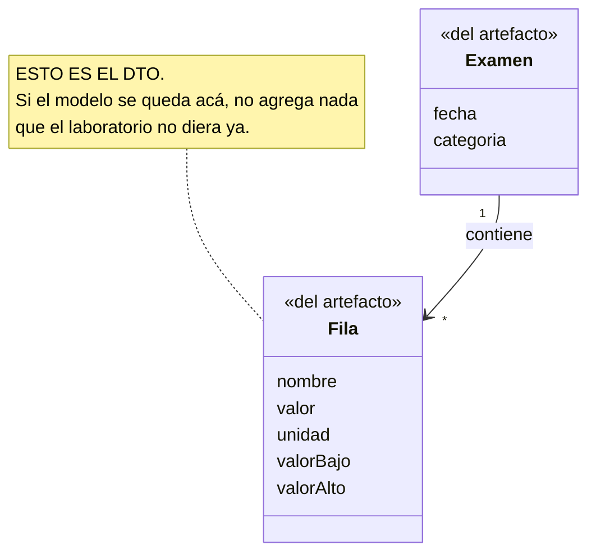
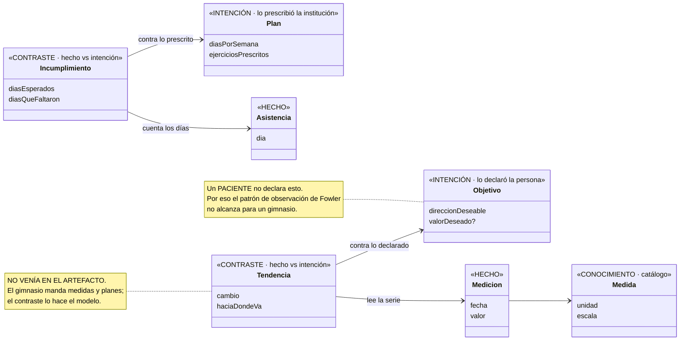
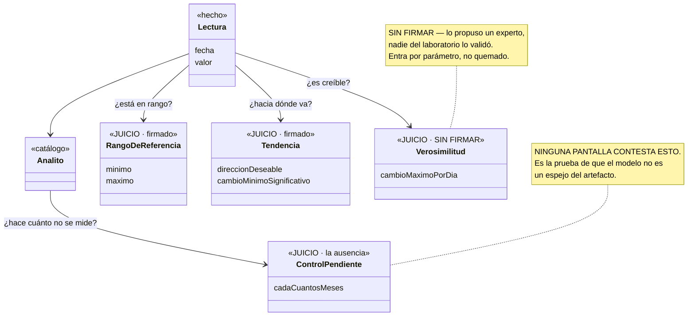
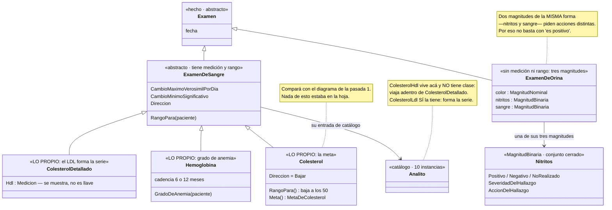

# La columna vertebral — proceso para construir un dominio que agrega valor

Un proceso de **cuatro pasadas** sobre dos entradas: **el artefacto que manda la institución** y **la
descripción funcional de la app**. Cada pasada produce un diagrama Mermaid y una lista de decisiones,
y el diagrama está diseñado para que se vea **qué vino del dato y qué vino de un juicio** — que es lo
único que distingue un dominio de un DTO con mejores modales.

> **La premisa que ordena todo, y sale del [estado del arte](01-estado-del-arte.md) §3:**
>
> **El sustrato se puede derivar del artefacto. Los juicios no se pueden derivar de nada.**
>
> El esquema físico *"transmite menos de la mitad de la semántica"*. Lo que agrega valor es
> precisamente lo que **no está** en el dato de origen, así que ninguna pasada puede inventarlo — sólo
> puede **preguntarlo** y **dejar el hueco a la vista** mientras nadie conteste.

---

## Antes de empezar · qué familia de patrones necesita tu dominio

**No preguntes si tu dominio "se parece al laboratorio".** Preguntá cuatro cosas, porque cada una
selecciona una familia de patrones distinta y la mayoría de los dominios necesita más de una.

| ¿El dominio…? | Familia | Dónde está documentada |
|---|---|---|
| **mide** algo del sujeto a lo largo del tiempo | **Observación** | Fowler, *Analysis Patterns* **cap. 3** — `PhenomenonType`, `Quantity`, `Measurement`, rango de referencia |
| **prescribe** algo que después se cumple o no | **Planificación** | Fowler **cap. 8** — `Proposed and Implemented Action`, `Plan`, `Protocol`, `Completed and Abandoned Actions`, `Suspension` |
| deja que el sujeto **declare hacia dónde quiere ir** | **Intención** | **No está en Fowler.** UFO-C (Guizzardi): *intentional moments*; ODI (Ulwick): *desired outcome* |
| registra un **intercambio entre dos partes** | **Contabilidad** | Fowler **cap. 6 y 9** |

### El gimnasio necesita las cuatro — por eso es el caso más rico

| | Mide | Prescribe | Declara objetivo | Intercambia |
|---|---|---|---|---|
| Laboratorio | ✅ | ⚠️ el control pendiente es casi un protocolo | ✅ | ❌ |
| **Gimnasio** | ✅ | ✅ | ✅ | ✅ la membresía |
| Supermercado | ✅ el precio en el tiempo | ❌ | ❌ | ✅ |
| Banco / presupuesto | ✅ | ❌ | ⚠️ un presupuesto **es** un objetivo | ✅ |
| Municipalidad | ✅ | ✅ el trámite tiene protocolo | ❌ | ✅ |

### Dos cosas que conviene saber antes de modelar un gimnasio

**El plan NO es una observación.** Es la familia del capítulo 8, y encaja pieza por pieza: el
ejercicio prescrito contra el que hizo es `Proposed and Implemented Action`; la rutina tipo es un
`Protocol`; la instancia de Sonia es un `Plan`. Y **`Suspension` (8.3) es el patrón del período
suspendido por atraso de pago** — un hueco que quedó abierto en el gimnasio y que tiene nombre desde
1996.

**El objetivo agrega un eje que el laboratorio no tiene.** El patrón de observación tiene **un** juicio:
el valor contra su rango. Un paciente no declara hacia dónde quiere que vaya su colesterol; Sonia sí.
De ahí sale el hallazgo del gimnasio:

> **Dos juicios sobre el mismo número.** La **lectura** (normal/bajo/alto) sale del **perfil**; la
> **tendencia** sale del **objetivo**. Ninguno se deduce del otro, y hacen falta los dos.

> **Y no es teoría: al laboratorio le pasó solo.** `Examenes/Dominio/MetaDeColesterol.cs` se agregó el
> 2026-08-26, y su comentario dice la distinción exacta —*"antígeno → se lee contra su línea base;
> colesterol → se lee contra una META"*—. **El mismo dominio terminó con los dos ejes**, y la
> distinción es por analito. El modelo de observación se le quedó corto justo donde apareció una
> intención declarada.

---

## El mapa de las cuatro pasadas

| | Pasada | Entrada | Sale | El diagrama muestra |
|---|---|---|---|---|
| **1** | **El espejo** | El artefacto, campo por campo | El inventario de sustantivos y sus **espacios de valor** | El DTO, a propósito. Es la línea base contra la que se mide todo lo demás |
| **2** | **La grilla** | El inventario | Dos niveles (conocimiento / operación) × tres papeles (hecho / intención / **contraste**) | Las seis celdas, y **cuál columna no venía en el artefacto** |
| **3** | **Los juicios** | La descripción funcional + una conversación | Un juicio por cada cosa que se sigue en el tiempo | Cada juicio, **con dueño y con firma o sin firma** |
| **4** | **La especialización** | Los juicios de la pasada 3 | Qué merece clase propia y qué es una instancia del catálogo | La jerarquía, con **la razón** de cada subtipo |

**El orden no es negociable, y la pasada 3 es la razón.** No se puede decidir si una fila del examen
merece su propia clase hasta saber **si tiene comportamiento propio** — y el comportamiento *son* los
juicios. Especializar antes de la pasada 3 es adivinar.

---

## Pasada 1 · El espejo

**Se hace con el artefacto en la mesa.** La hoja del laboratorio, el estado de cuenta, el plan del
gimnasio, el recibo municipal. No una descripción del artefacto: **el artefacto**.

Es la pasada más barata de todas y la única donde **nadie contesta "no sé"**: lo que está en la hoja
está en la hoja.

**Por cada campo, tres preguntas:**

| | Qué da |
|---|---|
| *¿Esto qué es, en tus palabras?* | El sustantivo, en idioma de negocio |
| *¿Viene siempre o a veces falta?* | Si es obligatorio — y a veces destapa una ausencia |
| *¿En qué escala vive?* | **El espacio de valor**: número continuo, entero grande, sí/no, una de un conjunto cerrado, texto libre |

La tercera es la que casi siempre se salta, y es la que más rinde. Es tu propia observación —*el
conteo de glóbulos rojos está en millones y el colesterol en decimales*— y tiene nombre formal:
**quality dimension** (UFO/OntoUML). **Dos cosas que se miden en espacios de valor distintos son
distintas aunque las dos sean números.**

**Tres sub-preguntas que la [prueba de la municipalidad](../Pruebas/Municipalidad/BITACORA.md) obligó a
agregar**, porque los papeles reales las hicieron falta:

| | Qué caza |
|---|---|
| *¿Este campo significa lo mismo en **todas** las filas?* | `Periodo` era *mes* en unas filas y *número de trimestre* en otras. Seis documentos para estar seguros. Un importador que no lo vea carga abril donde dice cuarto trimestre |
| *¿Este papel es una **foto** o un **hecho**?* | La consulta es el estado de hoy y mañana no existe; el comprobante ocurrió y tiene número. **La historia sale de los hechos.** (Paper 8 §5) |
| *¿Hay algo escrito **en el sobre** y no en el papel?* | El modo del pago —vencido, pendiente, anual— no estaba en el recibo: estaba en el nombre del archivo |

> **Y los papeles siguen llegando después de la pasada 1.** En la municipalidad llegó uno en la pasada
> 1, uno en la 2, y cinco a mitad de la 2 — y cada uno cambió algo. **Cada papel nuevo reabre la pasada
> 1 para sus campos**, y es tiempo bien gastado, no una interrupción.

**Y una cuarta pregunta, por cada campo, que produce la otra mitad de la lista:**

| | Qué da |
|---|---|
| *¿Qué hizo alguien para que este campo exista?* | **El verbo**: el laboratorio *midió*, el gimnasio *prescribió* / *registró la entrada*, el banco *cobró* |

Sale una **lista de verbos** al lado de la de campos, y es la que la doctrina considera primaria: el
paper 1 de la serie de Puppeteer dice que *"la operación es el primario representacional"* y la
estructura lo derivado; la guía de dominios (E24) lo repite. Sin esta lista, la pasada 2 clasifica
sustantivos a ojo. Con ella, el papel de cada cosa **se lee**: un hecho es la huella de un verbo que
*ocurrió*; una intención es la huella de un verbo que *se declaró*. Y es la lista que después necesita
cada `Puede<Comando>` (reglas 17 y 18 del substrato).

> **La lista de verbos tiene dos fuentes, y el artefacto sola da una incompleta.** Lo enseñó la
> [prueba contra Exámenes](04-prueba-1-examenes.md): del papel salen dos verbos —el laboratorio
> *reportó*, el laboratorio *publicó*— y el dominio tiene **tres**, porque la persona *declara* su sexo
> y *"para interpretar gana ella"*. Ese verbo no está en ningún evento: está en la descripción
> funcional. **Los verbos de la institución salen del artefacto; los de la persona, de la
> conversación.** Anotar sólo los primeros deja al dominio sin la mitad híbrida.

> **Este diagrama tiene nombre en la doctrina, y no es halagador.** Es la *codificación estructural*
> del paper 1 — la forma dimensionada al espacio de tipos del artefacto, o sea **la representación
> porosa**. Se dibuja a propósito porque las pasadas 3 y 4 son su inversión. Un modelo que al final se
> le parece no falló en la implementación: **se quedó estructural**.

### El diagrama de la pasada 1 — deliberadamente un espejo

**Se dibuja a propósito, y se guarda.** Es la línea base: en la pasada 4 se compara contra ella, y la
diferencia **es** el valor agregado. Un modelo que al final se parece a este diagrama no falló en la
implementación: falló en la pasada 3.

**Criterio de salida:** cada campo del artefacto está en la lista, con su espacio de valor anotado.

---

## Pasada 2 · La grilla — dos niveles por tres papeles

Acá el modelo deja de ser plano. Y hay que cruzar **dos ejes que son independientes**, no apilar
cuatro niveles — la primera versión de este documento los apilaba, y era un error de estructura:

- **El eje de Fowler** (*Analysis Patterns* cap. 2, §2.5): **conocimiento** — *lo que existe aunque no
  haya datos*, los tipos y las reglas — contra **operación** — *lo que ocurrió*, las instancias. Fowler
  lo dice así: *"las instancias del nivel de conocimiento gobiernan la configuración de las instancias
  del nivel operacional."*
- **El eje del papel**, que es propio de este método: **hecho** (algo que pasó), **intención** (algo que
  alguien declaró que quiere o debe pasar) y **contraste** (la comparación de un hecho contra una
  intención, o contra su propia historia).

Son independientes porque **cada papel existe en los dos niveles**. El propio capítulo 8 de Fowler lo
muestra: el `Protocol` (la rutina tipo) está en el nivel de conocimiento y el `Plan` (el de Sonia) en el
operacional — y los dos son *intención*. Igual con el contraste: el rango de referencia es una **regla**
(conocimiento); la tendencia de esta medición es una **evaluación** (operación).

| | **Hecho** | **Intención** | **Contraste** |
|---|---|---|---|
| **Conocimiento** — *existe sin datos* | `Analito`, `Medida`, `Producto`, `Ejercicio` | `Protocol` — la rutina tipo, el calendario del trámite | `RangoDeReferencia`, `UmbralesDeRendimiento`, la cadencia esperada, la dirección deseable |
| **Operación** — *ocurrió* | `Lectura`, `Asistencia`, `Compra`, `Cargo` | `Plan`, `Objetivo`, `Meta`, el presupuesto del mes | `Tendencia`, `Incumplimiento`, `EvaluacionDeRendimiento`, `VarianciaDelMes` |

Los cortes, aplicados:

- El **colesterol** existe aunque este paciente nunca se lo haya medido → conocimiento / hecho
- *"Colesterol deseable: hasta 200 después de los 50"* → conocimiento / **contraste** (una regla)
- La **rutina de fuerza para principiantes** existe aunque nadie la esté siguiendo → conocimiento / intención
- *"Bajar de peso"*, *"ir tres veces por semana"* → operación / intención
- *"Colesterol 280 el 4 de julio"*, *"fue el martes"* → operación / hecho
- *"Le faltaron nueve días"*, *"viene bajando"* → operación / **contraste** (una evaluación)

> ### La columna de contraste es donde vive el valor agregado
>
> **El artefacto de la institución trae hechos, y a veces intenciones. Puede traer reglas de contraste
> —un reporte de laboratorio real imprime los rangos de referencia al lado de cada valor—. Lo que
> nunca trae es una evaluación:** ninguna hoja dice *"viene bajando"* ni *"le faltaron nueve días"*.
> Por eso **la celda que garantiza el no-espejo es *operación / contraste***, no la columna entera —
> precisión que salió de la [prueba contra Exámenes](04-prueba-1-examenes.md).
>
> **Y una precisión más, del gimnasio v2 (2026-09-07), que afila el *"nunca"*.** El gimnasio manda una
> bandera *En mora* / *Al día* — y eso **sí es una evaluación**: la del gimnasio, sobre la cuenta de
> Sonia, contra sus propias reglas, en un instante. Un reporte de laboratorio real hace lo mismo con su
> *H* / *L* al lado del valor. Lo que la institución **no** hace es evaluar **sobre la historia de la
> persona** —*"viene bajando"*— ni **contra su intención** —*"le faltaron nueve días"*—. Así que la
> línea exacta es: **la institución evalúa contra sus reglas en un punto; la app evalúa sobre la serie
> y contra lo declarado.** La evaluación de la institución llega al dominio como **hecho** —lo que ella
> concluyó, con fecha— y la app **no la recalcula**: es la autoridad del paper 8 aplicada a un dato.
> La columna de contraste de la app son las evaluaciones que la institución **no hizo**.
>
> Ésa es la versión filosa del test de "no es espejo", y se puede verificar: **los cinco negocios del
> repo tienen la columna de contraste poblada.** Exámenes tiene `RangoDeReferencia` (regla) y
> `EvaluacionDeTendencia` / `ControlPendiente` (evaluaciones); Cargas tiene `UmbralesDeRendimiento` y
> `LineaBaseDeRendimiento` (reglas) y `EvaluacionDeRendimiento` / `VeredictoDeRendimiento` /
> `ProyeccionDeOdometro` (evaluaciones); Presupuesto tiene `PuntoDeComparacion` y `VarianciaDelMes`.
> Ninguna de esas clases estaba en el dato de origen.
>
> Un modelo sin columna de contraste **es un espejo**, por bien escrito que esté.
>
> **Y la grilla ordena las pasadas que siguen:** la pasada 3 llena la celda *conocimiento / contraste*
> —las reglas: umbrales, direcciones, cadencias—; la pasada 4 decide cuáles entradas del nivel de
> conocimiento merecen ser clases.

### Cuando la intención no está declarada: la app propone, la persona adopta

Salió de la [prueba de la municipalidad](../Pruebas/Municipalidad/BITACORA.md), y es la regla *"proponé, no
preguntés en frío"* aplicada a la propia persona. La fila de intención puede estar vacía —nadie declaró
cuánto quiere apartar por mes— y la app no puede inventar la declaración. Lo que sí puede es **calcular
una propuesta** (la proyección dividida en doce) y ofrecerla.

**La consecuencia de modelado es que son dos cosas, en dos celdas:**

| | Celda | Qué es |
|---|---|---|
| `ReservaPropuesta` | operación / **contraste** | Un número que la app **calculó**. Nunca se journalea; se recalcula |
| `ReservaDeclarada` | operación / **intención** | Lo que la persona **adoptó**, ajustado o no. Un comando, con fecha |

Colapsarlas en una `Reserva` con un `bool adoptada` es la misma porosidad del `Plan.Termino` del
gimnasio — y peor, porque un número de la app pasaría por decisión de la persona. **La propuesta se
muestra como propuesta; sólo lo adoptado se muestra como suyo.** Es la regla del default silencioso
vista desde el lado de la intención.

### Dos precisiones sobre la columna de contraste, que salen de los papers

**Los contrastes son respuestas computadas, nunca hechos journaleados.** `ComoVengo()` calcula la
`Tendencia` sobre la serie; no la guarda. Están en una columna al lado de los hechos porque tienen un
*papel* distinto, no porque se persistan igual. Es la distinción del paper 8 —*"una derivación, no un
campo almacenado"*— y de la guía de dominios E24: *"una respuesta computada no es porosidad"*.

**Y hay un criterio para decidir si un contraste va al dominio o al actor**, porque los dos lugares
son legítimos (paper 8 §4: el borde dominio/actor *"se dibuja por concepto"*):

| Va al **dominio** si… | Va al **actor** (el `print`) si… |
|---|---|
| es una noción que el negocio **nombra y sobre la que decide** — *"viene bajando"*, *"le faltaron nueve días"*, *"es un hallazgo"* | es un **recorte para una vista** — *"las líneas con descuento"*, *"los últimos cinco"*, *"el subtotal"* |
| tiene una regla propia en el nivel de conocimiento (un umbral, una cadencia) | no tiene regla: es filtrar o sumar lo que ya está |

Y lo que **no** puede hacer un contraste en ningún caso es **renderizarse solo**: el dominio expone
la hoja —`Estado`, `Nombre`, `Etiqueta`— y el actor decide qué imprime. Un `ToString()` como única
salida es el dominio tomando una autoridad que no es suya (paper 8 §4). `Nitritos` en `Examenes` lo
hace bien (`Etiqueta`, `Expresado`); los tipos de juicio del gimnasio, no — ver el
[contraste con los papers](03-contraste-con-los-papers.md), T2.

**Y acá aparece la primera decisión de forma:** el nivel de conocimiento se parte **por espacio de
valor**, no por categoría del negocio. La hoja del laboratorio agrupa por *"colesterol"* y *"sangre"*;
el modelo agrupa por **continuo / binario / nominal**, porque eso es lo que cambia cómo se lee un
valor.

### El diagrama de la pasada 2

> **Ojo con un error frecuente en esta pasada:** un `Plan` **no es un hecho ni un catálogo** — es una
> intención con fecha, en el nivel operacional. Meterlo en la columna de hechos hace que el
> incumplimiento no tenga contra qué compararse, y el modelo pierde justamente la pregunta que agrega
> valor. Y su gemelo del nivel de conocimiento —la rutina tipo, el `Protocol`— es intención también,
> aunque no tenga fecha.

**Criterio de salida:** todo sustantivo de la pasada 1 quedó en **una** de las seis celdas, y la
**columna de contraste tiene al menos una clase** — en cualquiera de sus dos filas. Si la columna está
vacía, el modelo es un espejo y hay que volver a la descripción funcional.

---

## Pasada 3 · Los juicios — la pasada que agrega el valor

**Es la única que no se puede derivar, y por eso la única que no se puede apurar.**

Por cada cosa que la app va a **seguir en el tiempo**, se declara un juicio. Y conviene escribirlos en
la forma canónica de *Outcome-Driven Innovation*, porque obliga a que sean medibles y sin solución
adentro:

> **dirección de mejora + medida + objeto + contexto**
>
> *"**Reducir** la **cantidad de días** entre **una medición y la siguiente** **cuando el valor está
> fuera de rango**"*

Las seis preguntas, en el orden que menos cansa:

| | El juicio | Qué decide en el modelo |
|---|---|---|
| **1** | **Dirección** — ¿hacia dónde es deseable que se mueva? | Si el modelo puede opinar sobre un número |
| **2** | **Identidad del hecho** — ¿qué cambio es tan grande que probablemente no sea la misma cosa? | El umbral de verosimilitud: distingue *error de medición* de *tendencia* |
| **3** | **Ruido** — ¿qué variación es normal y cuál merece aviso? | El cambio mínimo significativo |
| **4** | **Ritmo esperado** — ¿cada cuánto debería volver a ocurrir? | **De acá sale la pregunta sobre la ausencia** |
| **5** | **Urgencia** — ¿qué hace urgente un hallazgo: el tamaño o la clase de cosa? | Si la severidad es una escala o un conjunto cerrado |
| **6** | **Lo propio** — ¿qué sabe **esta** cosa que ninguna otra sabe? | **Decide la pasada 4** |

**La 6 es la más productiva de todo el proceso.** Es la que separa una clase de una fila de catálogo,
y es la que hay que insistir en hacer.

### Cuatro reglas que esta pasada no puede romper

**No se juzga un dato por plausibilidad.** Salió de romperla en la
[prueba de la municipalidad](../Pruebas/Municipalidad/BITACORA.md): con dos papeles escribí que *"todo se
duplicó en dos años"* era improbable y que la lectura correcta era la contraria. Cinco recibos después,
todo se había duplicado de verdad. **Cuando un número parece absurdo, la respuesta es *"¿hay otro
papel?"*, no *"probablemente es al revés"*.** Un juicio de plausibilidad es un juicio inventado con
apariencia de sentido común — y es el que más cuesta ver, porque uno lo hace sin darse cuenta.

**No se pregunta en frío: se propone.** Umbrales, ruido y cadencia no son conocimiento de producto:
son conocimiento experto del dominio. Quien está enfrente casi nunca los tiene. Se trae un valor
propuesto y se deja corregir — **corregir un número es fácil, inventarlo no**.

**Lo que no se sepa entra por parámetro y se marca sin firmar.** El dominio se queda con la **forma**
y hace la comparación; el número viene de afuera y se puede cambiar sin tocar una clase.

**Un juicio sin firmar NO tiene valor por defecto silencioso.** O el objeto no se construye sin él, o
la respuesta **dice que no sabe**. Un default es un juicio inventado con mejores modales: no falla
nunca, y da una respuesta creíble y equivocada cada vez.

### El diagrama de la pasada 3 — donde se ve el valor agregado

**Lo que este diagrama hace y el de la pasada 1 no:** se ve de un vistazo **cuánto del modelo no
estaba en la hoja del laboratorio**. Cuatro cajas nuevas, ninguna derivable del dato — y las cuatro
caen en la columna de contraste de la grilla: `RangoDeReferencia`, `Verosimilitud` y la cadencia de
`ControlPendiente` son **reglas** (nivel de conocimiento); la `Tendencia` de una serie concreta es una
**evaluación** (nivel operacional).

**Criterio de salida:** cada juicio está escrito en forma ODI, y **cada uno tiene o una firma o un
dueño con nombre y apellido**. Ninguno inventado.

---

## Pasada 4 · La especialización — ahora sí, "¿una clase por fila?"

Con los juicios sobre la mesa, la pregunta se vuelve contestable. **Y la respuesta no es sí ni no: son
dos niveles con reglas distintas.**

### El test, fila por fila

> **Decidido el 2026-09-07: la regla por defecto es la barra de activo, y el test del Curador es el
> piso.** Son dos preguntas, en este orden:
>
> **1 · ¿Esta fila *juzga* algo por sí misma** — tiene su rango de referencia, su dirección deseable,
> elige qué severidad o qué acción corresponde ante un hallazgo, sabe qué necesita del perfil para
> leerse? → **Es una clase nombrada.** Aunque hoy sólo difiera de su hermana en los valores: el dominio
> es un activo, se lee y se dice, y una clase con nombre es donde el comportamiento futuro va a tener
> casa (guía de dominios, **E40**, *la barra de activo*).
>
> **La frontera — decidida el 2026-09-07 al chocar esta regla contra la municipalidad:** una fila que
> sólo **parametriza** una operación que todas comparten —una cadencia, una fórmula de cobro, un monto—
> **no** juzga nada: es una **instancia del catálogo**. `Sodio` juzga (su rango, su dirección, qué
> `Severidad`/`Accion` elige `SerieDeSodio`) → clase. `Basura` parametriza (mensual, por unidad) una
> misma operación de cobro → `Rubro.Basura`. Lo que sí merece clase en la municipalidad es lo que
> **juzga**: `CobroMensual`/`CobroTrimestral` (cómo se lee el período, cuándo vence), y
> `TarifaPorUnidad`/`TarifaSobreBaseImponible` (qué explica un aumento). **Un analito carga juicios; un
> rubro carga parámetros.**
>
> **2 · El piso — *Replace Subclass with Fields* (Fowler, *Refactoring*):** *quitá el nombre y movés
> sus constantes a datos. ¿Se pierde algo — una regla, o siquiera un conocimiento que sólo esta fila
> declara?* Si **no se pierde nada** —la fila no sabe nada de sí misma— es una **instancia del
> catálogo**, no una clase. Ése es el único caso en que se colapsa.

El tell mecánico sigue valiendo, en una dirección: si aparece `if (tipo == X) …lógica… else if
(tipo == Y) …otra lógica…`, eso es comportamiento y **pide** subclase. Lo que ya no vale es la inversa
—*"sólo constantes → colapsá"*—: una constante que es conocimiento del dominio (un rango, una
dirección) **se gana la clase**; una constante suelta sin significado propio, no.

> **Y un control que ninguna de las dos preguntas hace, propuesto desde OntoUML (glosario nº 19):
> ¿una instancia puede *dejar de ser* esto sin dejar de existir?** Si sí, es una **fase**, no un
> subtipo — `CuentaMorosa : Cuenta` pasa las dos preguntas de arriba y en C# es imposible, porque la
> instancia tendría que cambiar de clase. Va como **situación calculada** en la columna de contraste,
> con las operaciones gateadas. Corrido contra los cinco dominios del repo en septiembre de 2026:
> **cero casos**, porque la grilla ya manda lo que va y viene al contraste.

> **T3, resuelto el 2026-09-07 por la decisión de arriba.** La
> [prueba contra Exámenes](04-prueba-1-examenes.md) había encontrado seis analitos —sodio, potasio,
> cloro, glucosa, BUN, proteínas— hechos como **doce clases que difieren sólo en constantes** (`Sodio`
> vs `Potasio`: cero líneas de lógica distintas), y el Curador leído como techo decía *colapsá*. Con la
> barra de activo como default, **se quedan como clases**: cada una declara su rango y su dirección,
> que es conocimiento del dominio y no una constante suelta — pasan la pregunta 1, y el piso no las
> toca. E40 lo licenciaba como excepción; la decisión lo vuelve la regla. **Lo que sigue pendiente es
> comunicárselo a Álvaro, no preguntárselo**, porque su E39 presenta la barra de activo como *caveat*
> y acá es el default — y esa diferencia tiene que quedar escrita en las dos guías, no en silencio.

### Aplicado a Exámenes, con el código real

| Fila | ¿Clase propia? | Por qué — leído del código |
|---|---|---|
| **Colesterol total** | **Sí** — `Colesterol` | Declara que su dirección deseable es **bajar**; su techo **baja a los 50 años y no depende del sexo**; su cambio mínimo significativo es 15 mg/dL; y expone `Meta()`, una `MetaDeColesterol` que es **el escalón siguiente**, lo que permite leer un 280 que viene bajando como buena noticia |
| **Colesterol LDL** | **Sí** — `ColesterolDetallado` | *"Es la fracción que decide la conducta clínica"* y **forma su propia serie**. Tiene su propio rango |
| **Colesterol HDL** | **No** | Viaja como una `Medicion Hdl` **adentro** de `ColesterolDetallado`: *"se muestra, pero no es la llave de la serie"*. Modelarle una serie sería *"mezclar dos cosas distintas en una"* |
| **Hemoglobina** | **Sí** | Sabe calcular el **grado de anemia**, y su cadencia pasa de 12 a 6 meses si hay anemia. **Ninguna otra lo sabe** |
| **Nitritos en orina** | **Sí** — pero en **otra** jerarquía | No es un examen: es una **magnitud** (`Nitritos : MagnitudBinaria`), un conjunto cerrado de tres valores que vive adentro de `ExamenDeOrina`. Pasa el test porque **comparte la forma con `SangreEnOrina` y pide otra acción**: *"si la severidad se dedujera de 'es positivo', estos dos darían lo mismo"* |

**Todos pasan el test, y la fila del HDL es la que más enseña:** LDL y HDL vienen en la **misma hoja**,
con la **misma unidad**, y el modelador tomó **dos decisiones distintas** — con la razón escrita en el
comentario. Eso es el test del Curador aplicado fracción por fracción, no fila por fila.

> **Y ése es el punto que hay que poder defender ante el equipo técnico:** el modelo no tiene una
> clase por fila. Tiene **una instancia de catálogo por fila** y **una clase por cada fila que carga un
> juicio propio** — y la especialización ocurre en **dos jerarquías**: la del examen (`ExamenDeSangre`
> / `ExamenDeOrina` / `ExamenDeHeces`, que se distinguen por *qué preguntas pueden contestar*) y la de
> la magnitud (`Continua` / `Binaria` / `Nominal`, que se distinguen por *cómo se lee un valor*). La
> diferencia se ve en el diagrama.

> **Una tensión con el capítulo 4 §6 de las guías, anotada el 2026-09-07 y sin resolver en ese
> capítulo.** El §6 dice *"pocas clases, mucho detalle — parece que hay 30 exámenes; en realidad se
> modelan 2 o 3"*, y la barra de activo empuja al revés. Son compatibles si *"2 o 3"* son las
> **familias** —`ExamenDeSangre` / `ExamenDeOrina` / `ExamenDeHeces`— y las clases por analito viven
> debajo, que es exactamente lo que Exámenes hace. Pero el §6 no lo dice así, y leído solo manda a
> colapsar lo que la decisión de hoy manda a nombrar. Cuando las cuatro pasadas entren a las guías, el
> §6 tiene que decir *familias*.

### El diagrama de la pasada 4 — el final

**Criterio de salida:** cada subclase **juzga algo por sí misma** — un rango, una dirección, una
severidad, un cálculo que explica. La que sólo parametriza una operación compartida se colapsa a
instancia del catálogo. Y ninguna subclase es una fase: nada por lo que la instancia entre y salga.

---

## Cuándo se deja de iterar

Es el hueco que la investigación encontró en **todas** las metodologías publicadas: dicen "es
iterativo" y ninguna dice cuándo parar. Ésta es la propuesta — **cuatro preguntas, y las cuatro tienen
que dar que sí**:

| | La pregunta | De dónde sale |
|---|---|---|
| **1 · Completitud** | ¿Cada dato que una pregunta necesita tiene origen — un campo del artefacto **o** un juicio declarado? Si algo no tiene origen, descubriste **un campo faltante, un evento faltante o una decisión faltante** | *Information completeness*, Event Modeling |
| **2 · No-espejo** | ¿La **columna de contraste** tiene al menos una clase —regla o evaluación—, y ninguna de ellas venía en el artefacto? Es la versión verificable de *"¿hay una pregunta que el portal no contesta?"* | Propio. Sin esto es un listado con mejor tipografía |
| **3 · Justificación** | ¿Cada clase **declara conocimiento propio**, y ninguna es una fase disfrazada de subtipo? | La barra de activo (E40) como default · *Replace Subclass with Fields* (Fowler, *Refactoring*) como piso · la rigidez (OntoUML) como control |
| **4 · Huecos con dueño** | ¿Todo lo que quedó sin decidir está **escrito y con dueño**? | Propio |

**La 4 es la que hace que el proceso termine.** *Satisfecho con el dominio* **no** significa *sin
preguntas abiertas* — significa que las preguntas abiertas **están a la vista y tienen a quién
preguntarle**. Un dominio joven con el registro de huecos vacío es sospechoso, no admirable.

---

## El mismo proceso en otros dominios

Para mostrar que no está hecho a medida del laboratorio. La grilla, aplanada por papel —las dos filas
de cada columna van juntas para que la tabla quepa—:

| | Artefacto | Conocimiento | **Intención** | Hecho | **Contraste** — el valor |
|---|---|---|---|---|---|
| **Gimnasio** | Hoja de rutina + historial de medidas | Ejercicio, medida, rango por perfil | Objetivo, plan | Asistencia, medición | Incumplimiento · tendencia. *¿Qué plan terminó sin que me midieran?* |
| **Supermercado** | El ticket | Producto, departamento, presentación | — *(nadie declara nada)* | Compra, línea | Cambio en la canasta · abastecimiento pendiente. *¿Qué dejé de comprar?* |
| **Banco** | Estado de cuenta | Gasto recurrente, propósito, bien | El presupuesto | Cargo, imprevisto | Variancia del mes · cargo ausente. *¿Qué cargo no llegó?* |
| **Municipalidad** | Recibo de impuestos | Tributo, tarifa, período | El calendario del trámite | Cobro, pago | Atraso · vencimiento próximo. *¿Qué trámite se me vence?* |

**Dos cosas que se leen bien en esta tabla:**

**El supermercado no tiene nivel de intención, y aun así tiene contraste.** Cuando nadie declara nada,
el contraste se hace **contra la propia historia** en vez de contra una intención — *"comprabas leche
cada 5 días y hace 12 que no"*. Es la misma capa con otra referencia, y es la salida para todo dominio
donde el sujeto no declara metas.

**El valor está siempre en la última columna, y en ningún caso venía en el artefacto.** Ninguna
institución de las cuatro manda el contraste: mandan hechos, y a veces la intención que ellas mismas
prescribieron.

---

## Cómo se corre esto con un agente

Es lo que hace el bucle práctico, y la literatura reciente lo respalda: hacen falta **varias
iteraciones** antes de que un modelo generado tenga la forma y la calidad buscadas, y conviene
**usar el diagrama para refinar los requerimientos**, no al revés.

### El contrato de cada pasada

| Pasada | Lo que el agente RECIBE | Lo que DEBE producir | Lo que tiene PROHIBIDO |
|---|---|---|---|
| **1** | El artefacto, literal | Inventario + espacios de valor + Mermaid del espejo | **Inventar cualquier campo que no esté en el artefacto** |
| **2** | El inventario | La grilla de seis celdas + Mermaid | Decidir subclases. **Y llenar la columna de contraste por su cuenta** — si no encuentra nada que poner ahí, tiene que decirlo, no inventarlo |
| **3** | La descripción funcional + las respuestas | Juicios en forma ODI + Mermaid con firma/sin firma | **Inventar un umbral.** Si no se lo dijeron, va sin firmar y a la vista |
| **4** | Los juicios | La jerarquía + Mermaid + el test aplicado fila por fila | Crear una clase que no pase el test |

**La prohibición de la pasada 3 es la que sostiene todo el método.** Un agente que rellena un umbral
razonable produce un modelo que compila, corre, y miente. Es el fracaso exacto que este proceso
existe para evitar.

### El visto bueno del equipo técnico

Cinco dimensiones, tomadas de la evaluación que usa el trabajo académico reciente sobre generación de
modelos con LLM — sirven tal cual como checklist de revisión:

- [ ] **Completitud** — ¿está todo lo que el artefacto trae y todo lo que las preguntas necesitan?
- [ ] **Corrección** — ¿las relaciones y cardinalidades son ciertas en el negocio?
- [ ] **Conformidad** — ¿respeta las reglas del sustrato (dominio `internal`, sin reloj adentro, conjuntos cerrados con resolutor total)?
- [ ] **Comprensibilidad** — ¿alguien que no estuvo en la sesión entiende el diagrama sin que se lo traduzcan?
- [ ] **Alineación terminológica** — ¿los nombres son los que la institución **dice en voz alta**, o son los del programador?

Y una sexta, propia y la más importante:

- [ ] **No-espejo** — poné el diagrama de la pasada 1 al lado del de la pasada 4. **¿Se parecen?** Si se parecen, el modelo no agregó nada y el problema está en la pasada 3. La forma rápida de verlo: **tapá la columna de contraste. Si lo que queda es el artefacto, no hay dominio.**

---

## Lo que este proceso NO resuelve

Tres cosas, dichas para que nadie las descubra tarde:

**No produce el modelo completo, sólo la columna vertebral.** Los casos de borde, los estados, el
ciclo de vida — todo eso aparece construyendo, y va al registro de huecos.

**No sustituye la conversación.** Las pasadas 1, 2 y 4 se pueden automatizar bastante. La 3 no: es
elicitación, y su costo es el que es.

**Y no garantiza que el modelo sea el mejor, sólo que no es un espejo.** Las cuatro preguntas de parada
detectan un dominio pobre; no detectan uno correcto pero mal cortado. Para eso hace falta alguien que
conozca el negocio mirando el diagrama — que es exactamente para lo que el diagrama existe.
