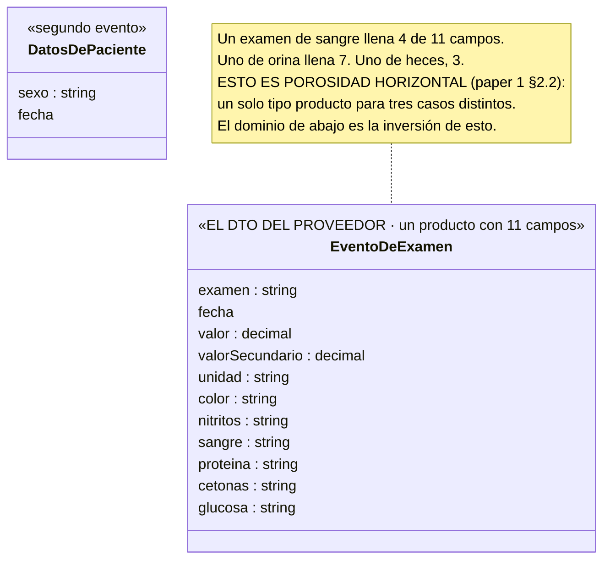
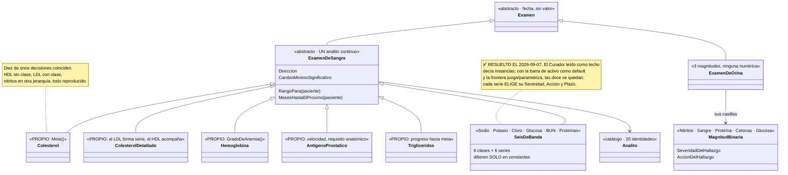

# Prueba 1 · Las cuatro pasadas contra Exámenes

**Corrida abiertamente**, el 2026-09-03, contra el dominio de `Examenes` tal como está en `origin/master`
(PR 10045, *"los 18 analitos de la portada"*). Abiertamente quiere decir: **yo ya había leído el
dominio**. Esto no prueba que el método descubre; prueba que **el criterio del método coincide o no con
lo que un equipo construyó sin él**. Donde no coincide, o el método está mal o el dominio tiene algo
que mirar — y el documento dice cuál cree que es en cada caso.

**Veredicto en una línea:** las pasadas 1 a 3 reproducen la estructura real; la pasada 4 reproduce
**todas las decisiones de especialización menos una** — y esa una es un hallazgo sobre el dominio, no
sólo sobre el método. Además la prueba corrigió el método en **tres puntos**.

---

## 0 · Las dos entradas

**El artefacto** — lo que el laboratorio manda, leído del contrato real (`Examenes.Eventos/ExamenAgregado.cs`
y el `EventoDeExamen` del mock `EndPointDeEventos/Program.cs`). Son **dos eventos**:

| Evento | Campos que trae el wire |
|---|---|
| `ExamenAgregado` | `examen` · `fecha` · `valor` · `valorSecundario` · `unidad` · `color` · `nitritos` · `sangre` · `proteina` · `cetonas` · `glucosa` |
| `DatosDePacienteActualizados` | `sexo` · `fecha` |

Más el guion de la demo (`Muestras.cs`): 19 eventos, 9 analitos de sangre distintos, la tira de orina
con sus seis casillas, tres exámenes de heces.

**La descripción funcional** — el README de `Examenes` en `origin/master`, sección *"Las tres preguntas que
ninguna pantalla contesta"*, más los nombres de las cinco tools MCP: `evaluar_tendencia`,
`velocidad_de`, `presencia_de`, `constancia_de`, `que_me_falta_medir`.

**La respuesta conocida** — el dominio real: 4 jerarquías (examen · analito · magnitud · serie), 20
identidades en el catálogo `Analito` (12 continuas, 6 binarias, 2 nominales), 11 subclases de
`ExamenDeSangre`, 6 de `MagnitudBinaria`, 2 de `MagnitudNominal`, 14 series, y tres familias de
evaluación (tendencia · presencia · constancia).

---

## Pasada 1 · El espejo

### Los campos y sus espacios de valor

| Campo | En sus palabras | ¿Viene siempre? | Espacio de valor |
|---|---|---|---|
| `examen` | qué se midió, o de qué muestra es | siempre | **conjunto cerrado**, pero mezclado: nombres de analito (*"Colesterol"*, *"HGB"*) **y** tokens de muestra (*"Orina"*, *"Heces"*) **y** un token de forma (*"ColesterolDetallado"*) |
| `fecha` | cuándo | siempre | fecha |
| `valor` | el número | sólo en sangre | **continuo con unidad** |
| `valorSecundario` | la fracción que acompaña (HDL) | *"siempre"* — pero en cero | continuo; **la presencia del campo no significa nada, sólo el valor > 0** |
| `unidad` | en qué se mide | sólo en sangre | conjunto cerrado (`mg/dL`, `g/dL`, `ng/mL`, `mEq/L`…) |
| `color` | de qué color salió | sólo en orina y heces | **nominal** — categoría sin orden |
| `nitritos` `sangre` `proteina` `cetonas` `glucosa` | las casillas de la tira | sólo en orina (sangre también en heces) | **binario con tres estados**: positivo · negativo · **vacío = no se corrió la prueba** |
| `sexo` | el sexo del paciente | otro evento, rara vez | conjunto cerrado; llega como *"M"*, *"masculino"*, *"Hombre"* |

**Tres cosas que la tercera pregunta —el espacio de valor— destapó y que un DTO no dice:**

1. **`examen` mezcla tres cosas distintas** en un solo campo: *qué se midió*, *de dónde salió la
   muestra* y *qué forma tiene el resultado*. Es la pregunta *"¿por examen o por analito?"* que el
   README dice que estuvo abierta con Álvaro *"buena parte del milestone"*. **El espacio de valor del
   campo la contesta en la pasada 1**: no es una disyuntiva, son tres espacios superpuestos en un
   string.
2. **`valorSecundario` es una trampa de porosidad.** El mock lo serializa en **todos** los eventos
   porque es un `decimal` no anulable, así que *"llega en cero hasta en un antígeno prostático"*
   (comentario del código). El primer `Refresh` reventó por preguntar presencia en vez de valor.
   Anotarlo como *"opcional"* en la pasada 1 hubiera reproducido el bug.
3. **El binario tiene tres estados, no dos.** *"Vacío significa que el laboratorio NO corrió la prueba,
   que es un estado legítimo del urianálisis y distinto de un negativo."* Un `bool` lo pierde.

### Los verbos — la media lista que la pasada 1 no tenía hasta ayer

| Campo | ¿Qué hizo alguien para que exista? |
|---|---|
| todo `ExamenAgregado` | el laboratorio **reportó** un examen |
| `sexo` | el laboratorio **publicó** un dato del paciente |

**Dos verbos.** Y acá la prueba corrigió el método por primera vez: **el dominio tiene tres**. `Expediente`
expone `Agregar(examen)`, `PublicarSexo(sexo)` y **`DeclararSexo(sexo)`** — la persona corrige lo que
el laboratorio dijo, y *"para interpretar gana ella"*. Ese tercer verbo **no está en el artefacto**:
está en la descripción funcional. → **Corrección 1:** la lista de verbos se arma con las dos entradas,
no sólo con el artefacto. Los verbos de la institución salen del papel; los de la persona, de la
conversación.

### El diagrama — deliberadamente la representación porosa

**Criterio de salida:** ✅ los 13 campos están, con espacio de valor. Y la pasada dejó un hallazgo que
no es del método: **el artefacto mismo es la forma porosa que el paper 1 describe**, y `Interpretar()`
—que devuelve `null` para lo que no modela y resuelve `TraeFraccionamiento` por valor y no por
presencia— es la capa anti-corrupción que lo invierte.

---

## Pasada 2 · La grilla

| | **Hecho** | **Intención** | **Contraste** |
|---|---|---|---|
| **Conocimiento** | `Analito` (20 identidades: `AnalitoContinuo` / `AnalitoBinario` / `AnalitoNominal`) · `UnidadDeMedida` · `Sexo` · `RequisitoAnatomico` · `Magnitud` (continua / binaria / nominal) | los **escalones** de `MetaDeColesterol` (200 · 240) | `RangoDeReferencia` (por analito, por paciente) · `CambioMinimoSignificativo` · `CambioMaximoVerosimilPorDia` · `MultiploQueNingunIntervaloJustifica` · `DireccionDeseable` · `MesesHastaElProximo` · `FormaDeLectura` (6) · `Severidad` · `Accion` · `Plazo` · `Veredicto` |
| **Operación** | `Expediente` (raíz) · `Paciente` · `Examen` → `ExamenDeSangre` / `ExamenDeOrina` / `ExamenDeHeces` · `Medicion` · `LecturaDeExamen` · `PruebaBinaria` · `ObservacionNominal` | `MetaDeColesterol` — *a dónde tiene que llegar Sonia hoy* | `SerieDeAnalito` → `SerieContinua` / `SerieBinaria` / `SerieNominal` (14 series) · `EvaluacionDeTendencia` / `DePresencia` / `DeNominal` · `Tendencia` · `Presencia` · `Constancia` · `Interpretacion` · `Velocidad` · `ControlPendiente` · `GradoDeAnemia` · `TranquilidadDelExpediente` · `UrgenciaDelExpediente` · `Aplicabilidad` |

**Lo que la grilla hizo bien:**

- **La columna de contraste tiene 24 clases y ninguna venía en el artefacto.** El test de no-espejo
  pasa con margen.
- **`MetaDeColesterol` cayó en intención sin forzarla.** El laboratorio no tiene familia de intención…
  salvo ésta, que apareció el 26 de agosto a pedido de Álvaro. La grilla la ubica sin que haya que
  inventarle un nivel. Es la confirmación de lo que el doc 1 decía: el laboratorio se salió del patrón
  de observación justo ahí.
- **Las tres familias de lectura (tendencia · presencia · constancia) son la fila operación/contraste
  partida por espacio de valor.** Es la misma partición del catálogo, un piso más abajo — el README lo
  dice: *"no se factorizan las dos últimas en una sola serie de hallazgos"*.

**Lo que la grilla obligó a precisar — corrección 2:**

> El doc 2 decía *"el artefacto casi nunca trae el contraste"*. Es cierto **para la fila de operación**
> (ninguna hoja de laboratorio dice *"viene bajando"*) y **falso a medias para la fila de
> conocimiento**: un reporte de laboratorio real **sí imprime los rangos de referencia** al lado de
> cada valor. Este artefacto no los trae —el dominio los posee— pero otro podría. La frase correcta
> es: **el artefacto puede traer reglas de contraste; nunca trae evaluaciones.** La celda que
> garantiza el no-espejo es *operación / contraste*, no la columna entera.

**Criterio de salida:** ✅ todo sustantivo de la pasada 1 quedó en una celda, y *operación / contraste*
no está vacía.

---

## Pasada 3 · Los juicios

Corrida sobre los cuatro analitos con más historia y sobre las seis de banda como grupo. Los valores
son los del código; la firma es la que el código declara.

| Analito | Dirección | Ruido | Verosimilitud (máx/día) | Ritmo | Urgencia | **Lo propio** | Firma |
|---|---|---|---|---|---|---|---|
| **Colesterol total** | bajar | 15 mg/dL | 1,0 | 12 m; techo baja a 200 a los 50 | por clase | **la meta** — el escalón siguiente | Álvaro, textual en el código |
| **Antígeno prostático** | — | — | — | — | — | **la velocidad sobre el tramo reciente**; el requisito anatómico | *"el pedido textual de Álvaro"* |
| **Hemoglobina** | preocupa que **baje** | — | — | 12 m → **6 si hay anemia** | por clase | **el grado de anemia** | — |
| **Triglicéridos** | bajar | 25 | 20 | — | — | progreso hacia meta *"aunque sigan sobre la meta"* | — |
| **Las seis de banda** (Na, K, Cl, glucosa, BUN, proteínas) | **mantenerse** — *"alejarse es peor en las dos direcciones"* | 3 · 0,4 · 3 · 8 · 4 · 0,5 | 3 · 0,5 · 3 · 5 · 2 · 0,2 | 12 m normal → **3 ó 6** fuera de rango | **por clase**: sodio → *mostrárselo al médico esta semana*; cloro → *conversarlo en la próxima cita* | **ninguno** — ver pasada 4 | **sin firma visible** |
| **Nitritos vs sangre en orina** | — | — | — | — | **misma forma, distinta acción**: *"si la severidad se dedujera de 'es positivo', estos dos darían lo mismo"* | la acción | Álvaro |

**Lo que la pasada 3 confirma:** los siete juicios del método aparecen en el código **como miembros con
nombre** —`Direccion`, `CambioMinimoSignificativo`, `CambioMaximoVerosimilPorDia`,
`MesesHastaElProximo`, `SeveridadDelHallazgo`, `AccionDelHallazgo`—, uno por columna de esta tabla.
El equipo llegó a la misma descomposición sin el método. Y la forma ODI cabe: *"reducir la cantidad de
meses entre controles cuando la hemoglobina está en anemia"* es exactamente `MesesHastaElProximo`.

**Lo que la pasada 3 hace y el código no:** marcar **quién firmó**. El código lleva la firma de Álvaro en
el colesterol, el antígeno y la acción de los nitritos. Los umbrales de las seis de banda no llevan
ninguna — son valores de uso corriente, y el método los marcaría **⚠️ sin firmar**, no porque estén
mal sino porque nadie del laboratorio los validó. Eso no es un defecto del dominio: es la columna que
el dominio no tiene dónde escribir y el `HUECOS.md` sí.

---

## Pasada 4 · La especialización — el examen final

El test, fila por fila: *quitá el nombre de la subclase y movés sus constantes al catálogo — ¿se pierde
alguna regla?*

| Fila | Predicción del método | Dominio real | ¿Coincide? |
|---|---|---|---|
| Colesterol total | clase — tiene meta, dirección, techo por edad | `Colesterol : ExamenDeSangre` | ✅ |
| Colesterol LDL | clase — forma su propia serie | `ColesterolDetallado : ExamenDeSangre` | ✅ |
| Colesterol HDL | **no** — viaja adentro del LDL | `Medicion Hdl` dentro de `ColesterolDetallado` | ✅ |
| Antígeno prostático | clase — velocidad, línea base, requisito anatómico | `AntigenoProstatico`, `SerieDeAntigenoProstatico` | ✅ |
| Hemoglobina | clase — grado de anemia, cadencia condicional | `Hemoglobina`, `GradoDeAnemia` | ✅ |
| Triglicéridos | clase — progreso hacia meta | `Trigliceridos`, `SerieDeTrigliceridos` con `FormaDeLectura.ProgresoHaciaMeta` | ✅ |
| Nitritos, sangre, proteína, cetonas, glucosa en orina | clases **en la jerarquía de magnitud** — misma forma, distinta acción | 6 × `MagnitudBinaria` | ✅ |
| Color de orina, color de heces | clases nominales, con serie propia | 2 × `MagnitudNominal`, `SerieNominal` | ✅ |
| **Sodio, potasio, cloro, glucosa en ayunas, BUN, proteínas totales** | el 2026-09-02: *una clase de banda + seis instancias*. **Desde el 2026-09-07: seis clases** — juzgan (rango, dirección, `Severidad`/`Accion` propias) | **seis clases + seis series = 12 archivos** | ✅ **resuelto** |

**Once de once, desde el 2026-09-07.** La undécima coincidía bajo una regla que la doctrina no tenía
escrita — la frontera *juzga vs. parametriza*— y esta fila es la que la produjo. El registro de cómo se
veía antes queda abajo, porque es la evidencia.

### Las seis de banda, medidas

Normalizando constantes, strings y nombres:

| Par | Líneas que difieren | Qué es lo que difiere |
|---|---|---|
| `Sodio` vs `Potasio` | **0** | nada |
| `Sodio` vs `Cloro` | 2 | una constante de cadencia: 3 vs 6 meses fuera de rango |
| `GlucosaEnAyunas` vs `NitrogenoUreico` | 2 | ídem |
| `SerieDeSodio` vs `SerieDeCloro` | 4 (de 12 con strings) | **qué miembro** de `Severidad`, `Accion` y `Plazo` se elige: *ConsultePronto / MostrarleEstoATuMedico / EstaSemana* contra *Vigilar / ConversarloConTuMedico / EnLaProximaCita* |

**Todo lo que difiere es un valor de un conjunto cerrado o una constante. No hay una rama de lógica
distinta en ninguna de las doce clases.** Es la definición literal del *tell* de E39: *"un método
compartido que lee valores distintos → datos → Definition"*. Y es lo que el propio README del negocio
admite al nombrarlas en plural — *"las seis de banda"* — como **un** ítem del árbol de series.

**Hay dos lecturas, y el documento no elige por el equipo:**

**Lectura A — el dominio se sobre-especializó.** El test del Curador (E39) dice instancias. Una
`AnalitoDeBanda : ExamenDeSangre` parametrizada por rango, ruido, verosimilitud, dos cadencias,
severidad, acción y plazo, con seis entradas en el catálogo, reemplaza **doce archivos** por dos. PR
10045 agregó 10 analitos en 2.955 líneas; con este corte hubieran sido varios cientos menos. Y la
regla se puede verificar: el diff normalizado de arriba es reproducible.

**Lectura B — la barra de activo (E40) las justifica.** *"Capturar la taxonomía como tipos nombrados
puede justificarse incluso cerca del polo de datos, por decibilidad… siempre que cada tipo se gane su
lugar: que posea conocimiento, no una constante suelta."* `new Sodio(...)` se lee; una entrada de
catálogo no. Y si mañana el sodio necesita una regla propia —la hiponatremia tiene su propia
conducta— ya tiene dónde vivir. **Pero E40 pone la condición en negrita: *no una constante suelta*.
Seis constantes y una elección de severidad siguen siendo constantes.**

> **Lo que la prueba deja dicho:** el criterio del método **es el del equipo** (E39) y el código **no lo
> cumple** en esta fila. O E39 tiene una excepción que nadie escribió —*"la barra de activo permite
> subtipos de sólo datos cuando…"*— o las seis de banda deberían colapsar. **Las dos salidas son
> legítimas; la que no lo es dejar la doctrina y el código diciendo cosas distintas.** Va para los
> peers junto con T1 y T2.

> **Resuelto el 2026-09-07: Lectura B, con una frontera que ninguna de las dos lecturas tenía.** Jorge
> decidió la barra de activo (E40) como regla por defecto y el Curador como piso. Y al probar esa regla
> contra la municipalidad —donde habría convertido los diez rubros en diez clases— salió la frontera:
> **clase cuando la fila *juzga*, instancia cuando sólo *parametriza*.** La fila 204 de arriba es la
> evidencia de que las seis de banda juzgan: `SerieDeSodio` y `SerieDeCloro` **eligen** distinta
> `Severidad`, `Accion` y `Plazo`. Eso no es una constante que una operación compartida lee — es un
> juicio del analito sobre qué hacer con su hallazgo. La objeción de la Lectura B —*"una elección de
> severidad sigue siendo una constante"*— era el error: una elección es un juicio. Lo que sigue siendo
> constante y no justifica clase es la cadencia (3 vs 6 meses), y sola no la justificaría; pero no está
> sola. **Las doce se quedan.** Y E39 pasa de presentar E40 como *caveat* a tenerla como default — eso
> es lo que hay que comunicarle a Álvaro.

### El diagrama de la pasada 4

---

## Los cuatro criterios de parada, contra el dominio real

| | Pregunta | Resultado |
|---|---|---|
| **1 · Completitud** | ¿Cada dato que una pregunta necesita tiene origen? | ⚠️ **Uno no.** `Expediente(int edad)` — la edad decide el techo del colesterol y **ningún evento la trae**. Hoy es una constante del demo (`EdadDelPacienteDelDemo = 34`). El código lo sabe: *"el día que el laboratorio publique la fecha de nacimiento, este mensaje crece"*. Es exactamente el *"evento faltante"* de Event Modeling, detectado por el criterio |
| **2 · No-espejo** | ¿*Operación / contraste* tiene clases que no vinieron en el artefacto? | ✅ 24 |
| **3 · Justificación** | ¿Cada subclase **juzga** algo por sí misma? | ✅ desde el 2026-09-07 — las seis de banda eligen su `Severidad`/`Accion`/`Plazo`. El 2026-09-02, con el Curador como techo, daba ❌. Ver pasada 4 |
| **4 · Huecos con dueño** | ¿Lo no decidido está escrito y con dueño? | — no aplica: `Examenes` no tiene `HUECOS.md`; sus pendientes viven en el README (§ *"Pendientes de este negocio"*) |

---

## Lo que la prueba le hizo al método — tres correcciones, aplicadas al doc 2

| # | Dónde | Antes | Ahora |
|---|---|---|---|
| **1** | Pasada 1, la lista de verbos | *"por cada campo, ¿qué hizo alguien para que exista?"* — sólo del artefacto | **Dos fuentes:** los verbos de la institución salen del papel; los de la persona (`DeclararSexo`) salen de la conversación. El artefacto solo da una lista incompleta por diseño |
| **2** | Pasada 2, el no-espejo | *"el artefacto casi nunca trae el contraste"* | **El artefacto puede traer reglas** (un reporte real imprime rangos); **nunca trae evaluaciones**. La celda que garantiza el no-espejo es *operación / contraste* |
| **3** | Pasada 4, el test | *"no se pierde nada → instancia"*, sin más | Se agregó la **excepción de E40 como pregunta abierta** el 2026-09-02. **Cerrada el 2026-09-07:** E40 es el default, el Curador el piso, y la frontera es *juzga vs. parametriza* — salió de probar la regla contra la municipalidad |

## Lo que la prueba NO prueba

- **Que el método descubre.** Yo conocía la respuesta. Lo que se probó es que el **criterio** coincide
  con lo construido en 10 de 11 decisiones, y que donde no coincide hay algo real.
- **Duración.** Es la queja original y esta prueba no la mide; la mide la prueba 2, en frío.
- **Generalidad.** Un dominio, y el que más se parece a Fowler. La municipalidad es la siguiente.

---

## Para los peers, junto con T1 y T2

**T3 · Las seis de banda.** `Sodio`, `Potasio`, `Cloro`, `GlucosaEnAyunas`, `NitrogenoUreico`,
`ProteinasTotales` y sus seis `SerieDe*` difieren únicamente en constantes y en qué miembro de
`Severidad` / `Accion` / `Plazo` eligen — `Sodio` y `Potasio` en **cero** líneas de lógica. E39 (el
test del Curador) dice que eso son instancias de catálogo, no subclases. **Dos salidas:** colapsarlas a
una `AnalitoDeBanda` parametrizada (−10 archivos), o escribir en E39/E40 la excepción que las justifica
(*"un subtipo de sólo datos se admite cuando…"*). Lo que no conviene es que la guía diga una cosa y el
código otra — es la deriva que el observable 14 persigue en las guías, ahora entre la guía y el
código.

> **Actualizado el 2026-09-07 — T3 ya no es una pregunta para Álvaro, es una comunicación.** La
> decisión está tomada de este lado: las doce se quedan, por la barra de activo como default y la
> frontera *juzga vs. parametriza*. Lo que se le lleva es que **su E39 presenta E40 como *caveat* y
> acá es la regla** — y que las dos guías tienen que decir lo mismo. La frase que escribir en E39:
> *"la excepción de sólo datos se admite cuando el subtipo **juzga** —elige severidad, acción, dirección—
> y no cuando sólo **parametriza** una operación compartida"*.
