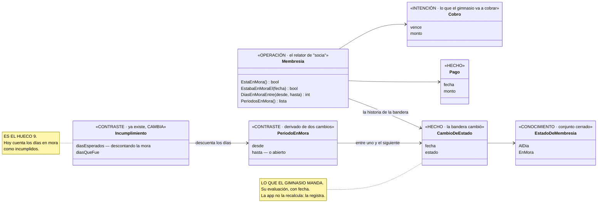

# Bitácora — Gimnasio

El cuaderno de laboratorio de este sujeto: cada corrida de la guía sobre él, con lo que se propuso,
lo que se firmó, lo que encontró y cuánto tardó. Se versiona con el sujeto — el tag de cada versión
(`gimnasio-v1`, `gimnasio-v2`…) lo incluye — y `git diff` entre dos tags es la comparación entre
versiones de la guía.

| Versión | Tag | Fecha | Qué cambió en la guía | Qué cambió en el dominio |
|---|---|---|---|---|
| **v1** | `gimnasio-v1` = `8ada9a0` | 2026-08-28 → 09-01 | La primera corrida del punto de partida con un peer del equipo. Sin papel: sólo la entrevista | 19 clases, 46 comprobaciones, el ciclo con journal. **Sin membresía** — huecos 9 y 12 |
| **v2** | `gimnasio-v2` = `37ba8eb` | 2026-09-07 | La regla del descarte del bloque 1, corregida: *descartado como funcionalidad no es descartado del modelo*. **Misma entrevista, sin papel** — mide el método, no el artefacto | **Construido y verificado el mismo día**: la membresía entra —la bandera *En mora* / *Al día*, pagos, cobros, el período en mora derivado— y el incumplimiento la descuenta. 19 → 25 clases; 46 → 69 comprobaciones; el ciclo con journal dos veces sin que los números se muevan |
| **v3** | *(pendiente)* | — | Las cuatro pasadas con un **artefacto real**. La fuente está por definir: la app del teléfono de Jorge es genérica y no sirve | — |

**No se compara v1 con v3 directo:** v2 mide el método con el mismo insumo; v3 mide lo que el papel
agrega. Dos variables, dos corridas.

---

## v2 · Lo que la corrida encontró — 2026-09-07

> **Qué midió y qué no, dicho con precisión.** El v2 corrió contra **dos** cosas: la regla del descarte
> del bloque 1 corregida —una guía **vieja**, el punto de partida— sobre las 19 clases del v1, que se
> construyeron el 28 de agosto antes de que las cuatro pasadas existieran; y **las cuatro pasadas sobre
> una rebanada**: la membresía, seis clases de veinticinco, con su pasada 1, su grilla, su hoja de
> firmas y su especialización. **No es una corrida de la columna vertebral sobre el gimnasio.** Ésa es
> el v3, contra [`Guias/columna-vertebral.md`](../../Guias/columna-vertebral.md), que se escribió el
> mismo día justamente por esto.

**La respuesta esperada estaba fijada de antemano y apareció.** Con la regla del descarte corregida y
la misma entrevista del 28 de agosto, la membresía entró al modelo. Lo medido:

| | v1 (`gimnasio-v1`) | v2 |
|---|---|---|
| Clases del dominio | 19 | **25** — `Membresia`, `EstadoDeMembresia`, `CambioDeEstado`, `Pago`, `Cobro`, `PeriodoEnMora` |
| Comprobaciones en verde | 46 | **69** |
| El incumplimiento del plan 1, con 15 días en mora adentro | *esperaba 39, fue 30, **faltaron 9*** | *esperaba **33**, descontó **6**, fue 30, **faltaron 3*** |
| El ciclo con journal, segunda corrida | rechaza todo, números quietos | rechaza todo —incluidas las tres banderas y el pago—, números quietos |

**Seis de los nueve días que el v1 le cobraba a Sonia no eran incumplimiento: estaba en mora y no
podía entrar.** Es exactamente la *"respuesta creíble y equivocada"* que el hueco 9 describía desde
el 28 de agosto, ahora medida y corregida.

**Lo que N1 cambió respecto de la hoja de firmas tal como se escribió:** el gimnasio no manda una
suspensión con fechas sino **una bandera que cambia** —*en mora*, después *al día*—. El hecho es el
cambio con su fecha; el período se deriva de dos cambios. Es la figura 8.4 de Fowler al pie de la
letra, y eliminó N3: quién está en mora lo decide el gimnasio. Y destapó un hallazgo para la doctrina:
*en mora* **es una evaluación** que la institución manda — el 02 decía que el artefacto nunca trae una;
ahora dice que trae las suyas, contra sus reglas, en un punto, y que la app evalúa sobre la serie y
contra lo declarado.

**Lo que quedó fuera del código, a propósito:** `Urgencia()` sobre la membresía (N4, sin firmar) y el
cobro que no llegó (N6, opcional). **Y lo que se asumió:** que la bandera llega con fecha — hueco 15,
dueño: el artefacto del v3.

**Estado:** código, `Preguntas.md` y `HUECOS.md` actualizados y verificados; **N1 y N2 firmadas
explícitamente el 2026-09-07** — N2 en sus tres partes, las tres tal como estaban implementadas, así
que no hubo cambio de código. Sin commitear y sin tag `gimnasio-v2` hasta que Jorge lo decida.

---

## v2 · La hoja de firmas

*La pasada 3 del v2, escrita el 2026-09-07 para que Jorge la firme antes de la pasada 4. Nada de lo
que está acá entra al código sin firma. Un juicio sin firmar entra por parámetro y se marca ⚠️.*

*Revisada el mismo día con la respuesta de Jorge a N1: el gimnasio manda **una bandera** —*En mora*,
que después cambia a *Al día*—, no una suspensión con fechas. Eso rehízo la pasada 1 y la 2, eliminó
N3 y reformuló N4.*

## Qué es este documento

El v2 aplica **una sola corrección** al gimnasio del 1 de setiembre: la regla del bloque 1 que decía
*descartado como funcionalidad = descartado del modelo*. Con la regla corregida, **la membresía entra
al modelo** — estaba declarada en la Parte 1 del `Preguntas.md` y a la vez en *"lo que el gimnasio ya
contesta"*, y el dominio se construyó sin ella. Es el [hueco 12](HUECOS.md), y su consecuencia es el
hueco 9: **hoy un período en mora cuenta como incumplimiento del plan.**

Meter la membresía obliga a decidir cosas que la entrevista del 28 de agosto no decidió. Éstas son. Cada
una viene **con un valor propuesto** —regla *proponé, no preguntés en frío*— y la fuente de la
propuesta, para que corregir sea fácil e inventar no haga falta.

**La respuesta esperada de la corrida está fijada de antemano**, y es lo que la hace un control:
después del v2, la fila *membresía* de la Parte 1 tiene algo en *dónde vive*, los huecos 9 y 12 cierran,
las 46 comprobaciones siguen en verde, y el ciclo con journal corrido dos veces sigue rechazando todo
en la segunda.

> **Lo que este documento no puede hacer, y hay que decirlo:** el gimnasio **no tiene artefacto**. Los
> sustantivos de abajo salen de la entrevista y de una respuesta de Jorge, no de un papel leído campo
> por campo. **Su forma es propuesta, no leída.** El v3 los confirma o los corrige con un artefacto
> real —la app del teléfono de Jorge es genérica y no sirve; la fuente está por definir—, y lo que
> corrija es exactamente la medida de lo que una entrevista sin papel pierde.

---

## Pasada 1 · lo que el gimnasio manda de la membresía

Lo dijo la entrevista —*"pagos, próximo cobro, atrasos"*— y lo precisó Jorge el 2026-09-07:

| Palabra | Espacio de valor | Verbo que lo produce | Quién lo tiene |
|---|---|---|---|
| **la bandera** — *En mora* / *Al día* | **un conjunto cerrado de dos**, y **cambia con fecha** | el gimnasio **la cambió** el día D | el gimnasio. **Es su evaluación**, y llega como hecho |
| **el pago** | una fecha y un monto | el gimnasio **registró un pago** | el gimnasio |
| **el próximo cobro** | una fecha de vencimiento y un monto | el gimnasio **anunció un cobro** | el gimnasio |
| **el atraso** — *"si está atrasada"* | **no se calcula acá**: es la bandera | — | el gimnasio lo dice; la app **no lo recalcula** |
| **el período en mora** — lo que el hueco 9 llamaba *suspensión* | desde–hasta, **derivado** de dos cambios de bandera | — es una comparación sobre los cambios | se calcula |

**Ninguno lo aporta Sonia.** El journal sigue siendo reconstruible.

> **Un hallazgo de doctrina, que va al 02:** *en mora* es una **evaluación** que el gimnasio hace de la
> cuenta de Sonia — y el 02 decía que el artefacto *"nunca trae una evaluación"*. Sí trae: la suya,
> contra sus reglas, en un instante. Lo que la institución no hace es evaluar **sobre la historia de la
> persona** ni **contra su intención**. Ésa es la columna de contraste de la app; la del gimnasio llega
> como hecho. Es la geometría del paper 8: el gimnasio es la autoridad sobre su mora, y la app la
> registra en vez de recalcularla.

## Pasada 2 · dónde cae cada cosa

| | Hecho | Intención | Contraste |
|---|---|---|---|
| **Conocimiento** | **`EstadoDeMembresia`** — conjunto cerrado {`AlDia`, `EnMora`} | *la cadencia esperada del cobro* (N6, opcional) | — |
| **Operación** | **`CambioDeEstado`** (bandera + fecha) · `Pago` | `Cobro` — lo que el gimnasio dice que **va a** cobrar | **`PeriodoEnMora`** — derivado de dos cambios · **`Incumplimiento`**, que cambia · **la situación actual**, calculada |

Tres cosas que la grilla decide sola:

- **Es la figura 8.4 de Fowler, literal.** `Action Status` tiene instancias —*proposed, started,
  suspended…*— y `Suspension` es un `Time Period` sobre la acción. Acá el estado es la bandera, y el
  período en mora es el tiempo entre dos cambios. **El hecho es el cambio; el período se deriva.**
- **`Cobro` es intención y `Pago` es hecho**: la *Proposed Action* del gimnasio y su *Implemented
  Action* (fig. 8.2). Mismo par que `ReservaPropuesta` / `ReservaDeclarada` en la municipalidad.
- **"En mora" es una fase, no un tipo.** La membresía entra y sale; no puede ser `MembresiaEnMora :
  Membresia`. Es la pregunta de rigidez (glosario nº 19), y la forma es la de E36: el estado en un
  campo, cambiado por una transición nombrada, y el actor pregunta `EstaEnMora()`, no recibe el objeto.



---

## Pasada 3 · los juicios, para firmar

| # | El juicio | Propuesta | De dónde sale | Qué decide en el modelo | Firma |
|---|---|---|---|---|---|
| **N1** | **Origen de la suspensión** | ✅ **Contestado por Jorge:** el gimnasio manda la bandera *En mora* / *Al día*, con fecha. El período en mora se deriva de dos cambios | Jorge, 2026-09-07 | `CambioDeEstado` es hecho; `PeriodoEnMora` es contraste derivado; **la app no calcula atraso propio** | ✅ |
| **N2** | **¿Un período en mora cuenta como incumplimiento?** *(pendiente nº 2 del `Preguntas.md`)* | **No.** *Reducir los días esperados de un plan por cada día que la membresía estuvo en mora dentro del plan* | Hueco 9 desde el 28-08, y Fowler 8.4: durante la suspensión las acciones propuestas no se esperan. **Firmado el 2026-09-07 en sus tres partes:** el fondo; **semanas enteras**, la misma ley que la duración (hereda a propósito la fuga del hueco 6); y **las asistencias durante la mora cuentan** — un hecho no se borra porque contradiga una regla | `IncumplimientoDe(plan)` calcula los esperados sobre los días **no en mora**. Es el cambio que cierra el hueco 9 | ✅ |
| ~~N3~~ | ~~Gracia antes del atraso~~ | **Eliminado por N1.** Quién está en mora lo decide el gimnasio; la app no tiene gracia que declarar | — | Un parámetro menos | — |
| **N4** | **Aviso al pasar a mora.** Cuando la bandera cambia a *En mora*, ¿la app avisa? ¿Lo decide el monto o la clase? | **Avisa, y lo decide la clase**: un cambio a mora es aviso negativo, del mismo peso por ₡5.000 que por ₡50.000. Un solo nivel | Juicio 6 en los dos dominios anteriores: *la clase, no el monto* | `Membresia.Urgencia()` → negativa si `EstaEnMora()`, ninguna si no | ☐ |
| **N5** | **Lo propio.** ¿Qué sabe la membresía que nada más sabe? | **Cuándo el plan estuvo en mora — y por eso cuándo un incumplimiento no fue incumplimiento** | Juicio 7. Y es el **relator** de *socia* (glosario nº 20) | `Membresia` se gana la clase: **juzga** (N2, N4), no sólo parametriza | ☐ |
| **N6** | **Ritmo del cobro** *(opcional)* | **Mensual**, por parámetro. Da la ausencia *"¿el gimnasio dejó de cobrarme?"* = *"¿sigo siendo socia?"* | — | Si se firma, `CobroQueNoLlego(fecha, cadencia)`. Si no, va al v3 | ☐ |

**Lo que el v2 NO hace, y ya estaba decidido:** no hay pantalla de pagos, cobros ni mora. El gimnasio
los contesta completos. **El dominio los sabe; el actor no los muestra.**

### Un hueco nuevo, descubierto al leer la respuesta de N1

**¿La bandera llega con la fecha en que el gimnasio la cambió, o sólo como estado actual?** Si el
feed dice *"estado: en mora"* sin fecha, la única fecha disponible es la de recepción — y eso es leer
el reloj, que el dominio no hace. El v2 asume **fecha en el evento**. Es un hueco de forma del dato,
**descubierto**, y su dueño es **el artefacto del v3**.

### Consultabilidad — cada juicio produce una consulta con predicado total

| Juicio | Consulta nombrada | Total porque… |
|---|---|---|
| N1 | `Membresia.EstaEnMora()` → `bool` · `EstabaEnMoraEl(fecha)` → `bool` | sin cambios registrados, `false` |
| N2 | `Membresia.DiasEnMoraEntre(desde, hasta)` → `int` · `Trayectoria.IncumplimientoDe(plan)` | sin mora descuenta 0; la segunda sigue guardada por `Termino` |
| N1 | `Membresia.PeriodosEnMora()` → lista de períodos, el último puede estar abierto | vacía si nunca hubo mora; el actor la proyecta hoja por hoja (regla 13) |
| N4 | `Membresia.Urgencia()` | siempre devuelve una `Urgencia` |
| N6 | `Membresia.CobroQueNoLlego(fecha, cadencia)` | sólo si se firma |

### Los comandos nuevos y su `Check` — reglas 17 y 18

| Comando | `Puede…` en la raíz | Qué rechaza |
|---|---|---|
| `CambiarEstadoDeMembresia(estado, fecha)` | `PuedeCambiarEstado` | estado desconocido (resolutor total, regla 11); **el mismo estado que ya tiene** — es el mismo hecho otra vez, **identidad**, regla 18; una fecha anterior al último cambio |
| `RegistrarPago(fecha, monto)` | `PuedeRegistrarPago` | monto ≤ 0; el mismo pago dos veces (**identidad**) |
| `AnunciarCobro(vence, monto)` | `PuedeAnunciarCobro` | monto ≤ 0; un cobro que ya existe con ese vencimiento (**identidad**) |

---

## Los juicios del 28 de agosto, para volver a firmar

Jorge decidió firmar todo de nuevo. Los ocho de la Parte 2 del `Preguntas.md`, con la decisión que
tienen hoy:

| # | El juicio | La decisión de hoy | Firma |
|---|---|---|---|
| 1 | Hacia dónde es deseable que se mueva una medida | **Lo da el objetivo**, no la medida. Excepción: masa muscular, que sube y punto | ☐ |
| 2 | Cuándo una medición no es creíble | Depende del tiempo y de qué medida. **Valores abajo, ⚠️ sin firmar** | ☐ |
| 3 | Cada cuánto se espera una medición | **Al final de cada plan.** No es calendario | ☐ |
| 4 | Qué es ruido y qué merece aviso | **Valores abajo, ⚠️ sin firmar** | ☐ |
| 5 | Se vigila cada medida por separado o el conjunto | **Por separado** — el ritmo es lento | ☐ |
| 6 | Qué hace urgente un hallazgo | **Magnitud + signo.** Existe la urgencia positiva | ☐ |
| 7 | Qué sabe cada medida que ninguna otra sabe | Su rango y qué parte del perfil necesita | ☐ |
| 8 | Qué es normal, bajo o alto | **La medida contra el perfil.** Distinto del 1; hacen falta los dos | ☐ |

**Los valores del 2 y del 4** — los dio un experto IA el 28 de agosto y **nadie del gimnasio los
validó**. Entran por parámetro; firmarlos hoy no los quema en el código, los saca del ⚠️:

| Medida | No es creíble si… | Ruido | Merece aviso | Firma |
|---|---|---|---|---|
| Peso | cambió más de **1 % del peso corporal por semana** | ± 1 kg en un trimestre | sostenido en la misma dirección dos mediciones seguidas | ☐ |
| % de grasa | saltó más de **5 puntos** entre dos mediciones de un trimestre | < 1 punto | **≥ 2 puntos** en un plan | ☐ |
| Cintura | cambió más de **1 cm** con menos de **2 semanas** de diferencia | < 1 cm | **≥ 2 cm** | ☐ |
| Masa muscular | igual que % de grasa — mismo aparato | < 0,5 kg | ≥ 1 kg | ☐ |

**Si alguno no se firma, queda ⚠️ y por parámetro, exactamente como hoy.** Eso no bloquea el v2.

---

## Después de firmar — lo que la pasada 4 hace con esto

1. `Preguntas.md`: la fila *membresía* de la Parte 1 pasa de ❌ a `Membresia`, `EstadoDeMembresia`, `CambioDeEstado`, `Pago`, `Cobro`; N1, N2, N4, N5 (y N6 si se firma) entran a la Parte 2; el pendiente nº 2 se cierra.
2. `HUECOS.md`: los huecos 9 y 12 cierran hacia el `Preguntas.md`, con la fecha. Entra el hueco nuevo — *¿la bandera trae fecha?* — como **descubierto, dueño: el artefacto del v3**.
3. Dominio: `EstadoDeMembresia` (cerrado, con resolutor total), `CambioDeEstado`, `Pago`, `Cobro`, `PeriodoEnMora`, `Membresia`; `Trayectoria` gana la membresía y los tres `Puede…`; `IncumplimientoDe` descuenta la mora. **Ninguna constante nueva en el dominio.**
4. `GimnasioAPI`: tres comandos con `Check`, tres consultas. `Medir`: los pasos nuevos, y la segunda corrida tiene que seguir rechazando todo.
5. Consola: *"un plan con dos semanas en mora espera dos semanas menos"*, *"la misma bandera dos veces se rechaza"*, *"un período en mora abierto se descuenta hasta el fin del plan"*.
6. `git tag gimnasio-v2`, y el diff contra `gimnasio-v1` es la primera comparación entre versiones.

---

**Fuentes de las formas propuestas.** Fowler, *Analysis Patterns*, cap. 8 — leído de las **figuras** del suplemento UML (De Swert), no del texto: fig. 8.2 *Proposed / Implemented Action*, fig. 8.4 `Action Status` = {proposed, started, completed, suspended, abandoned} y `Suspension` como `Time Period` sobre la acción. **La definición en prosa queda por verificar contra el libro.** La rigidez, de OntoUML (glosario nº 19). La forma de la fase, de E36. La autoridad del gimnasio sobre su mora, del paper 8.

*Firmado por ____________________ el ____ / ____ / 2026.*

---

# v3 · Las cuatro pasadas con un papel real — abierto el 2026-09-08

**Qué mide esta corrida, y ninguna de las dos anteriores podía:** la **pasada 1 con el artefacto en la
mesa**. El v1 y el v2 salieron de una entrevista sin papel, y la guía dice que sin papel la Parte 1 se
llena *"con lo que hubiera aparecido suelto en la conversación, que es exactamente cómo se pierde un
sustantivo"* — la membresía fue la prueba. El v3 pone el papel y mide **qué sustantivos la entrevista no
vio**. El diff `gimnasio-v2..gimnasio-v3` es esa medida.

**Qué no mide:** la legibilidad de la guía para alguien de fuera — sigue siendo la prueba 3.

**Contra qué se compara.** Ésta es la Parte 1 tal como quedó en el v2, que es lo que la entrevista del
28 de agosto produjo más la membresía que la regla corregida recuperó. La columna de la derecha se
llena al leer el papel:

| Lo que la entrevista dijo | Dónde vive en el v2 | ¿El papel lo trae? ¿Trae algo más? |
|---|---|---|
| **El plan** — lo que el gimnasio indica hacer, frecuencia, pesos prescritos | `Plan`, `EjercicioPrescrito` | |
| **La asistencia** — los días que entró | `Trayectoria.Asistio` | |
| **La medición** — la hoja de medidas al final de un plan | `Medicion`, `Medida` → `Peso`, `Cintura`, `PorcentajeDeGrasa`, `MasaMuscular` | |
| **El perfil** — género, edad, altura | `Perfil`, `Genero` | |
| **El objetivo** — hacia dónde quiere ir | `Objetivo`, `Meta`, `Direccion` | |
| **El rango de referencia** — normal, bajo, alto según el perfil | `Referencia`, `Lectura` | |
| **La membresía** — la bandera *en mora* / *al día*, pagos, próximo cobro | `Membresia`, `EstadoDeMembresia`, `CambioDeEstado`, `Pago`, `Cobro`, `PeriodoEnMora` | |
| *(lo que el papel traiga y no esté arriba)* | — | |

**Lo que la entrevista declaró que nadie tiene:** qué hizo Sonia adentro del gimnasio — el peso que
levantó, las series. Si el papel lo trae, la decisión de *cero aporte* se revisa; si no, se confirma.

**Lo que la grilla del v2 no tiene y la guía dice que un dominio que prescribe suele tener:** la **rutina
tipo** —el plan como plantilla, en el nivel de conocimiento— contra el plan de Sonia, en el operacional.
El v2 sólo tiene el segundo. El papel dirá si el gimnasio la tiene escrita.

**El reloj arranca cuando llegue el papel.** Pasada por pasada, como en la municipalidad.

---

## 12:08 · Llegó el papel

Cinco capturas de pantalla, de **dos apps**: la del gimnasio —una cadena internacional; un botón quedó
en portugués— y la del aparato que mide la composición corporal, en inglés. Jorge es el socio, así que
**él firma la pasada 3**. Trae datos personales —nombre, cédula, edad, sexo, peso, estatura— y los
valores de su cuerpo: **acá se anota la forma de cada campo, no el valor**, igual que con los recibos
de la municipalidad. Los datos de las corridas son inventados.

Las cinco pantallas, como cuatro papeles:

| Papel | Qué es | ¿Foto o hecho? |
|---|---|---|
| **A · Inicio** | *Plan Black · Tu plan está: Activo* · *Próximo pago: Cuota mensual Agosto · monto · Vencimiento 10/09/2026* · una tarjeta como medio de pago | **Foto.** El estado de hoy, sin fecha en la bandera |
| **B · Cobros** | *Fecha de vencimiento: Día 10* · una tarjeta por cobro: *Abierto · Agosto · monto · Vencimiento 10/09/2026 · período del 24/08/2026 a 23/09/2026 · Plan: monto* | **Hechos** —cada cobro fue puesto al cobro— con un estado que es foto |
| **C · Composición corporal** | Seis renglones: *BMI · Body fat · Water · Basal metabolism · Visceral fat · Bone mass*, cada uno con **un valor y una palabra del aparato** —*Increased, Insufficient, High, Didn't reach goals*— | **Hecho.** Una medición; la fecha no está en el recorte |
| **D · Plan de ejercicios** | Siete renglones: número de máquina (a veces), nombre, *3x 12 a 15*, *00:30 (Descanso entre series)*, una casilla para marcar; y uno que dice *15 minutos* | **Foto** de lo prescrito hoy; no se ve fecha de inicio ni frecuencia |

**Los tiempos, honestos:** las pasadas 1 a 3 se escribieron de corrido entre las 12:08 y las 12:20 —no
se cortaron por separado—; la pasada 4 y la construcción, de 12:20 a 12:28; el primer verde, a las
12:28. Los encabezados de abajo no llevan hora por eso.

### Pasada 1 · El espejo

Campo por campo, con las cuatro preguntas de la guía. **Ningún campo inventado**; lo que el recorte
no muestra queda como *no se ve*, que no es *no existe*.

| Campo | Qué es | Escala | ¿Misma cosa en todas las filas? | Verbo |
|---|---|---|---|---|
| *Plan Black* | el producto de membresía que contrató | texto de un conjunto cerrado del gimnasio; se vio **uno** | ⚠️ **"plan" son tres cosas distintas en el papel**: el producto (*Plan Black*), la línea del cobro (*Plan: monto*) y el plan de ejercicios | la persona **contrató** |
| *Tu plan está: Activo* | la bandera del gimnasio sobre la membresía | conjunto cerrado; se vio **uno**. Sin fecha | — | el gimnasio **evaluó** |
| *Fecha de vencimiento: Día 10* | el día del mes en que vence cada cuota | entero 1–31 | sí, es del calendario de cobro, no de un cobro | el gimnasio **fijó** |
| *Agosto*, *Septiembre* | la etiqueta del cobro: el mes en que **empieza** el período que cubre | nombre de mes | sí; y es la misma *Agosto* de la pantalla A | — |
| *Abierto* | el estado del cobro | conjunto cerrado; se vio **uno**. Los dos cobros están abiertos, incluso el que vence en dos días | — | el gimnasio **puso al cobro** |
| monto | la cuota | decimal con dos decimales, **moneda sin decir** (*$*) | sí; y *Plan: monto* es su única línea | — |
| *Vencimiento 10/09/2026* | cuándo hay que pagar | fecha | sí | — |
| *período del 24/08 a 23/09* | qué días cubre ese cobro | dos fechas; **del 24 al 23** — anclado en otro día que el vencimiento | sí | — |
| *BMI · Body fat · Water · Basal metabolism · Visceral fat · Bone mass* | seis medidas del cuerpo | **seis escalas distintas**: índice con un decimal · % · % · kcal entero con miles · índice entero · kg con dos decimales | **no**: seis cosas distintas aunque las seis sean números —[espacio de valor](../../Guias/glosario.md#adoptados) | el aparato **midió** |
| *Increased · Insufficient · High · Didn't reach goals* | la evaluación del aparato sobre cada valor | conjunto cerrado del aparato; se vieron **cuatro** | **no**: tres comparan contra un rango, *Didn't reach goals* compara **contra una meta** que alguien fijó en el aparato | el aparato **evaluó** |
| *Remo En Maquina Agarre Neutro*, … | el ejercicio | texto; siete nombres | sí | el gimnasio **prescribió** |
| *30 · 53 · 20 · 50* | el número de la máquina | entero; **a veces no viene** —mancuernas, abdominales, cardio—; con dos colores cuyo significado no se ve | — | — |
| *3x 12 a 15* | series por rango de repeticiones | entero × rango de enteros | **no**: la fila de cardio dice *15 minutos* — **otra escala.** Fuerza y cardio se prescriben distinto | — |
| *00:30 (Descanso entre series)* | el descanso | segundos | sólo en las de fuerza | — |
| la casilla | para marcar el ejercicio hecho | sí/no, hoy vacía | — | la persona **marca** —si lo hace |
| nombre, cédula, edad, sexo, peso, estatura | quién es y cómo es | *(no se pegaron)* | — | la persona **declaró** al inscribirse |

**Lo que está en el sobre y no en el papel:** la app es de una cadena internacional —el botón en
portugués—; la moneda del monto; la fecha de la medición del aparato; y **que las medidas las tomó un
aparato, no una persona con cinta**: la cintura del v2 no está en este papel.

**Los verbos, con sus dos fuentes.** De la institución, del papel: *contrató* (le ofreció el plan),
*fijó* el día de vencimiento, *puso al cobro*, *evaluó* la membresía, *midió*, *evaluó* cada medida,
*prescribió*. De la persona, de la conversación: *declaró* su perfil, *declaró* su objetivo (v2),
*marca* un ejercicio hecho. **Ninguna captura trae *asistió***: la asistencia no está en este papel.

### Lo que la línea base dice ahora — la columna de la derecha, llena

| Lo que la entrevista dijo | Dónde vive en el v2 | ¿El papel lo trae? ¿Trae algo más? |
|---|---|---|
| **El plan** — frecuencia, pesos prescritos | `Plan`, `EjercicioPrescrito` | **Trae la lista de ejercicios con series × repeticiones y descanso, y el número de máquina. NO trae peso prescrito.** La frecuencia y las fechas no se ven en el recorte. Cardio se prescribe en minutos: otra escala |
| **La asistencia** | `Trayectoria.Asistio` | **No está en este papel** |
| **La medición** | `Medicion`, `Medida` → `Peso`, `Cintura`, `PorcentajeDeGrasa`, `MasaMuscular` | **Trae seis medidas, y cuatro no estaban**: IMC —que el v2 calculaba—, agua, metabolismo basal, grasa visceral, masa ósea. **La cintura no está.** La masa muscular no se ve en el recorte. **Y cada valor viene con la evaluación del aparato** |
| **El perfil** — género, edad, altura | `Perfil`, `Genero` | Sí — en la parte no pegada |
| **El objetivo** | `Objetivo`, `Meta`, `Direccion` | **El aparato tiene metas propias** —*Didn't reach goals*—; nadie declaró la de Sonia |
| **El rango de referencia** | `Referencia`, `Lectura` | **El aparato ya hizo la lectura** y manda la palabra, no el rango |
| **La membresía** | `Membresia`, `EstadoDeMembresia`, `CambioDeEstado`, `Pago`, `Cobro`, `PeriodoEnMora` | **La bandera dice *Activo*, no *al día*, y no trae fecha** (hueco 15). **El cobro trae período cubierto, etiqueta de mes y estado *Abierto***; el v2 sólo tenía vencimiento y monto. Y trae el producto —*Plan Black*— y el día de vencimiento |
| *(lo que el papel trae y no estaba arriba)* | — | el producto contratado · el día de vencimiento · el período del cobro · el estado del cobro · el número de máquina · la casilla de hecho · la evaluación del aparato · la meta del aparato |

**Las dos hipótesis, contestadas por el papel:**

1. *¿Trae lo que Sonia hace adentro?* **A medias.** La app del gimnasio tiene **una casilla por
   ejercicio** para marcarlo hecho — así que el gimnasio *puede* saber qué ejercicio hizo, si ella lo
   marca. Lo que no se sabe es si eso viaja en el feed. **La decisión de cero aporte no se revisa
   todavía**: se abre el hueco con dueño.
2. *¿Existe la rutina tipo?* **No se ve.** La pantalla es la rutina de esta persona; si es una
   plantilla del gimnasio no está escrito.

**Y una tercera que no estaba prevista: el papel refuta un campo de la entrevista.** El v1 y el v2
tienen `PesoIndicado` en cada ejercicio, y la pregunta 2 del `Preguntas.md` —*"¿cuánto subió lo que me
piden levantar?"*— está construida sobre él. **El papel no trae peso.** Trae series, repeticiones y
descanso. Regla de la pasada 3: no se juzga por plausibilidad —el detalle del ejercicio (la flecha) no
se abrió—, así que el peso queda **opcional y con dueño**, y la progresión se reformula sobre lo que
el papel sí trae.

### Pasada 2 · La grilla

| | Hecho | Intención | **Contraste** |
|---|---|---|---|
| **Conocimiento** | el ejercicio, con su máquina · las seis medidas del aparato · el producto de membresía · el medio de pago | el calendario de cobro: mensual, período del 24 al 23, vence el 10 · *(la rutina tipo — no se ve)* | el rango del aparato —**no viene: viene su resultado**— · la dirección deseable (v2) |
| **Operación** | la medición, con **la evaluación del aparato al lado de cada valor** · el cobro con su período y su estado · la bandera *Activo* · el pago (no visto; todos abiertos) | la prescripción de esta persona: 3 × 12–15, 30 s; 15 min · el objetivo de Sonia (v2) · **la meta del aparato** | la tendencia (v2) · el incumplimiento (v2) · el plan sin medición (v2) · **la progresión de lo prescrito, en series y repeticiones** · **la lectura del aparato al lado del movimiento de la app** |

**Lo que la columna de contraste gana y el papel no trae:** la progresión ahora se lee sobre volumen
—series por repeticiones— para fuerza y sobre minutos para cardio; y el par *lectura / tendencia* del
`Preguntas.md` sigue siendo dos, pero **la lectura la manda el aparato** para seis medidas y la app la
sigue calculando sólo para lo que el aparato no mide (la cintura). Ninguna de las dos cosas está en el
papel: el aparato dice *Increased* hoy; no dice *y viene bajando*.

**Dos cosas que la grilla dice que NO se hacen:** un cobro *Abierto* después de su vencimiento **no**
se convierte en mora — la mora la dice el gimnasio (N1); y la casilla de *hecho* no entra como hecho
de Sonia hasta saber si el feed la manda.

### Pasada 3 · Los juicios · ⚠️ propuestos, firma Jorge

Cada uno en la forma fija, con el valor propuesto y de dónde salió. Firmar no quema nada en el código:
todo entra por parámetro o por forma.

| # | El juicio | Propuesta | De dónde sale | Qué decide en el modelo | Firma |
|---|---|---|---|---|---|
| **N7** | **Registrar** la **evaluación del aparato** al lado de **cada valor medido** **como hecho, sin recalcularla** | La palabra del aparato es su lectura, y llega como hecho. La app **no** vuelve a comparar esos seis valores contra un rango propio; sigue calculando la lectura sólo donde el aparato no mide | Regla *la columna de contraste* de la guía; el laboratorio con sus *H* y *L* | `EvaluacionDelAparato`, conjunto cerrado de las **cuatro** palabras vistas; `Medida` la lleva como opcional; **el juicio 8 deja de necesitar umbrales para estas seis** | ☑ **Jorge, 2026-09-08** |
| **N8** | **Reformular** la **progresión** de **lo prescrito** **sobre lo que el papel trae** | Para fuerza: series × repeticiones máximas —*volumen*—; para cardio: minutos. **Subir** es la dirección de la progresión. El peso, si algún día viene, se compara aparte | El papel; la reformulación que el `Preguntas.md` ya hizo una vez con esta pregunta | `Prescripcion` con dos formas; `Trayectoria.ComoCambioLoPrescrito` | ☑ **Jorge, 2026-09-08, con una precisión:** las formas son **tres** —sólo tiempo, sólo repeticiones, o repeticiones **y** tiempo—. La tercera no apareció en el papel; hueco 27 |
| **N9** | **Usar** las **palabras del gimnasio** para **el estado de la membresía** | El gimnasio dice *Activo*. **Se renombra `al-dia` → `activo`**; *en-mora* queda ⚠️ hasta que aparezca en una pantalla. Y la bandera **no trae fecha**: la fecha es la del evento del feed o la de la lectura del importador — **el dominio la recibe, no la lee** | Terminología formal del artefacto; hueco 15 | `EstadoDeMembresia.Activo()`; cierra el hueco 15 | ☑ **Jorge, 2026-09-08** |
| **N10** | **Registrar** el **cobro** con **el período que cubre, su etiqueta y su estado** | El cobro es *Agosto · vence el 10/09 · cubre del 24/08 al 23/09 · Abierto*. La identidad sigue siendo el vencimiento. El estado es conjunto cerrado de **una** palabra vista | El papel B | `Cobro` gana `Cubre`, `Etiqueta`, `Estado`; `EstadoDeCobro` | ☑ **Jorge, 2026-09-08** |
| **N11** | **Registrar** el **producto** y el **día de vencimiento** de la membresía | *Plan Black* y *Día 10* entran como declarados; el producto es texto —se vio uno, no hay catálogo—; el día, entero 1–31 | El papel A y B | `Membresia.Contratar(producto, diaDeVencimiento, fecha)` | ☑ **Jorge, 2026-09-08** |
| **N12** | *(sin construir)* **¿Qué me cuesta cada día que voy?** — cobro del período ÷ asistencias del período | Es el contraste que cruza dos hechos que el gimnasio manda por separado. **No está en la descripción funcional**: la pasada 2 tiene prohibido llenar la columna de contraste por su cuenta, así que se **propone** y no se construye | Salió de la grilla | Nada hasta que se firme como pregunta | ☐ |

**Dirección deseable de las medidas nuevas: no se inventa.** Masa ósea *sube y punto* y grasa visceral
*baja y punto* son plausibles y **están sin firmar** — así que las seis medidas nuevas siguen el juicio 1:
la dirección la da el objetivo, y sin meta declarada la app **revienta** en vez de opinar.

**Cada juicio produce una pregunta:** N7 → *¿qué dijo el aparato de mi grasa visceral, y cómo viene?*;
N8 → *¿cómo cambió lo que me prescriben de remo?*; N9 → *¿está activa mi membresía?*; N10 → *¿qué
período cubre el cobro que vence el 10?*; N11 → *¿qué plan tengo y qué día vence?*.

### Pasada 4 · La especialización — 12:20 a 12:28, con la construcción

Con la frontera *opina / parametriza* y el control de fase, sobre lo que el papel agregó:

| Candidata | ¿Opina? | ¿Fase? | Decisión | Por qué |
|---|---|---|---|---|
| Las cinco medidas del aparato | **Sí** — cada una vive en su escala y va a cargar su dirección cuando se firme | no | **cinco clases**, bajo `MedidaDelAparato` | Barra de activo: una clase con nombre es donde el comportamiento futuro va a tener casa. Y la base común carga lo que las cinco comparten y las cuatro del v2 no: *el aparato ya las leyó* |
| `MedidaDelAparato` (abstracta) | sí — decide que `Leer` y `ClaveDeReferencia` **revientan** | no | clase | Es N7 en código: la app no recalcula lo que el aparato evaluó, y no inventa de qué dependería un rango propio |
| La evaluación del aparato | conjunto cerrado de cuatro; sabe cuál compara contra una meta | — | clase (`EvaluacionDelAparato`) | Regla 11: un conjunto cerrado necesita resolutor total. Una palabra no vista **revienta** |
| Fuerza / cardio | **Sí** — cada una sabe cuál es su magnitud y cómo se llama | no | **dos clases** bajo `Prescripcion` | Es la pregunta *¿misma cosa en todas las filas?* contestada que no. El *tell*: *"si es fuerza, volumen; si es cardio, minutos"* pide clase |
| La progresión | carrier plano | — | clase (`Progresion`) | Contraste con nombre en el negocio; regla 13 |
| El estado del cobro | conjunto cerrado de **una** | **sí** — un cobro abierto va a dejar de estarlo | **campo**, no subtipo (`EstadoDeCobro`) | E36. Sin segundo estado no hay transición que escribir |
| El producto — *Plan Black* | **no** — se vio uno; parametriza la cuota | — | **texto dentro de `Contratacion`**, no catálogo ni clase | Curador: quitarle el nombre no pierde nada. Un catálogo con uno visto y otros inventados es el rubro sin recibo |
| El día de vencimiento | no | — | entero en `Contratacion` | Conocimiento / intención: el calendario del cobro |
| El número de máquina | no | — | opcional en `EjercicioPrescrito`, guardado | No se sabe qué dicen sus colores; no se modela lo que no se sabe |
| *Activo* | — | es la fase del v2, con la palabra del papel | renombre | N9 |

**El espejo al lado del modelo:** el papel es cuatro pantallas con doce campos; el modelo tiene lo
que el papel trae **más** la progresión sobre lo prescrito, el cobro que cubre un día, el par
*aparato dijo / la app dice que viene*, y todo lo del v2 —tendencia, incumplimiento, ausencia—. No se
parecen. **Y lo que el modelo NO tiene aunque el papel lo sugiera:** la casilla de *hecho* (hueco 16),
la mora deducida de un cobro vencido (N1 manda), y una dirección para las medidas nuevas (sin firmar).

### Las cuatro preguntas de parada

| | ¿Da que sí? | Cómo se ve |
|---|---|---|
| **1 · Completitud** | **Sí, con un cambio de pregunta.** La pregunta 2 del `Preguntas.md` —*cuánto subió lo que me piden levantar*— **no tenía origen en el papel**: se reformuló a *cómo cambió lo que me prescriben* y la vieja quedó guardada (`SePuedeVerLaProgresionDelPeso`). Todo lo demás tiene campo o juicio | hueco 17 |
| **2 · No-espejo** | Sí | la progresión sobre volumen, el cobro que cubre un día, *high y mejorando*: ninguno viene en el papel |
| **3 · Justificación** | Sí | la tabla de arriba; el producto **se colapsó** a texto, el estado del cobro **es campo** |
| **4 · Huecos con dueño** | Sí | del 16 al 26 en el `HUECOS.md`, cada uno con quién lo sabe |

### Resultado — 12:28

| | v2 (`gimnasio-v2`) | v3 |
|---|---|---|
| Clases | 25 | **38** — trece nuevas, todas del papel |
| Comprobaciones del dominio puro | 69 | **126**, en verde |
| El ciclo con journal, segunda corrida | 0 entradas | **0 entradas**, y la tercera igual: los números no se mueven |
| Comandos en la API | 12 | **18** — fuerza, cardio, máquina, peso, medida evaluada, contratación; el cobro cambió de forma |
| Consultas nuevas | — | `ComoCambioLoPrescrito`, `LoQueDijoElAparato`, `CobroQueCubre`, `ElProducto` |
| Constantes numéricas nuevas en el dominio | — | **ninguna** |

```
remo:      {"enQueSeMide":"volumen","antes":45.0,"despues":60.0,"cambio":15.0,"subio":true}
visceral:  {"elAparatoDijo":"high","contraUnaMeta":false,"movimiento":"mejora","urgencia":"positiva"}
cobro:     {"etiqueta":"Enero","dias":31,"venceDentroDelPeriodo":true,"comoEsta":"abierto"}
```

**Lo que el diff `gimnasio-v2..gimnasio-v3` mide, en tres frases.** El papel **agregó** siete
sustantivos que la entrevista no vio —cinco medidas, el producto, el período del cobro—. **Refutó** uno
que la entrevista sí dio —el peso prescrito— y **corrigió** una palabra —*activo*—. Y **cerró** el hueco
15 en la dirección incómoda: la bandera **no** trae fecha.

### Lo que esta corrida le sugiere a la guía — sin promover, hay que preguntar

1. **La pasada 1 también refuta.** La guía dice que el papel *agrega* sustantivos que la entrevista
   perdió. Acá además **quitó** uno que la entrevista inventó de buena fe. La línea base de la bitácora
   preveía una sola columna —*¿el papel lo trae?*—; hizo falta leerla en las dos direcciones.
2. **"Misma cosa en todas las filas" apareció dos veces en un solo papel** —fuerza/cardio y
   rango/meta en las palabras del aparato—. Es la pregunta más productiva de la pasada 1 después de la
   escala; hoy está en la tabla como una más.
3. **Un conjunto cerrado del que el papel mostró un solo miembro** —*Abierto*, *Plan Black*, *Activo*—
   es un caso que la guía no nombra. La decisión de acá —un miembro, resolutor total, lo no visto
   revienta— es la misma del rubro municipal, y ya son dos dominios: candidata a regla.
4. **La institución evalúa contra dos cosas distintas** —un rango y una meta— y la guía sólo nombra el
   rango. *Didn't reach goals* es una intención que vive **en la institución**, no en la persona: una
   casilla de la grilla que el 02 no discute.

**Tiempo total:** 12:08 → 12:28, veinte minutos del papel al verde, con la bitácora escrita en el
camino. La municipalidad tomó veintitrés de la pasada 4 al verde, sin pasadas 1–3.

### Más tarde ese día · Jorge firma N7 a N11, y contesta tres cosas sin captura

Las cinco firmadas **sin corregir ningún valor**; N8 con una precisión. Y tres respuestas de palabra que
cierran dos huecos y abren uno:

| Dijo | Qué cierra o abre | Qué cambia en el código |
|---|---|---|
| **El plan sí tiene el peso, cuando la máquina lo requiere** | **Cierra el 17.** El peso existe y es **por ejercicio, según la máquina** — exactamente la forma que quedó: opcional, guardado, con `IndicarPeso` aparte. La entrevista no había inventado el peso; el recorte no lo mostraba | **Nada.** La pregunta 2 vuelve a tener las dos lecturas: volumen o minutos para todos, y kilos para los que la máquina pide |
| **La prescripción puede ser sólo tiempo, sólo repeticiones, o repeticiones y tiempo** | **Abre el 27.** El papel mostró dos formas —*3x 12 a 15* y *15 minutos*— y Jorge dice que hay una tercera. No está en ninguna captura | **Nada todavía:** la tercera forma entra cuando se vea escrita — cómo la escribe la app decide su escala. `Prescripcion` es abstracta a propósito para eso |
| **La cabecera del plan tiene frecuencia y fechas** | **Cierra el 23.** `Plan.Inicio`, `Fin` y `DiasEsperadosPorSemana` del v2 tienen respaldo en el artefacto, aunque el recorte no los mostrara | Nada |

**Lo que sigue necesitando una captura, porque es una palabra o un número que hay que ver:** el estado
de la membresía cuando no está activa y un cobro pagado (18); el resto de la pantalla del aparato —fecha,
masa muscular— (25, 26); la leyenda de los colores de la máquina (21). **Y lo que se puede contestar de
palabra:** si la casilla de *hecho* viaja al feed (16), quién fijó la meta del aparato (20), la moneda (24).

### 21:25 · Once respuestas, nueve huecos cerrados, y dos cosas que salen del modelo

Le hice a Jorge una pregunta por hueco, con la forma de la respuesta que necesitaba. Contestó las once de
palabra, ninguna con captura. Lo que cada una hizo:

| # | Jorge dijo | Hueco | En el modelo |
|---|---|---|---|
| 1 | La casilla de *hecho* **queda en el teléfono** | **16 cerrado** | Nada. *Lo que nadie tiene* se sostiene: el gimnasio no sabe qué hizo adentro |
| 2 | *Didn't reach goals*: **"no hagas caso a eso, sólo vamos a tener la medida"** | **20 cerrado** | **Sale** la cuarta palabra del aparato. `EvaluacionDelAparato` queda con tres: *increased, insufficient, high*. El metabolismo basal entra como valor sin palabra al lado. **Leído así:** la evaluación contra una *meta* del aparato no entra; las tres contra rango siguen (N7). Si quiso decir que ninguna evaluación entra, N7 cambia y hay que decirlo |
| 3 | **Dólares.** Y *"el cobro no es tan importante para esta app: es cliente-céntrica del gimnasio"* | **24 cerrado** | La moneda se anota, no se modela: un solo tipo de monto. **N12 —costo por asistencia— se descarta** por esta frase; el lado del cobro no crece más |
| 4 | La cintura **sí la miden**, con cinta; no estaba en la captura | **26a cerrado** | Nada: `Cintura` sigue leyéndose por parámetro |
| 5 | El IMC **lo manda el gimnasio**, con máquinas más especializadas | **19 cerrado** | **`Peso` deja de convertirse a IMC.** Ya no se lee contra un rango propio —`ElAparatoLaEvalua` es `true`—; conserva su serie. Dos fuentes de la misma verdad eran una de más |
| 6 | *"Un objetivo puede ser bajar peso, y las medidas ayudan a ver si se cumple. **Por ahora no asociemos objetivos a medidas**: las combinaciones serían muchas"* | — | **Nada todavía, y es la respuesta que más pesa.** El v1 asocia una `Meta` por medida, y de ahí salen la dirección (juicio 1), el signo de la urgencia (juicio 6) y *cuánto falta* (pregunta 4). Desasociar deja a la tendencia sin *mejora / empeora* —sólo *subió / bajó*—, y a la urgencia sin signo. Se le lleva la consecuencia antes de tocar nada |
| 7 | *"Usa la palabra Activo"* | **18a abierto** | Confirma el renombre de N9. La palabra del estado **no activo** sigue sin verse; *en-mora* queda como palabra de la entrevista |
| 8 | *"Usa Pagado"* | **18b cerrado** | `EstadoDeCobro` gana *pagado*, y con él **la transición de la fase**: `Cobro.CambiarEstado`, con la regla 18 —*pagado* otra vez se rechaza—. Comando nuevo `CambiarEstadoDeCobro(vence, estado)` |
| 9 | La medición **sí tiene fecha**; el aparato **no manda masa muscular** | **25 y 26b cerrados** | `Medicion.Fecha` con respaldo. `MasaMuscular` se queda como la entrevista la dio —**sin fuente en ningún papel**, anotado— |
| 10 | Repeticiones y tiempo: **"olvidá ese método, no lo usemos por ahora"** | **27 cerrado** | `Prescripcion` sigue con dos formas |
| 11 | El número de máquina: **"no lo uses, ignorá ese dato"** | **21 cerrado** | **Sale** `NumeroDeMaquina`, `AsignarMaquina` y su comando. Lo que la persona no quiere en su modelo no entra por estar en el papel |

**Resultado después de las once:** 38 clases, **128 comprobaciones en verde**, el `medir` dos veces con
0 entradas en la segunda; `pagado` entra una vez y la segunda se rechaza. Cerrados 16, 18b, 19, 20, 21,
24, 25, 26, 27. Abiertos: 18a (la palabra del estado no activo) y 22 (dos cobros sobre el mismo día).

**Y una regla que salió de acá, para preguntar antes de promoverla:** dos veces Jorge dijo *"ignorá ese
dato"* sobre cosas que el papel trae —el número de máquina, la meta del aparato—. **El papel manda qué
existe; la persona manda qué entra.** La pasada 1 copia el papel entero a propósito; es la pasada 3 la que
tiene derecho a sacar. Hoy la guía dice *"todo lo que la institución manda entra al modelo"* sin esa
salvedad.

### 21:47 · Tres decisiones más, y la mora cambia de nombre

| Jorge dijo | Qué cierra | En el modelo |
|---|---|---|
| **No desasociar** objetivos de medidas, vista la consecuencia | pendiente 6 del `Preguntas.md` | Nada. Los juicios 1 y 6 y la pregunta 4 siguen en pie |
| La membresía que no está activa dice **"No Activa"** | **18a cerrado**; el conjunto queda completo: *activo* / *no-activa* | **Renombre grande, y no cosmético:** *en-mora* era la palabra de la entrevista; la app no dice por qué la membresía no está activa. Así que todo lo que el modelo derivaba de la **mora** pasó a derivarse de la **inactividad**: `PeriodoInactivo`, `EstaInactiva`, `DiasInactivaEntre`, `DiasDescontadosPorInactividad`. **El juicio 10 se conserva con el alcance ampliado**: el plan no espera días mientras la membresía no esté activa, **sea la razón que sea** — es lo que la bandera permite saber, y nada más |
| Dos cobros sobre el mismo día **son un error** | **22 cerrado** | `PuedeAnunciarCobro` rechaza el que se solapa con otro; `Cobro.SeSolapaCon`. El `Check` lo dice |

**Resultado:** 38 clases, **130 comprobaciones**, `medir` dos veces con 0 entradas en la segunda. **Quedan
cero huecos abiertos del v3** — los 27 del gimnasio están todos cerrados o con decisión, salvo el 1 al 8
del v1 y los 13 y 14 (umbrales sin firmar), que son de antes.

**Sobre la regla candidata**, Jorge la refinó: *"lo que envíe la institución podría entrar al modelo, pero
no debe ser tan rígido. Pensá en el número de máquina: ¿de qué serviría para saber si estoy mejorando?"*
El criterio que da es **el de la pregunta**: un campo del papel entra si alguna pregunta lo necesita.
Es la misma vara que la pregunta 1 de parada —*cada dato que una pregunta necesita tiene origen*—
leída al revés: **un dato que ninguna pregunta necesita no tiene por qué entrar.** **Jorge autorizó
escribirla**, y quedó en tres lugares: el [punto de partida](../../Guias/punto-de-partida.md) (bloque 1,
marcador `lo-que-entra-lo-decide-la-pregunta`, etiquetado *sesión*), la [hoja](../../Guias/hoja-de-la-entrevista.md)
(mismo marcador) y la [columna vertebral](../../Guias/columna-vertebral.md) (pasada 1, marcador
`el-papel-manda-que-existe`, y la pregunta 1 de parada leída en las dos direcciones). Es la primera regla
de guía que sale del v3.
