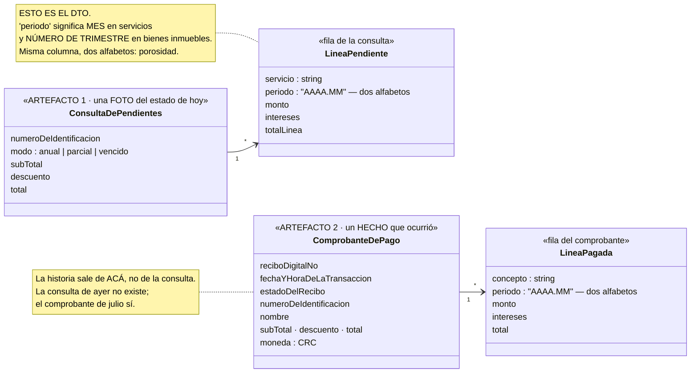
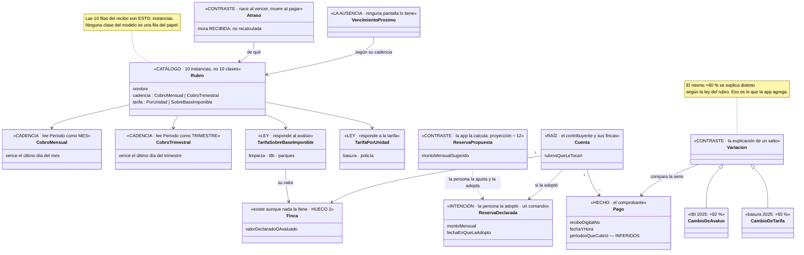

# Bitácora — Municipalidad

El cuaderno de laboratorio de este sujeto. Hoy tiene una sola entrada: la corrida en vivo del
2026-09-03, que es de donde salió su columna vertebral en papel. Cuando el dominio se construya, cada
versión deja su tag y su entrada acá, igual que el [gimnasio](../Gimnasio/BITACORA.md).

> **Este archivo está sin los datos crudos, a propósito.** La sesión se hizo con los recibos y la
> consulta municipal reales de la persona, y esos papeles tienen cédulas, nombres, números de recibo y
> el historial de pagos de una cuenta concreta. Al entrar al repo el 2026-09-07 se quitaron **los
> identificadores** —cédulas, el nombre de una tercera contribuyente, los números de recibo, las horas
> de transacción— y **las transcripciones literales** de los seis documentos. Lo que queda son **los
> hallazgos con su aritmética**, porque son la evidencia de que el método funcionó y sin números no se
> pueden verificar. Donde dice *[omitido]* había un dato personal.

---

## Prueba 2 · Las cuatro pasadas contra la municipalidad — en vivo

**La primera corrida del método en frío:** un dominio que **ningún negocio del repo cubre**, con un
**artefacto real** sobre la mesa y **una persona que conoce el trámite** contestando. Empezó el
2026-09-03.

**Qué mide esta prueba, y la anterior no podía:**

| | Cómo se mide |
|---|---|
| **Descubrimiento** | ¿Aparecen sustantivos, verbos y contrastes que nadie tenía escritos antes de empezar? |
| **Duración** | Tiempo por pasada, anotado al cerrar cada una |
| **Los "no sé"** | Cuántos, en qué pasada, y si cada uno cerró con **un valor propuesto** o quedó con **dueño** |
| **Generalidad** | Si la grilla y las cuatro familias sirven en un dominio que no es de observación pura |

**Lo que NO mide:** nada sobre el código. Esta prueba termina en diagramas y un `HUECOS.md`, no en
clases.

---

## Contadores

| Pasada | Empezó | Terminó | Preguntas | "No sé" | Propuestos | Con dueño |
|---|---|---|---|---|---|---|
| 1 · El espejo | 11:51 | 12:18 · **27 min** | 9 | **1** | 1 (el 3,78 %, con fuente) | 3 huecos abiertos → ver HUECOS |
| 2 · La grilla | 12:19 | 12:50 · **~31 min** — la grilla en sí fueron ~10; el resto fue leer y cuadrar **cinco recibos nuevos** que llegaron a mitad de pasada | 5 (ronda 2) | **1** — cerrado por decisión de producto | 3 (mora, descuento, "anual") — cerrados con datos | 2 (finca, pagos fuera del portal) |
| 3 · Los juicios | 12:50 | 13:03 · **13 min** | 6 valores propuestos + 1 pregunta de intención | **0** | 6 → **6 firmados sin corregir** | la reserva → opción b, firmada |
| 4 · La especialización | 12:53 | 12:56 · **3 min** — los juicios ya decían qué merecía clase | 0 — la hace quien modela | — | — | — |
| 4 · La especialización | | | | | | |

---

## 0 · Las dos entradas

### El artefacto

**Municipalidad de Santa Ana**, portal https://www.santaana.go.cr/guia-de-servicios/#consulte-estado-cuenta.
Cuatro capturas, transcritas tal como vienen:

**1 · El menú de formas de pago** (la lista de lo que se puede pagar):

| Opción | Lo que el portal aclara entre paréntesis |
|---|---|
| Pago parcial | *adeudado y puesto al cobro a la fecha de todos los Bienes Inmuebles y Servicios; incluyen si tienen Cementerio, Patentes o Licores* |
| Pago vencido | *deuda a la fecha* |
| Pago anual bienes inmuebles | |
| Pago parcial bienes inmuebles | *solo bienes inmuebles adeudado y puesto al cobro a la fecha* |
| Pago anual patentes · Pago parcial patentes | |
| Pago anual patente licores · Pago parcial patente licores | |
| Pago anual cementerio · Pago parcial cementerio | |
| Cuota arreglos de pago | *cuotas vencidas* |
| Pago solicitud permiso de construcción | |

**2 · La consulta**: un solo campo, *Número de identificación* → *Consultar*.

**3 · "Consulta de pendientes" — modo ANUAL**, para una sociedad anónima (cédula jurídica omitida):

*Transcripción literal omitida.* La forma de la tabla, que es lo que la pasada 1 lee:

| Columna | Qué trae |
|---|---|
| **Servicio** | uno de cinco para este contribuyente: recolección de basura, limpieza de calles *base imp*, servicio policía, bienes inmuebles, parques y zonas verdes |
| **Periodo** | `AAAA.MM` — los tres servicios en `2026.12`, bienes inmuebles y parques en `2026.04` |
| **Monto** · **Intereses** · **Total línea** | dinero con dos decimales; los tres servicios traen intereses, bienes inmuebles y parques traen `0.00` |
| **Sub-total** · **Descuento** · **Total** | el descuento es `0.00` |

**4 · La misma consulta — modo PARCIAL**, mismo contribuyente: *transcripción omitida.* Misma forma,
con los servicios en `2026.09` y bienes inmuebles y parques en `2026.03`, **los mismos intereses** que
en el modo anual, y **cada monto de servicio exactamente la mitad** del anual. Los números que los
hallazgos de abajo usan salen de estas dos tablas.

Este contribuyente **no tiene** cementerio, patentes ni licores; el portal dice que aparecerían como
líneas más de la misma tabla.

**Lo que el portal ya contesta** (para separarlo de lo que entrega): *cuánto debés ahora, por rubro,
con sus intereses, y cuánto sería pagar el año entero*. Eso queda descartado **como funcionalidad** —
y entra igual al modelo.

### La descripción funcional

> *"Un asistente personal para administrar obligaciones municipales, desde la perspectiva del
> ciudadano y no desde la estructura interna de la Municipalidad. La app consolida, mantiene historial
> y convierte los datos en información útil: qué debe, qué está pagando, cómo han cambiado sus cobros,
> cuánto probablemente tendrá que pagar en los próximos meses y cuánto debería reservar."*
>
> **"Tu Municipalidad te dice cuánto debés. Nosotros te ayudamos a entenderlo, anticiparlo y
> administrarlo."**

Las preguntas en voz de la persona, tal como las dijo: *¿cuánto he pagado este año?* · *¿por qué este
trimestre pago más?* · *¿cuánto debo apartar mensualmente?* · *¿qué cambió desde mi último pago?* · y
*recordatorios de vencimientos* — que es la pregunta sobre una **ausencia**.

### Las cuatro familias — a ojo, antes de empezar, para comparar al final

| ¿El dominio…? | Antes de empezar |
|---|---|
| mide algo de la persona en el tiempo | ✅ montos por rubro por período |
| prescribe algo que se cumple o no | ✅ la municipalidad **pone al cobro** con vencimiento; y el **arreglo de pago** es un plan de cuotas |
| deja que la persona declare hacia dónde quiere ir | ✅ *"cuánto debería reservar"* — la reserva mensual es una meta declarada |
| registra un intercambio entre partes | ✅ el pago |

**Las cuatro.** Antes de empezar yo había apostado a tres — no había visto que *"apartar"* es una
intención declarada. Igual que el gimnasio, y por eso conviene el dominio.

---

## Pasada 1 · El espejo

### Los campos

*La columna "en tus palabras" la propongo yo y la corrige la persona; lo que está en cursiva es lectura
mía pendiente de confirmar.*

| Campo (como dice el papel) | En tus palabras | ¿Viene siempre? | Espacio de valor |
|---|---|---|---|
| Número de identificación | quién debe — *puede ser una persona o una sociedad* (el formato de la cédula distingue física de jurídica) | siempre; es la llave de la consulta | identidad |
| Servicio | el **rubro**: qué cosa se cobra | siempre, una fila por rubro | **conjunto cerrado**: basura, limpieza de calles, policía, bienes inmuebles, parques, cementerio, patentes, licores, arreglo de pago, permiso |
| Periodo | *hasta qué período cubre esta línea* — `AAAA.MM` | siempre | período mensual; **pero no todos los rubros van al mismo**: servicios `.12`/`.09`, bienes inmuebles `.04`/`.03` |
| Monto | lo que se debe de ese rubro hasta ese período | siempre | dinero, dos decimales |
| Intereses | *la mora sobre lo vencido* — igual en anual y en parcial | siempre, a veces `0.00` | dinero |
| Total línea | monto + intereses | siempre | dinero, derivado |
| Sub-total · Descuento · Total | la suma; *un descuento que hoy es cero* | siempre | dinero; el descuento es un **hueco** — ver preguntas |
| Modo (anual / parcial / vencido) | *cuánto del año querés pagar* | es la elección de la persona, no un campo de la fila | conjunto cerrado de tres |

**Lo que las dos capturas juntas dicen y una sola no diría:**

- **Anual es exactamente el doble de parcial** en los tres servicios: 44,160 / 22,080. Y los períodos
  van de `.09` a `.12`: **un trimestre**. → *Lectura:* los servicios se cobran **por trimestre**, el
  parcial cubre lo puesto al cobro hasta hoy (dos trimestres), el anual cubre los cuatro.
- **Los intereses no cambian entre anual y parcial** (45.31 en los dos). → *Lectura:* la mora corre
  **sólo sobre lo ya vencido**, no sobre lo que se adelanta. Y bienes inmuebles con `0.00` de interés
  **no está vencido**.
- **Bienes inmuebles y parques van a otro período** (`.04` / `.03`) que los servicios (`.12` / `.09`).
  → *Lectura:* **tienen otra cadencia**, o su año fiscal empieza distinto. **No lo sé, y es la
  pregunta más importante de esta pasada.**

*Consultado el portal (`/guia-de-servicios/`) antes de preguntarle a la persona:* confirma que el pago
anual es *"adeudado y puesto al cobro **hasta el 31 de diciembre del año en curso**"* — o sea que
`Periodo` es **hasta dónde cubre la línea**, y el anual de servicios llega a `.12` por eso. El portal
**no dice nada** de descuento por pronto pago, ni de cadencia de bienes inmuebles, ni de consulta por
finca, ni de qué documentos entrega. Esos quedan para la persona.

### Los verbos

| Campo | ¿Qué hizo alguien para que exista? | ¿Quién? |
|---|---|---|
| cada fila | la municipalidad **puso al cobro** un rubro por un período | institución |
| Intereses | la municipalidad **cobró mora** sobre lo vencido | institución |
| Descuento | la municipalidad **ofrece un descuento** — ¿por pronto pago? | institución |
| Cuota arreglos de pago | la municipalidad **acordó un plan** de cuotas con la persona | las dos |
| Pago anual / parcial / vencido | la persona **paga**, eligiendo cuánto | persona |
| Permiso de construcción | la persona **solicitó**; la municipalidad **cobra la solicitud** | las dos |
| *(no está en el papel)* | la persona **reserva** plata para lo que viene | persona — sale de la descripción funcional |
| *(no está en el papel)* | la persona **tiene** una o más propiedades | persona — el portal consolida por cédula, no por finca |

**Los dos últimos verbos no salen del artefacto**, exactamente como `DeclararSexo` en Exámenes. Es la
corrección 1 de la prueba 1 funcionando: los verbos de la persona vienen de la conversación.

*De la Guía de Trámites del mismo portal (`/guia-de-tramites/`), que es artefacto de la institución
también:*

| Trámite que el portal lista | El verbo que esconde | ¿Quién? |
|---|---|---|
| Avalúos municipales — *"cálculo del valor del bien inmueble para efectos de cobro del IBI"* | la municipalidad **avalúa** la finca; **de ese valor sale el monto de bienes inmuebles** | institución |
| Declaración de bienes inmuebles — *"determinación del valor de la propiedad en forma voluntaria"* | la persona **declara** el valor de su finca | **persona** |
| Inclusión de finca o derecho · Traspaso de propietario | la persona **incorpora** o **traspasa** una finca | persona |
| Certificación de impuestos al día | la municipalidad **certifica** que no debés | institución |

Esto cambia la pasada 1 en algo que la captura no mostraba: **el monto de bienes inmuebles no es un dato
primario — es una función del valor de la finca**, y ese valor lo fija la municipalidad (avalúo) o lo
declara la persona. La línea *"BIENES INMUEBLES 75,952.36"* es la huella de un avalúo o de una
declaración que el portal no muestra.

### Las nueve preguntas que el papel no contestaba, y sus respuestas

| # | Pregunta | Respuesta de la persona | ¿"No sé"? |
|---|---|---|---|
| 1 | Cadencia de bienes inmuebles | **Trimestral, igual que los servicios.** Se puede pagar todo junto o sólo BI — *"infiero que porque BI es lo más costoso"*. Parques **no** va con BI: son dos menús, no dos grupos | no |
| 2 | ¿Intereses sólo sobre lo vencido? | **Sí.** Consultó el portal: iguales en anual y parcial; esos tres rubros están atrasados | no |
| 3 | El descuento | *"No tengo el dato de cuánto ni de cuándo"* → **y lo encontró**: **3,78 % por pronto pago del IBI, si se paga todo el año durante el primer trimestre**; el porcentaje es la tasa básica pasiva al momento del acuerdo municipal. Pagar los dos trimestres restantes **no** da descuento | **1** — cerró con fuente en la sesión |
| 4 | ¿Varias fincas? | **Consolidadas** en una línea, por cédula | no |
| 5 | Qué entrega además del portal | El **comprobante de pago por correo** — adjunto, es el segundo artefacto | no |
| 6 | Vencido vs parcial | **Correcto**: vencido = sólo lo atrasado; parcial = atrasado + al cobro | no |
| 7 | "BASE IMP" | **Base imponible** | no |
| 8 | Vencimiento | **El último día del mes que cierra el trimestre**, igual para todos los rubros | no |
| 9 | Declaración de BI | **Cada 5 años**, y sí puede cambiar el monto | no |

**Nueve preguntas, un "no sé", y ese uno cerró en la sesión con una fuente.** Es lo que la pasada 1
promete — *lo que está en el papel está en el papel* — y acá se cumplió.

### Lo que las respuestas destaparon

**A · `Periodo` lleva dos codificaciones en la misma columna.** Con la cadencia confirmada
(trimestral para todo) los números cierran así: la persona pagó Q1 y Q2, le faltan Q3 y Q4. *Parcial*
= Q3 = 22,080; *anual* = Q3+Q4 = 44,160 ✓. Los servicios marcan el período **por mes** —`.09` =
septiembre, `.12` = diciembre— y bienes inmuebles y parques **por número de trimestre** —`.03` = tercer
trimestre, `.04` = cuarto—. **Misma columna, dos alfabetos, según la fila.** Es porosidad del artefacto
(paper 1 §2.1: el significado de un campo condicionado por otro) y una trampa para cualquier importador:
`2026.04` **no es abril**.

**B · "Anual" no quiere decir el año: quiere decir *el resto del año*.** Cubre lo que falta, no los
cuatro trimestres. Y por eso el descuento por pronto pago no aplicó: la regla es *todo el año en el
primer trimestre*, y esto es medio año en el tercero.

**C · "Base imponible" en Limpieza de calles significa que ese servicio se cobra como función del valor
de la propiedad**, igual que el IBI — no por unidad como la basura. Dos servicios, dos leyes de cálculo,
y el papel las muestra como filas iguales.

**D · Los intereses y el vencimiento no cierran — HUECO 1.** La persona dice que el trimestre vence *el
último día del mes que lo cierra*: Q3 vencería el 30 de septiembre. Pero la consulta es del **3 de
septiembre** y Q3 **ya tiene intereses** (45.31 sobre 22,080 = 0,205 %; los tres rubros en la misma
proporción, así que es una tasa, no una tarifa). Con la tasa básica pasiva del 3,78 % anual, 0,205 %
son ~20 días de mora → Q3 estaría vencido desde mediados de agosto. **O la regla del vencimiento es
otra, o la mora se cuenta desde que se pone al cobro y no desde que vence.** No se decide acá: es
exactamente la clase de juicio que un modelo con default silencioso inventaría. Va al `HUECOS.md` con
dueño.

**E · El monto de bienes inmuebles no es un dato: es una función** del valor declarado o avaluado, y
ese valor cambia cada cinco años. La app no puede explicar *"¿por qué este año pago más de IBI?"* sin
saber el valor de la finca — que **no viene en ningún artefacto**. HUECO 2.

### El segundo artefacto — el comprobante de pago que llega por correo

El comprobante llega por correo como PDF; se leyó inflando los streams con Perl (sin Python ni
poppler en la máquina). *Transcripción omitida* — era el recibo de una **tercera contribuyente**, y sus
datos no son de esta historia. Su forma, que es lo que la pasada 1 lee: un encabezado con la
municipalidad, el departamento y la sección; *Recibo digital N°*, *Fecha de la transacción* **con
hora**, *Estado del recibo*, *N° de identificación* y *Nombre*; después las mismas columnas de la
consulta —CONCEPTO, PERIODO, MONTO, INTERESES, TOTAL—, tres líneas para esta contribuyente (policía en
`2026.06`, bienes inmuebles y parques en `2026.02`, **las tres con intereses**), y SUB-TOTAL, DESCUENTO y
TOTAL en CRC.

| Campo nuevo respecto a la consulta | En tus palabras *(propuesto)* | Espacio de valor |
|---|---|---|
| Recibo digital N° | la identidad del **pago** | identidad, correlativa |
| Fecha de la transacción | cuándo pagó — **con hora** | fecha y hora |
| Estado del recibo | *"pagado"* — ¿hay otros estados? | conjunto cerrado, **desconocido** |
| Nombre | quién es la persona | texto |
| CRC | la moneda | conjunto cerrado de uno |
| CONCEPTO | el mismo *Servicio* de la consulta, con otro nombre | el mismo conjunto cerrado |

**Y tres cosas que el segundo artefacto dice y el primero no podía:**

**F · La consulta es una foto; el comprobante es un hecho.** *"Consulta de pendientes"* muestra **el
estado de hoy** — mañana será otro y el de ayer no se puede recuperar. El comprobante registra **un
pago que ocurrió**, con su número, su fecha y su hora. Es exactamente la distinción del paper 8 §5
entre *snapshot* y *narración*: **la historia de la app sale de los comprobantes, no de las
consultas.** Y trae una consecuencia dura para el modelo: si la persona no paga por el portal
—paga en ventanilla, en el banco— ¿le llega comprobante igual? Si no, la historia tiene huecos que la
app no puede ver. → HUECO 3.

**G · `Periodo` confirma la doble codificación.** `2026.06` para policía (**junio**, cierre del segundo
trimestre) y `2026.02` para bienes inmuebles y parques (**segundo trimestre**). Dos artefactos
independientes, la misma columna, los mismos dos alfabetos. Ya no es una lectura: es un hecho.

**H · El conjunto de rubros es por contribuyente.** La otra contribuyente paga policía, bienes
inmuebles y parques — **ni basura ni limpieza de calles**. La sociedad de las capturas paga los cinco. *¿Viene siempre?* → no:
qué rubros le cobran a cada quien depende de algo que ningún artefacto muestra. → pregunta 12.

### El tercer artefacto — el comprobante de la misma sociedad, dos años antes

Imagen pegada por la persona. **Mismo contribuyente que las capturas** (la misma cédula, escrita sin
guiones acá y con guiones en el nombre: otro detalle de frontera). *Transcripción omitida.* Su forma:
recibo digital del **3 de enero de 2024**, estado *pagado*, cinco líneas —los tres servicios en
`2024.12`, bienes inmuebles y parques en `2024.04`—, **cero intereses en las cinco**, y un **DESCUENTO
negativo** en el pie: el primer documento donde ese campo no vale cero. Los montos por rubro se citan
abajo, en el hallazgo I y en la tabla de dos años del hallazgo J.

Pagó el **3 de enero** el año completo: períodos `.12` / `.04` (todo 2024), **cero intereses** —nada
vencido en enero— y **descuento de 5,982.90**. Es el pronto pago funcionando, y el primer artefacto
donde el campo `Descuento` no vale cero.

**I · El descuento, medido.** 5,982.90 es **3,60 % del sub-total** (166,009.79). La regla que la persona
encontró dice *"3,78 % del Impuesto sobre Bienes Inmuebles"* — pero 5,982.90 sobre los 83,560.05 de BI
sería **7,16 %**, que no es ninguna tasa conocida. Dos lecturas:

| Lectura | Cálculo | ¿Cierra? |
|---|---|---|
| Sólo sobre BI | 5,982.90 / 83,560.05 = 7,16 % | ✗ — muy alto para una tasa básica pasiva |
| **Sobre todos los rubros, prorrateado por el tiempo que se adelanta cada trimestre** | promedio de adelanto ≈ 7,5 meses = 0,625 año → tasa anual = 3,60 % / 0,625 ≈ **5,8 %** | ✓ — la tasa básica pasiva de enero de 2024 rondaba ese valor |

*Propuesta, ⚠️ sin firmar:* el descuento es **la mora que la municipalidad se ahorra** — tasa básica
pasiva × monto × tiempo adelantado — aplicado a **todos** los rubros, no sólo al IBI. El texto que la
persona encontró diría sólo la mitad. → HUECO 4.

**J · "Anual" en 2026: ¿dos trimestres o cuatro? La aritmética contradice lo dicho.** La persona dijo:
*"este cliente pagó dos trimestres y le faltan dos; hice la consulta de pago anual (pagar dos
trimestres)"*. Con el comprobante de 2024 se puede comprobar qué implica cada lectura:

| Rubro | 2024, año completo | 2026 "anual" | Si son **2** trimestres → año 2026 | Si son **4** trimestres → año 2026 |
|---|---|---|---|---|
| Basura | 48,950 | 44,160 | 88,320 — **+80 %** | 44,160 — −10 % |
| Limpieza | 14,854 | 12,614 | 25,228 — **+70 %** | 12,614 — −15 % |
| Policía | 12,550 | 12,322 | 24,645 — **+96 %** | 12,322 — −2 % |
| Bienes inmuebles | 83,560 | 75,952 | 151,905 — **+82 %** | 75,952 — −9 % |
| Parques | 6,097 | 6,234 | 12,468 — **+105 %** | 6,234 — +2 % |

Si *anual* son los dos trimestres que faltan, **los cinco rubros se duplicaron en dos años, todos a la
vez** — incluidos los que no dependen del valor de la finca. Si son los cuatro, los cinco se movieron
entre −15 % y +2 %, que es lo que uno espera de dos años. **La segunda lectura es la plausible, y
contradice lo que la persona dijo.** No lo decido: es la pregunta 13. Pero conviene notar qué acaba de
pasar — **la pregunta central de la app, *"¿por qué pago más?"*, apareció sola en la pasada 1**, con
dos papeles reales, antes de tener un modelo. Eso es la columna de contraste pidiendo existir.

### HUECO 1, revisado con dos mediciones

Ahora hay **dos puntos**, y ninguna regla simple explica los dos:

| Contribuyente | Trimestre | Mora sobre el principal | Fecha del dato |
|---|---|---|---|
| la otra contribuyente (comprobante) | Q2, vencido el 30-jun según la regla dicha | **1,008 %** (625.42 / 62,082.94; los tres rubros idénticos) | pagó el **14-jul** → 14 días |
| La S.A. (consulta) | Q3, vencería el 30-sep según la regla dicha | **0,205 %** (45.31 / 22,080; los tres idénticos) | consulta del **3-sep** → **antes** del vencimiento dicho |

Que en cada caso los tres rubros den **exactamente la misma proporción** confirma que es una **tasa
sobre el principal**, no una tarifa. Lo que no cierra es el *desde cuándo*:

- Si la mora es lineal en días, 1,008 % / 0,205 % = **4,9** → la otra contribuyente pagó con ~14 días de mora y la
  S.A. tenía **~3 días** el 3 de septiembre → **Q3 habría vencido el 31 de agosto, no el 30 de
  septiembre.** Y la tasa diaria sería ~0,072 % — ~2,2 % mensual.
- Si la mora se cuenta por **mes entero o fracción**, el 1,008 % de la otra contribuyente es *un mes* a ~1 %
  mensual, y el 0,205 % de la S.A. no encaja con nada.
- Si las capturas de la S.A. **no son del 3 de septiembre** sino de octubre, todo cambia otra vez.

> **Lo que el método hace acá, y un DTO no:** en vez de poner `TasaDeMora = 0.01m` y seguir, deja
> escrito que **dos papeles reales no alcanzan para reconstruir la regla**, propone la lectura más
> simple que cierra —*vence el 31 de agosto, 0,072 % diario*— y la marca ⚠️ sin firmar con dueño. Es el
> juicio que un default silencioso habría inventado y nadie habría vuelto a mirar.

### La segunda ronda — cinco preguntas, y una decisión de producto

| # | Pregunta | Respuesta | ¿"No sé"? |
|---|---|---|---|
| 10 | Fecha de las capturas | **Hoy**, 3 de septiembre, anual y parcial | no |
| 11 | La regla de la mora | *"La respuesta honesta es **no sé**"* — y una decisión: **la app no verifica cálculos; recibe los datos y muestra semáforos y proyecciones.** Encontró una fuente que insinúa 0,2052 % anual | **1** — cerrado por **decisión**, no por dato |
| 12 | Los rubros de la otra contribuyente | Ya había pagado los otros. **Los rubros son fijos por contribuyente** | no |
| 13 | ¿"Anual" son dos trimestres o cuatro? | *"Recibimos los datos y damos alarmas."* Y una observación: **la nomenclatura de un pago no está clara — no sé si estoy pagando uno o varios trimestres — y eso es una debilidad de los datos de la institución** | declinada — se resolvió con los recibos, abajo |
| 14 | La base del descuento | **Por todo el monto** | no |

**La 11 y la 13 no son "no sé": son una decisión de alcance**, y de las importantes. *"Recibir y
alarmar, no verificar"* mueve la mora y el monto de la columna de contraste a la de **hecho recibido**.
Las reglas quedan en el nivel de conocimiento **sólo para proyectar** —*"¿cuánto me costará si pago
tarde?"*— marcadas como propuestas, nunca para contradecir lo que la municipalidad cobró. Es la misma
frontera que Exámenes traza con el laboratorio: el dominio **nombra**, no **inventa**.

### Cinco recibos, una historia — y tres huecos que se cierran solos

La persona mandó los comprobantes de la sociedad de 2023 a 2026. **El nombre del archivo trae el
modo** —*vencido*, *pendiente*, *anual*— **y el cuerpo del recibo no**: otro dato que el artefacto
esconde. Los cinco, en orden:

*Transcripción omitida.* Cinco recibos de la misma sociedad, del **13 de mayo de 2023** al **14 de julio
de 2026**, más la consulta del **3 de septiembre de 2026**: un *vencido* de 2023; el *anual* de enero de
2024; un *pendiente* y un *vencido* del **mismo 25 de marzo de 2026**, con un minuto de diferencia; y
el *vencido* de julio. Cada uno con sus cinco rubros, el `Periodo` de cada rubro —que es lo que
resuelve la doble codificación—, si trajo intereses y si trajo descuento. Los números que los
hallazgos K a N necesitan están citados en cada hallazgo, y son los únicos que se conservan.

**K · `Periodo` resuelto del todo — y corrige la pregunta 1.** El recibo *pendiente* del 25 de marzo
paga basura `2026.03` por **7,360**; el del 14 de julio paga `2026.06` por **22,080 = 3 × 7,360**; la
consulta de hoy muestra `2026.09` por 22,080 y `2026.12` por 44,160 = **6 × 7,360**. → **Los servicios
se cobran por MES**, no por trimestre; `Periodo` es el último mes que cubre la línea. Y el *vencido* del
25 de marzo, `2026.02` por 34,880, es **octubre 2025 a febrero 2026: 3 meses a 6,720 + 2 meses a
7,360**. Bienes inmuebles y parques sí son **trimestrales**: 37,976.18 aparece en `2025.04`, `2026.01`,
`2026.02`, y la consulta anual `2026.04` es exactamente el doble. **La misma columna lleva mes en unas
filas y trimestre en otras — confirmado con seis documentos.**

**L · La 13 se resuelve con aritmética, y la persona tenía razón.** *Anual* en la consulta de hoy son
**los seis meses que faltan** de servicios (`.12` = 44,160 = 6 × 7,360) y **los dos trimestres que
faltan** de BI (`.04` = 2 × 37,976). *"Anual"* quiere decir *hasta fin de año*, no *doce meses*.

> **Y acá me retracto.** Hace veinte minutos escribí que *"si son dos trimestres, los cinco rubros se
> duplicaron en dos años, todos a la vez — improbable"* y que la lectura plausible era la contraria.
> **Los recibos dicen que sí se duplicaron.** Basura mensual: ~4,079 en 2024 → 6,720 a fines de 2025
> → 7,360 en 2026. Bienes inmuebles trimestral: 20,890 en 2024 → 37,976 desde 2025. Parques, limpieza
> y policía igual. **El 2025 fue el año en que todo cambió** — un avalúo nuevo (el IBI y parques van
> con el valor) y una actualización de tarifas (basura, policía). Yo juzgué el dato por lo que me
> parecía razonable, que es **exactamente lo que el método prohíbe**, y el dato me corrigió. Queda
> escrito porque es la lección más útil de la sesión: *"¿por qué pago más?"* tenía una respuesta real
> y enorme, y un default silencioso mío la habría tapado.

**M · La mora, reconstruida con cuatro recibos — HUECO 1 se cierra.** Tomando cada período como
vencido **el último día que cubre** y una tasa **diaria**:

| Recibo | Línea | Días de mora | Interés observado | Tasa anual implícita |
|---|---|---|---|---|
| 14-jul-2026 | Parques Q2 (vence 30-jun) | 14 | 7.46 sobre 3,117.08 | **6,24 %** |
| 14-jul-2026 | BI Q2 (vence 30-jun) | 14 | 90.91 sobre 37,976.18 | **6,24 %** |
| 14-jul-2026 | Basura abr+may+jun (vencen 30-abr, 31-may, 30-jun) | 75 + 44 + 14 | 165.91 sobre 3 × 7,360 | **6,19 %** |
| 03-sep-2026 | Basura jul+ago+sep (vencen 31-jul, 31-ago, —) | 34 + 3 + 0 | 45.31 sobre 3 × 7,360 | **6,1 %** |
| 03-sep-2026 | BI Q3 (vence 30-sep) | 0 | **0.00** | ✓ |
| 13-may-2023 | Parques Q1 (vence 31-mar) | 43 | 18.53 sobre 2,032.18 | **7,74 %** |
| 13-may-2023 | BI Q1 (vence 31-mar) | 43 | 253.91 sobre 27,853.35 | **7,74 %** |

**Todo cierra.** La mora es **diaria, desde el último día del período, a una tasa anual que en 2026
ronda 6,2 % y en 2023 rondaba 7,7 %** — la tasa básica pasiva de cada año. La regla del vencimiento
que la persona dio (*"el último día del mes que cierra el trimestre"*) es **correcta para BI** y se
extiende a los servicios como *"el último día del mes"*. El *"0,2052 % anual"* que la persona encontró
es el cociente de la consulta de hoy, no la tasa. **El único recibo que no cierra es el de la otra contribuyente**
(1,0 % a 14 días) — es otra contribuyente, tal vez con arreglo de pago; no es de esta historia.

**N · El descuento, cerrado — HUECO 4.** Con la base confirmada (*por todo el monto*) y prorrateando
cada período por los días que se adelantó al pagar el 3 de enero de 2024: **la tasa anual implícita es
6,24 % — la misma que la mora.** *El descuento por pronto pago es la mora que la municipalidad se
ahorra, a la misma tasa.* Es una sola regla vista desde los dos lados, y el *"3,78 %"* que la persona
encontró es la tasa de 2026, más baja porque la tasa básica pasiva bajó.

### El diagrama del espejo — la representación porosa, a propósito

**Criterio de salida:** ✅ los campos de los **dos** papeles están en la lista con su espacio de valor.
Los verbos de la institución salieron del papel y de la guía de trámites; los de la persona
—*reservar*, *tener una finca*, *declarar el valor*— de la conversación.

---

## Pasada 2 · La grilla

*Hecha por quien modela, con el inventario de la pasada 1. Lo marcado ⚠️ es una regla que existe pero
cuyo valor nadie firmó todavía.*

| | **Hecho** | **Intención** | **Contraste** |
|---|---|---|---|
| **Conocimiento** — *existe sin datos* | **Rubro** — conjunto cerrado: basura, limpieza de calles, policía, bienes inmuebles, parques, cementerio, patentes, licores, arreglo de pago, permiso · **Ley de cálculo del rubro**: *por unidad* (basura) o *por base imponible* (limpieza, IBI) · **Contribuyente** — persona física o jurídica · **Finca** — existe aunque ningún papel la muestre · **Trimestre** · Moneda | **Calendario de cobro** — cuándo vence cada trimestre; es el *Protocol* de Fowler cap. 8 · **Condiciones del arreglo de pago** — el plan tipo · **Oferta de pronto pago** — 3,78 % si se paga el año en Q1 | **Tasa de mora y desde cuándo corre** ⚠️ HUECO 1 · **Umbral de cargo inusual** — ¿cuánto tiene que moverse un rubro para avisar? ⚠️ · **Regla de reserva** — cómo se reparte el año en meses ⚠️ · **Cadencia de la declaración** — 5 años · La tasa del descuento |
| **Operación** — *ocurrió* | **Pago** — el comprobante: número, fecha-hora, sus líneas · **Cobro puesto** — una línea pendiente, en una fecha · **Avalúo** / **Declaración de valor** — cambian el IBI · **Consulta** — la foto, fechada | **Reserva declarada** — cuánto aparta la persona por mes · **Arreglo de pago acordado** — las cuotas de *esta* persona · **"Estar al día"** — la meta implícita de toda la app | **Atraso** — lo vencido contra el calendario · **Vencimiento próximo** — *la ausencia*: qué vence y cuándo · **Variación** — este trimestre contra el anterior: *"¿por qué pago más?"* · **Cargo inusual** — una línea fuera de lo esperable · **Proyección del año** — lo que falta · **Faltante de reserva** — lo apartado contra lo proyectado · **Lo pagado en el año** · **Historial por rubro** — la serie de comprobantes |

**Lo que la grilla hizo con este dominio:**

- **Las cuatro columnas del papel cayeron en *operación / hecho*, y nada más.** Todo lo demás —dos
  filas y dos columnas enteras— lo puso la conversación o lo derivó el modelo. La frase de la persona
  *"la Municipalidad proporciona los datos; la app los transforma en contexto, historial, previsión y
  control"* es literalmente la descripción de la grilla: los datos son una celda, el valor son las
  otras cinco.
- ***Operación / contraste* tiene ocho clases y ninguna viene en ningún artefacto.** El no-espejo pasa
  con margen. Y **una de las ocho es una ausencia** —*Vencimiento próximo*— que es la pregunta que
  ninguna pantalla contesta y que la persona pidió con la palabra *recordatorios*.
- **La fila de intención tiene las dos autorías**, como el gimnasio: la municipalidad *prescribe* (el
  calendario, el arreglo, la oferta) y la persona *declara* (la reserva). Y hay una intención que no
  dijo nadie y está debajo de todo: **"estar al día"**. Es el objetivo implícito contra el que se lee
  *Atraso* — sin él, un trimestre vencido es un dato y no un problema.
- **Tres reglas de contraste quedaron ⚠️ sin firmar**, y las tres son las que la app necesita para
  hacer lo que promete: la mora (para explicar el interés), el umbral de cargo inusual (para avisar), y
  la regla de reserva (para *"cuánto debo apartar"*). Ninguna está en ningún papel. Es la pasada 3.

**Dos decisiones de frontera que la grilla obliga a escribir:**

- **La doble codificación de `Periodo` NO entra al dominio.** El dominio recibe un `Trimestre` ya
  resuelto; el que sabe que `2026.04` es *el cuarto trimestre* en una fila y *abril* en otra es el
  adaptador del evento — igual que `Interpretar()` en Exámenes resuelve `valorSecundario > 0`. Si esa
  lógica entra al dominio, el dominio queda hablando el idioma del portal.
- **La `Finca` existe en el modelo aunque ningún artefacto la nombre.** Es la corrección del bloque 1
  del punto de partida aplicada en vivo: la consulta *consolida* las fincas, pero *"¿por qué subió mi
  IBI?"* sólo se contesta por finca. Entra al modelo; que hoy no haya cómo llenarla es el HUECO 2, no
  una razón para no modelarla.

**Criterio de salida:** ✅ todo sustantivo de la pasada 1 quedó en una celda; *operación / contraste*
tiene ocho clases, una de ellas una ausencia.

---

## Pasada 3 · Los juicios

**Regla de la sesión:** no se pregunta en frío — se propone un valor y se deja corregir. Lo que no se
sepa entra por parámetro y queda ⚠️ sin firmar, con dueño. **Tres "no sé" seguidos → se anota y se
sigue.**

*Los valores de esta tabla fueron **propuestos por quien modela** a partir de los seis documentos —el
método dice que no se pregunta en frío— y la persona los revisó uno por uno.*

> **Firmados los seis por la persona, el 2026-09-03, sin corregir ningún número.** Las marcas ⚠️ que
> quedan en la columna *Firma* señalan lo que sigue **reconstruido de los recibos** (la tasa de mora, el
> prorrateo del descuento) y no lo que la persona decidió: eso está firmado. Y la intención que faltaba
> —la reserva— se resolvió con la **opción b**: la app **propone** la proyección dividida en doce y la
> persona **la ajusta y la adopta**.

| Cosa que se sigue en el tiempo | Dirección | Identidad del hecho | Ritmo | Ruido | Urgencia | **Lo propio** | Firma |
|---|---|---|---|---|---|---|---|
| **El cobro mensual de un servicio** (basura, limpieza, policía) | *mantenerse* — un aumento es noticia, una baja también | *propuesto:* un salto **> 25 %** entre un mes y el siguiente no es el mismo cobro: es tarifa nueva (2025: +65 %) | **mensual**, vence el **último día del mes** — leído de los recibos | *propuesto:* **< 2 %** es redondeo, no cambio | *propuesto:* el aumento **no** es urgente — ya pasó y no se puede evitar; lo urgente es lo que vence | **Limpieza se cobra sobre la base imponible**: cambia con el avalúo aunque no cambie la tarifa. Basura y policía no | ⚠️ sin firmar |
| **El cobro trimestral de bienes inmuebles y parques** | *mantenerse* | *propuesto:* un salto **> 25 %** es **avalúo nuevo** (2025: +82 %), no tarifa | **trimestral**, vence el **último día del trimestre** — **firmado por la persona** (pregunta 8) | *propuesto:* < 2 % | igual que arriba | **El IBI es función del valor de la finca**, que se declara cada **5 años** — **firmado** (pregunta 9). Un salto de IBI *es* un avalúo |  parcial |
| **El atraso** (un período vencido y no pagado) | *bajar a cero* | — | corre **por día** desde el vencimiento | ninguno: un día vencido es vencido | *propuesto:* **la clase decide, no el monto** — un mes de basura vencido y un trimestre de IBI vencido pesan igual como *estado*; lo que cambia es cuánto cuesta cada día | Genera **mora** a la tasa del año: reconstruida ≈ tasa básica pasiva, **6,2 % en 2026**. **Decisión de la persona: la app la recibe, no la recalcula** | **decisión firmada**; la tasa ⚠️ reconstruida |
| **La reserva mensual** (lo que la persona aparta) | *cubrir lo proyectado* | — | **mensual** — es lo que la persona pidió: *"cuánto debo apartar mensualmente"* | avisar si lo apartado queda **> 10 %** por debajo de lo proyectado — **firmado** | urgente **sólo si el faltante vence en el mes en curso** — **firmado** | **Opción b, decidida:** la app **propone** la proyección anual ÷ 12 y la persona **la ajusta y la adopta**. **Hasta que la adopte, es un contraste** —un número que la app calculó—; **desde que la adopta, es una intención** —algo que la persona declaró—. Son dos cosas, y el modelo las separa: `ReservaPropuesta` (calculada) y `ReservaDeclarada` (un comando). La app nunca muestra la propuesta como si fuera de la persona | **firmado** — opción b |
| **El vencimiento próximo** (la ausencia) | — | — | el próximo último-día-de-mes para servicios; el próximo último-día-de-trimestre para BI | — | *propuesto:* **7 días antes** aviso; **el día** urgente | Es la única pregunta que **ninguna pantalla del portal contesta**: el portal muestra lo puesto al cobro, no *cuándo* | ⚠️ sin firmar |
| **El pronto pago** (la oportunidad de enero) | — | — | **una vez al año, durante el primer trimestre** — encontrado por la persona (3,78 % en 2026) | — | *propuesto:* avisar en **enero**, con el ahorro calculado | Es la mora vista al revés: **misma tasa, signo contrario** (finding N). La app puede decir *"si pagás todo hoy te ahorrás X"* | tasa **firmada por acuerdo municipal**; la regla de prorrateo ⚠️ reconstruida |

**Lo que salió al llenar la tabla:**

- **Dos cadencias distintas en el mismo contribuyente**, mensual y trimestral, y el *vencimiento
  próximo* tiene que saber cuál es cuál. Un modelo con un solo `Periodo` no puede decir *"te vence
  basura el viernes y el IBI en tres semanas"*.
- **La "identidad del hecho" acá no es error de medición, es cambio de régimen.** En el laboratorio un
  salto imposible dice *repetí el examen*; acá un salto del 80 % dice *hubo avalúo* o *hubo tarifa
  nueva*. La misma pregunta, otra respuesta — y ninguna de las dos está en el papel.
- **Tres de las seis filas dependen de una intención que hoy nadie declaró**: la reserva. Sin ella,
  *Faltante de reserva* no existe y *"cuánto debo apartar"* sólo puede contestarse con la proyección
  bruta. Es el hueco de intención, y es de la persona, no de la municipalidad.

**Criterio de salida:** cada juicio en forma ODI —*dirección + medida + objeto + contexto*— y con firma
o con dueño. Ninguno inventado.

---

## Pasada 4 · La especialización

*Hecha por quien modela, con los juicios de la pasada 3 sobre la mesa. El test: quitá el nombre de la
subclase y movés sus constantes al catálogo — ¿se pierde alguna regla?*

> **Esta tabla fue el control negativo de una decisión, el 2026-09-07.** Jorge fijó la barra de activo
> (E40) como regla por defecto de la pasada 4 —resolviendo T3 a favor de las doce clases de Exámenes—,
> y la primera redacción de esa regla, aplicada acá, **habría convertido los diez rubros en diez
> clases**, revirtiendo esta tabla. De ese choque salió la frontera que quedó escrita en el 02: **clase
> cuando la fila *juzga*** —`Sodio` tiene rango, dirección y elige severidad— **e instancia cuando sólo
> *parametriza*** —`Basura` es mensual y por unidad, y una misma operación de cobro lee eso—. Esta
> tabla ya lo decía en otras palabras, en su párrafo de cierre: *lo que merece clase es lo que el papel
> NO muestra*. Queda como está.

| Cosa | ¿Clase propia? | Por qué — el test del Curador |
|---|---|---|
| **Los diez rubros** (basura, limpieza, policía, IBI, parques, cementerio, patentes, licores, arreglo, permiso) | **No, como diez.** Son **instancias del catálogo `Rubro`** | Quitá `Basura` como clase y dejá `Rubro.Basura` con su nombre, su cadencia y su ley de cálculo: **no se pierde ninguna regla**. Diez clases de rubro sería el error de las seis de banda de Exámenes, repetido |
| **La cadencia** (mensual / trimestral) | **Sí — dos clases**, `CobroMensual` y `CobroTrimestral` | Quitá la distinción y dejá un `int meses`: se pierde **cómo se lee `Periodo`** (mes vs número de trimestre), **cuándo vence** (último día del mes vs del trimestre) y **cuántos períodos cubrió un pago**. Tres reglas distintas → comportamiento, no dato |
| **La ley de cálculo** (por unidad / por base imponible) | **Sí — dos clases**, `TarifaPorUnidad` y `TarifaSobreBaseImponible` | La segunda **responde a un avalúo** y la primera no. *"¿Por qué subió mi IBI?"* y *"¿por qué subió mi limpieza?"* tienen la misma respuesta (**avalúo**); *"¿por qué subió mi basura?"* tiene otra (**tarifa**). Es una regla que cambia la explicación → clase |
| **El pago** | **Una clase**, no tres por modo | *Vencido*, *pendiente* y *anual* **no están en el recibo** (hueco 6) y no cambian ninguna regla del pago en sí: son **qué períodos eligió pagar**. El modo se **infiere** de los períodos cubiertos; no es identidad |
| **El atraso** | **Sí**, y **no es un pago negativo ni un cobro con flag** | Tiene su propia ley — la mora diaria desde el vencimiento— y su propio ciclo de vida: nace al vencer, muere al pagar. Es la fila *Completed/Abandoned* de Fowler cap. 8. Un `Cobro` con `bool Vencido` sería la porosidad del `Plan.Termino` del gimnasio (T1) |
| **La reserva** | **Sí — y son dos clases**, en dos celdas distintas | `ReservaPropuesta` es un **contraste**: la proyección ÷ 12, calculada, nunca journaleada. `ReservaDeclarada` es una **intención**: lo que la persona adoptó, un comando con fecha. Colapsarlas en una sola `Reserva` con un `bool adoptada` es exactamente la porosidad del `Plan.Termino` (T1) — y peor, porque haría que un número de la app pasara por decisión de la persona. **Opción b firmada por la persona** |
| **La variación** | **Sí**, y **con dos subtipos**: `CambioDeTarifa` y `CambioDeAvaluo` | Son la *identidad del hecho* de la pasada 3: el mismo salto del 80 % **se explica distinto** según la ley de cálculo del rubro. Colapsarlos a un `decimal porcentaje` pierde la explicación, que es lo único que la app agrega |
| **El vencimiento próximo** | **Sí** — es la ausencia | No hay dato del que sea proyección: se **calcula** de la cadencia y del calendario. Ninguna pantalla del portal lo tiene |
| **La finca** | **Sí**, aunque hoy nada la llene | Corrección del bloque 1 aplicada: entra al modelo porque el IBI es *suyo*, no del contribuyente. Consolidarla sería repetir el error de la membresía |

**Lo que este dominio le enseñó al test:** la pregunta *"¿una clase por fila?"* acá tiene una respuesta
**más filosa que en el laboratorio**. Los diez rubros —lo que el papel muestra como filas— son
instancias. Lo que merece clase es **lo que el papel NO muestra**: la cadencia, la ley de cálculo, el
atraso, la reserva, la explicación de un cambio. **Ninguna de las clases del modelo es una fila del
recibo.** Es la versión más limpia del no-espejo que ha salido en las dos pruebas.

### El diagrama de la pasada 4

**Criterio de salida:** ✅ cada subclase tiene un miembro que ninguna hermana tiene — `CobroMensual` lee
`Periodo` distinto que `CobroTrimestral`; `TarifaSobreBaseImponible` responde al avalúo y
`TarifaPorUnidad` no; `CambioDeAvaluo` y `CambioDeTarifa` explican distinto. Y **los diez rubros no son
clases**, que es la decisión que el test existe para forzar.

---

## Los cuatro criterios de parada

| | Resultado |
|---|---|
| 1 · Completitud | ⚠️ **Un dato sin origen**: el **valor de la finca** (hueco 2 — el IBI es función de algo que ningún artefacto trae). La **reserva** ya tiene origen: la propone la app (contraste) y la adopta la persona (intención) — opción b, firmada. Y uno **inferido**: qué períodos cubrió cada pago (hueco 6) |
| 2 · No-espejo | ✅ *Operación / contraste* tiene ocho clases; **ninguna clase del modelo es una fila del recibo** |
| 3 · Justificación | ✅ Cada subclase tiene lo suyo — y los diez rubros quedaron como instancias, no como clases |
| 4 · Huecos con dueño | ⚠️ Siete huecos, cuatro cerrados con datos en la sesión; **los tres abiertos tienen dueño** (finca → la persona; pagos fuera del portal → la persona; la otra contribuyente → quien tenga su expediente) |

**El proceso puede parar acá.** No porque no queden preguntas —quedan tres— sino porque las tres están
escritas, tienen dueño, y ninguna se cerró inventando.

---

## HUECOS.md — lo que quedó sin decidir

| # | Qué falta | Origen | Dónde muerde | Qué se decidió para seguir | Dueño |
|---|---|---|---|---|---|
| ~~1~~ | ~~La regla de la mora~~ — **CERRADO con datos** (finding M): diaria, desde el último día del período, tasa anual ≈ tasa básica pasiva del año (6,2 % en 2026; 7,7 % en 2023). Siete líneas de cuatro recibos cierran | descubierto | `Atraso`, `Proyección` | **Decisión de producto:** la app **recibe** la mora, no la recalcula; la regla se guarda sólo para proyectar, ⚠️ marcada como reconstruida | — |
| **2** | **El valor de la finca** y su avalúo. El IBI es función de un valor que ningún artefacto trae, y las fincas llegan consolidadas por cédula | descubierto | `Finca`, `Variación` de bienes inmuebles — *"¿por qué subió mi IBI?"* no se contesta sin esto | La `Finca` **entra al modelo** aunque no haya cómo llenarla; el valor entra por parámetro | la persona, con su declaración o su avalúo |
| **3** | **Pagos fuera del portal.** Si la persona paga en ventanilla o en el banco, ¿le llega comprobante? Sin eso la historia tiene huecos invisibles | descubierto | `Historial por rubro`, `Lo pagado en el año` | Se asume que **sólo** los pagos digitales entran; la app tiene que **decir** cuando un trimestre aparece pagado sin comprobante | la persona — sabe cómo paga |
| ~~4~~ | ~~La base del descuento~~ — **CERRADO** (finding N): por **todo** el monto, prorrateado por días adelantados, **a la misma tasa que la mora** (6,24 % en 2024). La persona lo confirmó; los recibos lo cuadran | descubierto | `Proyección del año` | La tasa del año entra por parámetro (2026: 3,78 %, del acuerdo municipal) | el acuerdo municipal de cada año |
| ~~5~~ | ~~"Anual" en 2026~~ — **CERRADO** (finding L): son **los meses y trimestres que faltan hasta diciembre**. La persona tenía razón; mi lectura de "plausibilidad" estaba **equivocada**: todo se duplicó de verdad en 2025 | descubierto — **la contradicción era mía**, no de los papeles | `Historial`, `Variación` | *"Anual"* = hasta fin de año. Y la observación de la persona queda como hallazgo sobre el artefacto: **el recibo no dice qué cubre** — ni el modo, ni cuántos períodos | — |
| **6** | **El recibo no dice qué modo de pago fue** — vencido, pendiente, anual — ni cuántos períodos cubre. Sólo se sabe por el nombre del archivo que la persona le puso | descubierto — lo dijo la persona en la 13 | `Pago`, `Historial` — reconstruir qué períodos cubrió cada pago exige **inferirlo del `Periodo` y de la cadencia** | La cadencia por rubro (mes / trimestre) es conocimiento del dominio y permite deducirlo; se marca como **inferido**, no como recibido | — |
| **7** | **El recibo de la otra contribuyente no cierra** con la regla de mora que cierra los otros cuatro (1,0 % a 14 días) | descubierto | nada de *esta* historia — es otra contribuyente | Se excluye; se anota por si aparece un arreglo de pago u otra tarifa | quien tenga su expediente |
| ~~8~~ | ~~La intención que faltaba: la reserva~~ — **CERRADO por decisión** (opción b): la app propone proyección ÷ 12, la persona ajusta y adopta. **Dos clases**: `ReservaPropuesta` (contraste) y `ReservaDeclarada` (intención) | declarado — era la fila de intención vacía de la grilla | `Faltante de reserva`, *"cuánto debo apartar"* | La propuesta **nunca se muestra como decisión de la persona**; sin adopción, la app proyecta pero no opina | **la persona — firmado 2026-09-03** |

---

## Lo que esta corrida le hizo al método

Siete cosas. La primera es la que más cuesta escribir.

**1 · El método me prohibía juzgar el dato por plausibilidad, y lo hice igual.** Con dos papeles en la
mano escribí que *"todo se duplicó en dos años"* era improbable y que la lectura correcta era la
contraria. Cinco recibos después: todo se duplicó de verdad. **La pasada 1 no puede tener opinión sobre
si un número es razonable** — sólo sobre qué dice el papel. Cuando el dato parece absurdo, la respuesta
del método es *"¿tenés otro papel?"*, no *"probablemente es al revés"*. Va al doc 2 como regla.

**2 · Los artefactos siguen llegando después de la pasada 1, y el proceso tiene que absorberlos.** Un
papel en la pasada 1, uno más en la 2, cinco más a mitad de la 2. Cada uno cambió algo. La pasada 2
duró 31 minutos en vez de 10 **por eso**, y fue el mejor tiempo gastado de la sesión. El método hoy
dice *"traé el papel"* como si fuera uno y llegara al principio. Debe decir: **cada papel nuevo
reabre la pasada 1 para sus campos, y se agradece.**

**3 · Un campo puede significar cosas distintas según la fila.** `Periodo` es *mes* en unas filas y
*número de trimestre* en otras, y hicieron falta seis documentos para estar seguros. La pregunta de
espacio de valor de la pasada 1 —*¿en qué escala vive?*— necesita una sub-pregunta: **¿significa lo
mismo en todas las filas?** Es porosidad del artefacto, y un importador que no la vea carga abril donde
dice cuarto trimestre.

**4 · Hay que preguntarle a cada papel si es una foto o un hecho.** La consulta es el estado de hoy y
mañana no existe; el comprobante es algo que pasó y tiene número. La historia de la app sale de los
hechos. El método no lo preguntaba; el paper 8 §5 dice por qué importa. Nueva pregunta de la pasada 1.

**5 · Un papel puede traer metadatos afuera del papel.** El *modo* del pago —vencido, pendiente,
anual— no está en el recibo: está en el **nombre del archivo** que la persona le puso. La pasada 1 mira
el cuerpo; debería mirar también el sobre.

**6 · Una decisión de producto mueve conceptos de celda, y la grilla tiene que registrar el porqué.**
*"Recibir y alarmar, no verificar"* pasó la mora de *conocimiento / contraste* (una regla que
calculamos) a *operación / hecho* (un dato que recibimos), y dejó la regla sólo para proyectar. Si la
grilla no anota **por qué** una regla está en una celda y no en otra, alguien la va a "corregir" dentro
de seis meses.

**7 · Los verbos de dos fuentes, confirmado por segunda vez.** Del papel: *puso al cobro, cobró mora,
ofreció descuento, avaluó*. De la conversación: *reservar, tener una finca, declarar el valor*. Igual
que `DeclararSexo` en Exámenes. Ya es regla; ahora tiene dos casos.

**Y lo que la sesión midió, que era el objetivo:**

| | Pasada 1 | Pasada 2 | Pasadas 3 y 4 |
|---|---|---|---|
| Duración | 27 min | ~31 min (con 5 recibos nuevos) | ~35 min, redactadas por quien modela |
| Preguntas a la persona | 9 | 5 | 6 valores propuestos a firmar |
| *"No sé"* | **1** — cerró con fuente | **1** — cerró por decisión | — |
| Huecos abiertos → cerrados en sesión | 5 → | 4 cerrados con datos | 3 quedan, con dueño |

**Sesión completa: 11:51 → 13:03, 1 h 12 min.** Catorce preguntas a la persona más seis valores a
firmar; **dos "no sé", ninguno abierto**; los seis valores firmados sin corregir un número; ocho huecos,
cinco cerrados en la sesión, tres con dueño. Contra la sesión con la Product Owner —larga, repetitiva,
con el bloque 3 inconstestable— la diferencia no es la persona: es que **esta vez había papeles sobre
la mesa y los juicios se propusieron en vez de preguntarse**. Es exactamente lo que el análisis
predecía, y ahora tiene una medición.

**Y una salvedad honesta sobre esa medición:** la persona de esta sesión **conoce la Metodología** y
trabaja con quien la escribió. Una hora doce con alguien de fuera es la prueba 3, no ésta.
